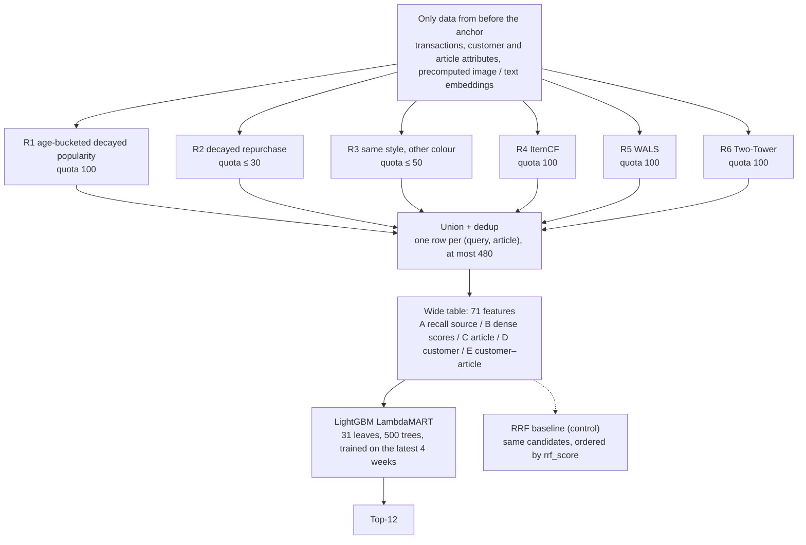

# H&M Personalized Fashion Recommendation — Final Report

> **Language.** This English version is the original; `docs/final_report.zh-CN.md` is its Chinese translation. The numbers are identical; where the two differ, the English version prevails.
> Dates and tags: sections 1–9, 2026-11-19, tag `v0.1`; section 10 and the pointers to it were added on 2026-11-20, tag `v0.2`.
> The design reference is `docs/proposal.md`; every decision made along the way is logged in `docs/decisions.md`. This report is written for readers who did not take part in the project and can be read on its own; for details, follow the sections and files it points to.
> **Where the numbers come from.** Every result comes from a file under `results/` or from `docs/decisions.md`, cited below the table or at the end of the sentence. Numbers derived from result tables (relative changes, query-weighted pooled values) say how they were computed. Configuration values (quotas, windows, τ and so on) come from the four lock files under `configs/locks/` and from `configs/fold_manifest.yaml`.
> **What this report does not do.** It gives no official Kaggle rank (§7.3 says why the T1–T4 result is not compared with the leaderboard; §4.6 and §10.6 report two late submissions and label where their scores would stand), and it does not present correlation as causation (§5).

---

## 1. Summary

**System.** The task is to predict the 12 articles each customer will buy in the following week (Kaggle H&M dataset, transactions from 2018-09-20 to 2020-09-22); the main metric is MAP@12. The system has two stages: six recall channels each produce candidates (this is the candidate generation, or retrieval, stage, with six independent candidate sources), which are merged and deduplicated into one row per `(customer, article)`; then 71 features are computed and a single LightGBM LambdaMART model ranks the candidates and keeps the top 12.

**How it is evaluated.** The last 16 weeks of the data form one fold per week, in four phases; each phase selects only what it is meant to select:

| Phase | Weeks | What happens |
|---|---|---|
| D | D1–D4 | Select the configuration of the six recall channels, then lock it |
| F | F1–F4 | Generate candidates with the locked configuration; used only as ranker training data, nothing is selected |
| V | V1–V4 | Select the ranker configuration, then lock it |
| T | T1–T4 | Final evaluation with everything locked, **run once** |

Each week is predicted using only data from before its first day (the anchor). The labels of the T weeks were never read before the final evaluation; this is enforced in code (§3.5).

**Final result** (T1–T4, 2020-08-26 to 09-22, 297,078 queries in total):

| | T1 | T2 | T3 | T4 | 4 weeks pooled |
|---|---|---|---|---|---|
| **LambdaMART MAP@12** | 0.034960 | 0.040270 | 0.039673 | 0.042435 | **0.039194** |
| RRF baseline MAP@12 (a control with no trained model) | 0.019151 | 0.021471 | 0.021848 | 0.022411 | 0.021154 |
| Union recall of the six channels | 27.88% | 29.08% | 29.09% | 30.69% | — |

Sources: `results/t_phase_metrics.csv`, `results/t_phase_recall.csv`. "Pooled" means averaging over the queries of all 4 weeks together (query-weighted). The 95% interval of the pooled MAP@12 is 0.038672–0.039721 (`results/t_diag_bootstrap.csv`; it reflects only the uncertainty from sampling customers, see §4.5).

**Verdict on the three goals** (the criteria were written into `configs/m8_final.yaml` before any T label was read; the verdict was written by code to `results/t_phase_goals.csv`):

| Goal | Criterion | Actual | Verdict |
|---|---|---|---|
| G1 | Pooled MAP@12 on T1–T4 ≥ 0.032 | 0.039194 | **Met** |
| G2 | Union recall of the six channels ≥ 24% in every week of T1–T4 | Lowest week (T1): 27.88% | **Met** |
| G3 | LambdaMART MAP@12 strictly above the RRF baseline in at least 3 of the 4 weeks | Higher in all 4 weeks | **Met** |

**Three things to know when reading these numbers:**

1. **T is 19.8% higher than V** (V1–V4 pooled: 0.032713, `results/v_phase_metrics.csv`), contrary to the prior expectation that "V is optimistically biased and T may fall below 0.032". §5 uses four descriptive tables to give an explanation consistent with the numbers; it is a correlation, not a verified cause. Single-week MAP@12 over V1–T4 ranges from 0.030112 to 0.042435, and the results carry a seasonal component (§4.4, §7.2).
2. **One run, one seed, offline evaluation only.** The results of the system on T come from one training per week with seed 42. There is no online A/B test, and no repeated runs on T to give a range of variation (§7.2). Stage 2 later trained LambdaMART with 3 seeds on V1–V4: the range of the pooled MAP@12 is 0.07% (§10.4).
3. **T1–T4 is used data.** Its labels were read for the final evaluation and on 4 more occasions afterwards; every occasion is recorded (§7.2 item 5). Any later change may only be compared and selected on V1–V4 (`AGENTS.md` §3.2).

**Stage 2 (added 2026-11-20): DeepFM as an alternative ranker.** With the same candidates, features and training rows, a DeepFM ranker was compared with LambdaMART (§10). The configuration chosen on V (standardised numeric input, listwise loss) has a pooled MAP@12 of 0.032765 on V1–V4 against 0.032701 for LambdaMART (means of 3 seeds), and 0.039341 on T1–T4 against 0.039194 (LambdaMART: 1 seed); both 95% intervals of the difference include zero. One Kaggle late submission scored Private 0.03588 against 0.03600, a difference of −0.33%, inside the band of 1% fixed before the run (Public: 0.03492 against 0.03548, −1.58%). In all three comparisons the two rankers cannot be told apart, which does not mean that they are equal. The ranker of the system is still LambdaMART.

---

## 2. System design

### 2.1 Pipeline



Definitions used throughout (`docs/proposal.md` §2):

- **Anchor** `a` is the first day of the predicted week. Inputs use only data with `t_dat < a`; labels are the purchases in `[a, a + 7 days)`.
- **Query** = `(customer, anchor)`, provided the customer bought at least one catalog article in the label week. So the queries of a week are "the customers who bought something that week": 69,000–86,000 per week (F1–T4, `results/m6_candidates.csv`).
- **Label set** = the articles the customer bought in the label week, deduplicated.
- **Active pool** `A(a)` = articles with at least 3 purchase lines in `[a − 28 days, a)`. It approximates "currently on sale"; it is not real inventory. R1, R3, R4, R5 and R6 output only articles in the pool; R2 (repurchase) is not filtered.
- **MAP@12**: AP@12 per query (denominator `min(12, number of labels)`, the same definition as the Kaggle H&M competition), averaged over queries. A query with no hit scores 0 and stays in the denominator.
- **Union recall**: the share of labels covered by all candidates of the six channels after merging and deduplication, with no cut-off. It is the upper bound of the recall the ranking stage can reach.
- **Event age** `age_days = anchor − purchase date`; yesterday is 1. Every decay is written as `exp(−age_days / τ)`, where τ is a time constant.

### 2.2 The six recall channels

Every channel is recomputed or refitted each week from data before the anchor, and outputs `query_id, article_idx, rank, score`. The configurations below are the locked final ones (`configs/locks/channels.lock.yaml`, `configs/locks/twotower.lock.yaml`); the D-phase scores of the channels are in §4.1.

**R1 — age-bucketed, time-decayed popularity** (quota 100). Take the purchase lines of the last 7 days and, per customer age bucket (7 buckets: 18–24, 25–34, 35–44, 45–54, 55 and over, invalid age, missing age), compute `Σ exp(−age_days / τ)` for each article, with τ = 3 days. Each customer gets the top 100 of their own age bucket. It is the only statistics-based channel that returns something for every customer; customers without purchase history rely mainly on it.

**R2 — time-decayed repurchase** (quota at most 30, not padded). Recommends only articles the customer bought in the last 365 days, scored by `Σ exp(−age_days / 30)`: the more recent and the more frequent the purchases, the higher the rank. Customers without history get an empty output.

**R3 — same style, other colour** (quota at most 50, not padded). If a customer bought one colour of a style (`product_code`), recommend the other colours of that style. Score = the customer's preference for the style (purchases of the last 180 days, decayed with τ = 30 and summed) × `(1 + site-wide sales of the article in the last 7 days)^γ`, with γ = 1.0. The article the customer already bought is excluded, and only articles in the active pool are output.

**R4 — ItemCF** (quota 100). Item-to-item similarity from the 0/1 "customer–article" matrix of the last 365 days: co-occurrences are down-weighted by customer activity (customers who buy a lot weigh less), followed by an asymmetric normalization with `α = 0.7`; each article keeps 100 neighbours inside the active pool. A customer's score for a candidate is the sum of the similarities from every article they bought in the last 365 days (the seeds), with each seed decayed by the time of its most recent purchase (τ = 30).

**R5 — WALS** (quota 100). Matrix factorization for implicit feedback (weighted alternating least squares, the `implicit` library). Interaction strength is the decayed sum of the purchases of the last 180 days (τ = 60); confidence is `1 + 60 × strength`; 128 dimensions, regularization 0.1, 15 iterations. The customer vector is dotted with the article vectors and the top 100 inside the active pool are kept. Customers with no purchase in the window get an empty output.

**R6 — Two-Tower** (quota 100). Two neural towers map customers and articles to 128-dimensional unit vectors; the dot product is the score.

- Item tower: image embedding (CLIP, 512 dimensions), text embedding (MiniLM, 384 dimensions), article ID, style and 6 category fields are each projected and concatenated to 442 dimensions, then passed through `Linear → ReLU → Linear` and L2 normalization (`docs/decisions.md` 2026-11-17, "Two-Tower model structure").
- User tower: the customer's 20 most recent purchases before the anchor go through the same item tower and are averaged with position weights, then concatenated with three attributes such as the age bucket.
- Training: in-batch softmax with a LogQ correction (which reduces the bias of popular articles serving as negatives), temperature 0.05.
- The **training chain** is the biggest difference between R6 and the other five channels: a base model is first trained on the purchases from 2019-12-03 to 2020-06-02 (epoch 4 is used); after that, every week the model "first predicts the week, then is fine-tuned for 2 epochs on that week's purchases", with half of the fine-tuning data from the new week and half sampled from the previous 4 weeks (replay 50%). The project has exactly one such chain, running from D1 all the way to T4. Every weekly score is obtained before the model has seen that week.

### 2.3 Candidate fusion

The outputs of the six channels are merged and deduplicated on `(query_id, article_idx)`: an article returned by three channels is one row, and the ranks and scores from the three channels are three groups of columns in that row. "One row per channel" is not used (labels would be counted repeatedly and the ranking groups would contain duplicate articles), nor is "truncate with RRF first" (the ranker would never see the articles cut off). After merging, a query has 304–310 candidates on average (F1–T4, `results/m6_candidates.csv`).

### 2.4 The 71 features

Each row is one `(query, candidate article)`. All features use only data with `t_dat < anchor`; raw IDs are not used; missing values stay NaN. The list, order and dtypes are locked in `configs/locks/features.lock.yaml`; the definitions are in `docs/proposal.md` §8.

| Group | Count | Content | Examples |
|---|---|---|---|
| A Recall source | 14 | The candidate's rank in each channel, the raw scores of four channels, the number of channels that returned it, its best rank, the RRF score | `tt_rank`, `rep_score`, `best_rank`, `rrf_score` |
| B Dense scores | 7 | Scores computed for every candidate, whichever channel it came from | `tt_dot` (Two-Tower dot product), `wals_dot`, image / text / Two-Tower similarity between the candidate and the customer's 20 most recent purchases |
| C Article | 17 | Recent sales, days since first and last sale, mean price, discount ratio, online share, mean buyer age, 6 categories | `item_cnt_1w`, `item_days_since_first_sale`, `item_discount_ratio` |
| D Customer | 12 | Attributes such as age and membership status; purchase counts, days since last purchase, mean price, online share | `user_days_since_last_purchase`, `user_cnt_4w` |
| E Customer–article cross | 21 | Whether and how long ago the customer bought this article / this style; the customer's purchase share and decayed sum in this category; gaps in price, age and sales channel | `ui_days_since_pcode`, `ui_decay_ptype`, `ui_price_ratio` |

There were originally 56 features; before the lock, and before any ranker result existed, the list was extended to 71 (mostly in group E). This was a design change, not a selection based on scores (`docs/decisions.md` 2026-11-17).

### 2.5 Ranker

- **Model**: LightGBM, `objective = lambdarank`, `learning_rate` 0.05, `feature_fraction` 0.8, `bagging_fraction` 0.8, `max_bin` 255, `num_leaves` 31, `min_data_in_leaf` 500, **500 trees**, seed 42 (`configs/locks/ranker.lock.yaml`).
- **Training data**: to predict a week, the model is trained from scratch on the 4 weeks before it (for example T1 ← V1–V4, T4 ← V4, T1, T2, T3). Only queries with at least one positive are used; all positives are kept, and each positive is paired with 40 negatives drawn at random from the candidates of the same query.
- **Prediction**: all candidates of the predicted week are scored, with no sampling, and the top 12 of each query are kept.
- **No early stopping**: like the number of Two-Tower epochs, the number of trees is a hyperparameter selected once over 4 weeks and then locked.
- **RRF baseline**: the same candidates, ordered by `rrf_score = Σ 1 / (60 + rank in each channel)`, top 12, no trained model. It answers "how much better is the ranker than a simple rank fusion".

---

## 3. Evaluation protocol

### 3.1 The 16-week split

| Phase | Fold | Label dates (2020, inclusive) | What is selected here |
|---|---|---|---|
| D | D1–D4 | 06-03 to 06-30 | Hyperparameters of the six recall channels |
| F | F1–F4 | 07-01 to 07-28 | Nothing (only generates ranker training data) |
| V | V1–V4 | 07-29 to 08-25 | Hyperparameters of the ranker |
| T | T1–T4 | 08-26 to 09-22 | Nothing (final evaluation) |

Each week has 7 days; weeks are adjacent and do not overlap (`configs/fold_manifest.yaml`, validated on load). The Two-Tower base model is trained on the 26 weeks before that (2019-12-03 to 2020-06-02), which end before D1.

**D1–D4 are not used to train the ranker**: their candidates were generated with "the configuration selected on these very weeks" and carry selection bias, so F1–F4 are set aside as the first batch of training data.

### 3.2 Three rules

1. **Each week is predicted using only data with `t_dat < anchor`.** This holds for model weights, statistics and features alike.
2. **Each phase selects only what it is meant to select.** D selects recall, V selects the ranker, F and T only execute.
3. **Hyperparameters are selected once over 4 weeks and then locked.** This includes the number of epochs and the number of trees. Afterwards only model parameters are updated each week (recomputed statistics, fine-tuning or retraining); nothing is selected again.

### 3.3 Selection rule

Written in `configs/selection_rule.yaml` and committed before any score was seen (`docs/proposal.md` §4.2):

- The 4 weeks are combined into one score by averaging over the queries of all 4 weeks together.
- A candidate replaces the default only if both conditions hold: the 4-week pooled score **improves by ≥ 1% relative**, and it is **strictly better in at least 3 of the 4 weeks**. Otherwise the default is kept.
- When several candidates of a step pass, those within 1% of the best score count as "about the same", and the one that comes first in a priority order written in advance is chosen (simpler and cheaper first).
- One parameter is changed at a time, and the outcome of a step is the default of the next. Grids are never extended automatically.
- Number of trees of the ranker: each parameter set first fixes its own number of trees (the smallest number of trees within 1% of its best pooled MAP@12), and only then are the parameter sets compared. This rule was written into `configs/hpo/v_phase.yaml` before any ranker result existed.

The rule is conservative by design: a difference below 1% triggers no change.

### 3.4 Lock files

Once selected, a configuration is written to `configs/locks/`, a directory where files may only be added, never modified:

| File | Content | Locked on | git tag |
|---|---|---|---|
| `channels.lock.yaml` | Full configuration of R1–R5, the corresponding trials, the basis of each selection | 2026-11-17 | `lock-channels-v1` |
| `twotower.lock.yaml` | Full configuration of R6; sha256 of two model files | 2026-11-17 | `lock-channels-v1` |
| `features.lock.yaml` | Names, order and dtypes of the 71 features, and the settings that determine their values | 2026-11-18 | `lock-features-v1` |
| `ranker.lock.yaml` | All ranker parameters, the sampling method, the LightGBM and libomp versions; sha256 of the other three lock files | 2026-11-18 | `lock-ranker-v1` |

After the lock, code can obtain a configuration only through two entry points: `src/hmrec/recall/locked.py` (the six recall channels) and `src/hmrec/ranker/locked.py` (the ranker). Before returning a configuration, the entry point checks the sha256 of the model files, the sha256 of the referenced lock files, the configuration id recomputed from the settings, and the library versions of the running process; any mismatch raises an error. Tests scan the code of later phases and fail if it reads default configurations or replays a selection over the result tables. The lock files themselves are verified too: a test that does not read the lock file replays the selection rule over the result tables, derives "what the lock file should contain", and compares item by item.

### 3.5 The M8 gate and rehearsal

The final evaluation on T1–T4 (M8) is run once. The order is: write code and tests (on small data only) → commit → rehearsal → formal run.

The **rehearsal** reads no T label: it runs the M8 code path with the locked configuration, treating V4 as the target week, and the result must be **bit-identical** to the V-phase records (metrics, the first 500 trees of the model, the saved Top-12, the recall monitoring). The rehearsal made 18 comparisons and all matched (`results/m8_rehearsal_check.csv`). What it proves: the code the formal run is about to execute reproduces existing records on a week whose answer is already known.

The **gate** (`src/hmrec/final/gate.py`, enforced in code):

1. The latest rehearsal must have passed and run on a clean working tree, and the current code and configuration must equal the commit of that rehearsal; otherwise the formal run refuses to start and reads no file.
2. When the formal run starts, before any T label is read, it records the time and commit of the "first read of T labels" (`results/t_phase_label_access.csv`: 2026-11-18T22:14:34, commit `18d957f`).
3. Once that record exists, every process refuses to run if the code or configuration changes. An interrupted formal run can therefore be resumed, but not with different code.
4. T labels have a single read entry point (`src/hmrec/eval/final_eval.py`), which requires a permit issued by the gate; the entry points of all earlier phases reject T folds.
5. T weeks are evaluated only at the locked 500 trees; metrics at other tree counts are never computed, so there is nothing to pick from afterwards.

What code cannot do: it cannot stop someone from deleting the record by hand, or from bypassing the entry point and reading the files directly.

After the formal run, one round of **descriptive diagnostics** was carried out (§5). It read the T labels again through a separate entry point (`src/hmrec/eval/diagnostic_labels.py`), on the conditions that the verdict on G1–G3 was already written and the M8 code and configuration were unchanged, and after first recording this read in `results/t_diag_label_access.csv` (2026-11-19T01:55:42, commit `cd07687`). The diagnostics only describe; they are not used to select or change anything.

### 3.6 How each step prevents data leakage

There are two kinds of "leakage" here: **temporal leakage** (predicting a week with data from that week or later) and **selection leakage** (data used to report results also took part in selecting the configuration).

| Step | Risk | What is done | How it is enforced or checked |
|---|---|---|---|
| Reading transactions by date | Counting purchases on or after the anchor day as history | All date filtering goes through `src/hmrec/data/asof.py` only; the window is `[a − N, a)`, and the anchor day belongs to the label week | Before returning, the function checks that the latest date in the result is before the anchor, and raises otherwise; every recall channel and every feature has a "poison" test: transactions added on or after the anchor day must leave the result exactly unchanged |
| Reading labels | Recall or feature code sees the answers | Labels are read only in `eval/` and in the ranker's sampling code; the wide table has no label column, and labels are joined only at training time | Tests scan the code and fail if anything else references the function that reads the label week |
| Selecting recall | Using the weeks that selected a configuration to train or evaluate downstream | Recall is selected on D1–D4 only; these 4 weeks are not used to train the ranker | Phase rules; nothing is selected in the F phase |
| Two-Tower | The model has seen the week it predicts | The base window ends before D1; the training chain predicts each week first and fine-tunes afterwards; the `tt_dot` feature uses the model from before that week's fine-tuning | A week's model must exist, be recorded and match its sha256 before it can predict the next week, so a week cannot be skipped and a model left by another run cannot be used |
| Candidates and features | Regenerating earlier weeks with later models or data | Each week's candidates and features are frozen once generated | Every feature file has its sha256 recorded; the ranker must verify it before reading |
| Ranker training window | A training week later than or equal to the predicted week | Always the 4 weeks before the predicted week; every training week ends before the predicted week begins. The training data of T2–T4 contain the labels of T1–T3; this is rolling retraining by design, not leakage | The window function checks this as the first step of every entry point; a non-compliant fold raises before any file is opened |
| Selecting the ranker | Using T weeks to pick parameters or the number of trees | The ranker is selected on V1–V4 only; no T fold may appear in the tuning modules | Test scans; the V-phase entry points reject T folds |
| The selection rules themselves | Setting the rule after seeing the scores | All three rule files were committed first: `selection_rule.yaml` (before any score), `hpo/v_phase.yaml` (before any ranker result), `m8_final.yaml` (before any T label) | git history |
| Final evaluation | Looking at T results repeatedly and then changing things | Rehearsal + gate + a single run (§3.5) | `final/gate.py`; the first-read record |
| Traceability of results | Not knowing which code produced a result | New or modified code must be committed first; full-data runs happen only on a clean working tree | Every result row records `git_commit` and `git_dirty`; all result rows of the phases cited in this report have `git_dirty = False` |
| Independent verification | The checked code and the check share the same bug | The scripts under `scripts/checks/` do not use the modules they check, and recompute features and metrics with the plainest loops | For the features of the 12 weeks, 1,000 sampled rows × 25 features per week all match; for the 8 trials of the final configuration on V and T, the three metrics match the records (`docs/decisions.md` 2026-11-18) |

Biases that remain and that the protocol itself cannot remove: **the scores on the D weeks and the V weeks are optimistically biased** (the configurations were selected on those weeks), so system performance is judged on T; and a few decisions along the way were made after seeing results, listed candidly in §7.1.

---

## 4. Results

### 4.1 D phase: per-channel recall and union

Selection metric of each channel on D1–D4 (Recall@quota, %), locked configuration:

| Channel | Metric | D1 | D2 | D3 | D4 | 4 weeks pooled | Relative to the default configuration |
|---|---|---|---|---|---|---|---|
| R1 Popularity | Recall@100 | 7.497 | 8.333 | 7.029 | 7.058 | **7.388** | 0 (no candidate passed the rule; default kept) |
| R2 Repurchase | Recall@30 | 5.336 | 4.770 | 3.491 | 4.011 | **4.266** | +7.51% |
| R3 Sibling | Recall@50 | 3.526 | 3.574 | 2.890 | 3.188 | **3.240** | see below |
| R4 ItemCF | Recall@100 | 10.544 | 10.135 | 8.336 | 9.012 | **9.332** | +14.52% |
| R5 WALS | Recall@100 | 12.295 | 11.760 | 9.576 | 10.444 | **10.807** | +8.05% |
| R6 Two-Tower | Recall@100 | 14.478 | 15.912 | 13.970 | 14.575 | **14.634** | +23.57% (relative to the base without updates) |

Sources: `results/d_phase.csv` (R3: `results/m4_trials.csv`); "relative to the default configuration" is taken from `docs/decisions.md` 2026-11-17, "Final D-phase selection for R1–R5", and for R6 from `results/d_phase_steps/r6_twotower.csv`. The D phase has 54 trials in total (8, 5, 7, 9, 11 and 14 for R1–R6 respectively).

- R3: the configuration selected by the D-phase rule scored 3.257% (+2.34% relative to the default); it was then switched, under a pre-registered rule, to output only articles in the active pool, which changed the score to 3.240% (§7.1).
- R6: the base without updates (epoch 4) scores 11.843% pooled; with weekly fine-tuning, 14.634%. The rule selected the configuration without replay (14.576%); the one finally adopted uses 50% replay, which was a manual decision (§7.1).
- Scores in D3 and D4 are generally lower than in D1 and D2, and these two weeks also have clearly more queries (D1–D4: 78,193 / 77,306 / 120,190 / 115,992). They look like promotion weeks and carry 60.3% of the weight in the pooled score (§7.2).

**Union of the six channels** (`results/m4_union_check_r3_active_pool.csv`, locked configuration):

| | D1 | D2 | D3 | D4 | 4 weeks pooled |
|---|---|---|---|---|---|
| Union recall | 26.51% | 27.15% | 23.46% | 24.97% | **25.24%** |

- After deduplication a query has 307.1 candidates on average (P50 320, P90 364; at most 480).
- **For 50.5% of the queries, no channel hits any label.** The AP of these queries is necessarily 0, which is one source of the ceiling on every MAP number that follows.
- Drop in union recall when one channel is removed (percentage points, 4 weeks pooled): R6 4.96, R1 3.03, R5 1.41, R4 1.15, R2 0.50, R3 0.48. R6 contributes the most "candidates no other channel has".

**These scores are optimistically biased**: the configurations were selected on these 4 weeks, and the R6 base model was trained right before these 4 weeks. They serve only to compare configurations and do not represent the performance of later weeks; the measured values for the F, V and T weeks are in §4.4.

### 4.2 V phase: Ranker HPO and feature importance

**HPO.** Two steps, 8 configurations in total; each trains one 1000-tree model per week on V1–V4, evaluated every 100 trees:

| Step | `num_leaves`, `min_data_in_leaf`, negative sampling ratio | Selected number of trees | V1–V4 pooled MAP@12 | Relative to default | Weeks better | Best score (at number of trees) |
|---|---|---|---|---|---|---|
| Default | **31, 500, 40** | **500** | **0.032713** | — | — | 0.032865 (1000) |
| 1 | 31, 100, 40 | 500 | 0.032619 | −0.29% | 1 | 0.032849 (1000) |
| 1 | 63, 500, 40 | 300 | 0.032645 | −0.21% | 1 | 0.032804 (600) |
| 1 | 63, 100, 40 | 300 | 0.032555 | −0.48% | 0 | 0.032755 (600) |
| 1 | 127, 500, 40 | 200 | 0.032536 | −0.54% | 1 | 0.032766 (500) |
| 1 | 127, 100, 40 | 200 | 0.032528 | −0.56% | 1 | 0.032653 (400) |
| 2 | 31, 500, 60 | 400 | 0.032664 | −0.15% | 2 | 0.032917 (900) |
| 2 | 31, 500, 80 | 400 | 0.032698 | −0.04% | 2 | 0.032952 (800) |

Source: `results/v_phase_steps.csv`.

- No candidate passed the rule in either step; **the default configuration is kept**, with 500 trees.
- **These ranker parameters are on a plateau**: at their own number of trees, the 8 configurations all have a pooled MAP@12 between 0.0325 and 0.0330, at most 0.56% apart. The headroom is in candidates and features, not in these parameters.
- The curve of the default configuration is almost flat towards the end: pooled MAP@12 at 100, 300, 500 and 1000 trees is 0.031210, 0.032363, 0.032713 and 0.032865 (query-weighted, computed from `results/v_phase_metrics.csv`).
- A larger negative sampling ratio gives a slightly higher best score, and the rule assigns it a smaller number of trees, which is why the differences in the table are negative. At the same 500 trees, ratio 80 scores 0.032821, 0.33% above the default and far below the 1% threshold (`docs/decisions.md` 2026-11-18).

**Results on V** (final configuration; `results/v_phase_metrics.csv`):

| MAP@12 | V1 | V2 | V3 | V4 | Pooled |
|---|---|---|---|---|---|
| RRF baseline | 0.018511 | 0.019064 | 0.020604 | 0.019662 | 0.019419 |
| LambdaMART | 0.030112 | 0.031332 | 0.035029 | 0.034850 | **0.032713** |
| Without R6 | 0.028727 | 0.029881 | 0.033603 | 0.033013 | 0.031193 |

G1 (≥ 0.032) and G3 are met on V, but the margin on G1 is only 2.2%, and the scores on V are optimistically biased (the number of trees and the parameters were selected on these very four weeks). The record at the time therefore read "T may fall below 0.032; M8 decides".

**Feature importance** (the 4 models of the final configuration, first 500 trees, share of gain, averaged over the four weeks; `results/v_phase_feature_importance.csv`; for analysis only, not used to add or drop features). Top 10:

| Rank | Feature | Group | Share | Rank | Feature | Group | Share |
|---|---|---|---|---|---|---|---|
| 1 | `best_rank` | A | 12.01% | 6 | `product_type_no` | C | 5.39% |
| 2 | `rrf_score` | A | 10.80% | 7 | `ui_days_since_item` | E | 4.15% |
| 3 | `tt_dot` | B | 9.37% | 8 | `item_cnt_1w` | C | 3.21% |
| 4 | `ui_days_since_pcode` | E | 9.28% | 9 | `colour_group_code` | C | 3.07% |
| 5 | `tt_rank` | A | 7.57% | 10 | `user_days_since_last_purchase` | D | 2.97% |

| Group | Features | Share (four-week mean) | Range over the four weeks |
|---|---|---|---|
| A Recall source | 14 | 33.85% | 33.09–35.14% |
| B Dense scores | 7 | 15.02% | 14.27–15.98% |
| C Article | 17 | 24.22% | 23.82–24.68% |
| D Customer | 12 | 5.27% | 4.93–5.82% |
| E Customer–article cross | 21 | 21.64% | 21.23–22.68% |

- The top 5 features account for 49.0% and the top 20 for 85.1%.
- The 4 features that come from R6 (`tt_dot`, `tt_rank`, `tt_sim_max_hist`, `tt_sim_top5_hist`) account for about 19.0%.
- The smallest contributors: `fn` (0.0008%), `active` (0.0013%), `fashion_news_frequency` (0.0017%), `pop_is_fallback` (0.0028%), `index_group_no` (0.0040%).

### 4.3 T phase: main table, RRF baseline, without R6

The formal run started at 2026-11-18 22:14:34 and ended at 22:49:38, commit `18d957f`, clean working tree (`results/t_phase.csv`, `results/t_phase_label_access.csv`). Training weeks: T1 ← V1–V4, T2 ← V2 V3 V4 T1, T3 ← V3 V4 T1 T2, T4 ← V4 T1 T2 T3.

| | T1 | T2 | T3 | T4 | Pooled | Equal-weight mean of the four weeks |
|---|---|---|---|---|---|---|
| Queries | 80,253 | 75,822 | 72,019 | 68,984 | 297,078 | — |
| **LambdaMART MAP@12** | 0.034960 | 0.040270 | 0.039673 | 0.042435 | **0.039194** | 0.039335 |
| LambdaMART Recall@12 | 0.080965 | 0.088694 | 0.086791 | 0.092959 | 0.087135 | 0.087352 |
| LambdaMART NDCG@12 | 0.054734 | 0.061135 | 0.060277 | 0.063951 | 0.059852 | 0.060024 |
| RRF baseline MAP@12 | 0.019151 | 0.021471 | 0.021848 | 0.022411 | 0.021154 | 0.021220 |
| RRF baseline Recall@12 | 0.049777 | 0.055978 | 0.057542 | 0.059756 | 0.055559 | 0.055763 |
| RRF baseline NDCG@12 | 0.031942 | 0.035476 | 0.036235 | 0.037149 | 0.035094 | 0.035200 |
| LambdaMART relative to baseline (MAP@12) | +82.6% | +87.6% | +81.6% | +89.4% | +85.3% | — |

Source: `results/t_phase_metrics.csv`; the pooled values and the equal-weight means are computed from the rows of that table and agree with the record in `docs/decisions.md` 2026-11-18.

**Without R6** (a pre-registered secondary analysis; reported only, with no effect on any verdict). Method: drop the candidates returned only by R6 and the 4 R6 features, recompute the aggregate features from the other five channels, resample and retrain:

| | T1 | T2 | T3 | T4 | Pooled |
|---|---|---|---|---|---|
| MAP@12 without R6 | 0.033202 | 0.037679 | 0.037330 | 0.039141 | 0.036724 |
| Relative to the full system | −5.03% | −6.43% | −5.91% | −7.76% | **−6.30%** |

Pooled Recall@12 drops by 8.37% (0.087135 → 0.079841) and NDCG@12 by 7.45% (0.059852 → 0.055392).

**Only @12 is reported**: the locked ranker keeps only the top 12 of each query, so @20 metrics cannot be computed (§7.1).

### 4.4 Weekly results for V1–T4

Pooled values hide the differences between weeks, so the 8 weeks are shown in one table:

| Week | Label dates (2020, inclusive) | Queries | Union recall | LambdaMART MAP@12 | RRF baseline MAP@12 | MAP@12 without R6 | LambdaMART relative to baseline |
|---|---|---|---|---|---|---|---|
| V1 | 07-29 to 08-04 | 82,802 | 25.44% | 0.030112 | 0.018511 | 0.028727 | +62.7% |
| V2 | 08-05 to 08-11 | 74,833 | 27.54% | 0.031332 | 0.019064 | 0.029881 | +64.4% |
| V3 | 08-12 to 08-18 | 71,094 | 26.38% | 0.035029 | 0.020604 | 0.033603 | +70.0% |
| V4 | 08-19 to 08-25 | 72,035 | 27.62% | 0.034850 | 0.019662 | 0.033013 | +77.2% |
| T1 | 08-26 to 09-01 | 80,253 | 27.88% | 0.034960 | 0.019151 | 0.033202 | +82.6% |
| T2 | 09-02 to 09-08 | 75,822 | 29.08% | 0.040270 | 0.021471 | 0.037679 | +87.6% |
| T3 | 09-09 to 09-15 | 72,019 | 29.09% | 0.039673 | 0.021848 | 0.037330 | +81.6% |
| T4 | 09-16 to 09-22 | 68,984 | 30.69% | 0.042435 | 0.022411 | 0.039141 | +89.4% |
| V pooled | 07-29 to 08-25 | 300,764 | — | 0.032713 | 0.019419 | 0.031193 | +68.5% |
| T pooled | 08-26 to 09-22 | 297,078 | — | 0.039194 | 0.021154 | 0.036724 | +85.3% |

Sources: `results/v_phase_metrics.csv`, `results/t_phase_metrics.csv`, `results/m6_candidates.csv` (union recall of the V weeks), `results/t_phase_recall.csv` (union recall of the T weeks). The last column is computed from the two columns before it.

- Over the 8 weeks, LambdaMART MAP@12 goes from 0.030112 (V1) to 0.042435 (T4): **the best week is 41% above the worst**. A single week's score does not tell you the level of the system.
- There are differences inside the V phase already: V1 and V2 (about 0.030–0.031) are clearly lower than V3 and V4 (about 0.035).
- T1 (0.034960) is at the level of V3 and V4; T2–T4 are higher.
- The results on V are reported on the same four weeks **after the configuration was selected on them**; the results on T are the first and only evaluation after the lock. The two are different in nature, and T is the basis for judging system performance.

**Measured recall of each channel over the 12 weeks after the lock** (Recall@quota, %; monitoring only, not used to select anything):

| Week | R1 | R2 | R3 | R4 | R5 | R6 | union | Zero-hit queries |
|---|---|---|---|---|---|---|---|---|
| F1 | 6.55 | 4.90 | 3.49 | 9.90 | 11.52 | 14.52 | 25.61 | 51.64 |
| F2 | 7.33 | 4.49 | 3.48 | 9.56 | 10.96 | 14.77 | 25.89 | 51.74 |
| F3 | 7.67 | 4.33 | 3.56 | 9.61 | 10.86 | 15.43 | 26.33 | 51.31 |
| F4 | 8.25 | 4.20 | 3.62 | 9.59 | 10.62 | 15.24 | 26.13 | 51.50 |
| V1 | 7.81 | 3.87 | 3.41 | 9.07 | 10.15 | 15.53 | 25.44 | 52.09 |
| V2 | 9.16 | 4.00 | 3.41 | 9.14 | 10.53 | 16.68 | 27.54 | 49.00 |
| V3 | 8.15 | 4.29 | 3.48 | 9.15 | 10.22 | 16.25 | 26.38 | 52.14 |
| V4 | 11.00 | 4.13 | 3.34 | 8.82 | 9.50 | 16.01 | 27.62 | 50.70 |
| T1 | 12.22 | 3.74 | 2.99 | 8.03 | 8.41 | 17.33 | 27.88 | 50.29 |
| T2 | 12.47 | 4.24 | 2.99 | 8.58 | 9.06 | 19.00 | 29.08 | 49.34 |
| T3 | 11.22 | 4.39 | 3.16 | 8.71 | 9.48 | 18.90 | 29.09 | 49.21 |
| T4 | 12.79 | 4.48 | 3.06 | 8.91 | 9.78 | 20.46 | 30.69 | 48.14 |

Sources: `results/m6_candidates.csv` (F, V), `results/t_phase_recall.csv` (T). The G2 criterion (union recall ≥ 24%) holds in every one of these 12 weeks.

### 4.5 95% intervals

| Phase | Customers | Queries | Quantity | Pooled MAP@12 | 95% interval |
|---|---|---|---|---|---|
| T | 233,174 | 297,078 | LambdaMART | 0.039194 | 0.038672 – 0.039721 |
| T | | | RRF baseline | 0.021154 | 0.020796 – 0.021510 |
| T | | | LambdaMART − baseline | 0.018040 | 0.017620 – 0.018474 |
| V | 234,382 | 300,764 | LambdaMART | 0.032713 | 0.032267 – 0.033155 |
| V | | | RRF baseline | 0.019419 | 0.019090 – 0.019752 |
| V | | | LambdaMART − baseline | 0.013294 | 0.012912 – 0.013665 |

Source: `results/t_diag_bootstrap.csv`.

**How it is computed**: a cluster bootstrap over customers. The 4 weeks of a phase are pooled and customers are drawn with replacement; a drawn customer brings all of their queries in these 4 weeks (the queries of one customer across weeks are not independent, and drawing by query would make the interval too narrow). This is repeated 1000 times, seed 42, taking the 2.5% and 97.5% quantiles. "LambdaMART − baseline" uses the same draws, i.e. it is a paired comparison.

**This interval reflects only the uncertainty from sampling customers.** It answers "how much would the pooled score of these 4 weeks differ with another set of customers". It does **not** reflect:

- differences between weeks (every resample contains the same 4 weeks, while §4.4 shows single weeks can differ by 41%);
- the randomness of training (every model was trained once, with one seed);
- performance in another period or with another set of articles.

So a narrow interval does not mean "the result is stable around 0.039"; it only says that, given these 4 weeks and this one training run, the customer sample is large enough to pin the pooled value down to the third decimal place.

---

### 4.6 Kaggle late submission

After the T1–T4 evaluation, **one late submission** was made to the Kaggle competition `h-and-m-personalized-fashion-recommendations` with the locked system. The procedure was recorded before anything was run; one submission was made; the score is only reported, and nothing was tuned, selected or changed because of it.

| Quantity | Value |
|---|---|
| Public score (MAP@12, computed by Kaggle) | 0.03548 |
| Private score (the one that counts) | **0.03600** |
| Submitted | 2026-11-19 (received by Kaggle at 2026-11-18 18:24:50 UTC); submission ref 58521284 |
| Produced by | branch `kaggle-late-submission`, commit `507cff5d50b81eb388414ca45454c52ca7335986` (the scores are recorded in commit `84b25be` of that branch) |
| Where the Private score would stand | position 4 of the 2,954 teams of the final leaderboard: **late submission, not an official rank** |

Source: `docs/decisions.md` 2026-11-19, "Kaggle late submission". The result tables (`results/kaggle_*.csv`) are on branch `kaggle-late-submission`, which is not merged into main.

How the submission week differs from T1–T4:

- **The week.** 2020-09-23 to 2020-09-29, the week after the data end. Its labels are not in the data: the score is computed by Kaggle. T1–T4 are the last 4 weeks inside the data, scored with the project's own labels.
- **The customers.** The file holds 12 articles for every one of the 1,371,980 customers of `sample_submission.csv`. A T week has 68,984–80,253 queries: only the customers who bought in that week.
- **The training data.** Everything up to 2020-09-22 is used: R1–R5 are recomputed as of 2020-09-23, R6 is fine-tuned once more (on the T4 week), and the ranker is trained from scratch on T1–T4. The labels of T1–T4 are therefore training labels here; for T4 this is new (in M8 it was only evaluated).
- **One week.** The score is for a single week; 0.039194 is pooled over 4 weeks, and §4.4 shows how much single weeks differ. The two numbers are not compared here.

Before the real run, the same code path was rehearsed on T4: it trained the same ranker as M8 (the same 500 trees), and for 68,984 of the 68,984 T4 queries its Top-12 list was identical to the one M8 saved.

The position says where the Private score would stand. Kaggle does not rank a late submission, and the submission was made years after the competition ended; this report states no other rank.

---

## 5. Why T is higher than V

Pooled MAP@12 on T1–T4 is 19.8% higher than on V1–V4 (0.032713 → 0.039194). This is contrary to the prior expectation: the configuration was selected on V, so V should have been the optimistic one. After the formal run, four descriptive tables were produced (`results/t_diag_*.csv`); the subsections below go through them. **These tables only describe results that were already recorded; no experiment was run. They were not, and may not be, used to select or change anything.**

### 5.1 Decomposing the increase: half from union recall, half from ranking

Recall@12 can be written as the product of two factors: `Recall@12 = union recall × (Recall@12 ÷ union recall)`. The first factor is how many labels are among the candidates (the recall stage); the second is how many of the labels among the candidates were ranked into the top 12 (the ranking stage).

| | union recall | LambdaMART Recall@12 | LambdaMART ratio | RRF baseline Recall@12 | RRF baseline ratio |
|---|---|---|---|---|---|
| V1 | 0.254379 | 0.067410 | 0.2650 | 0.048789 | 0.1918 |
| V2 | 0.275415 | 0.071690 | 0.2603 | 0.050742 | 0.1842 |
| V3 | 0.263840 | 0.075796 | 0.2873 | 0.052952 | 0.2007 |
| V4 | 0.276163 | 0.077972 | 0.2823 | 0.051959 | 0.1881 |
| T1 | 0.278773 | 0.080965 | 0.2904 | 0.049777 | 0.1786 |
| T2 | 0.290767 | 0.088694 | 0.3050 | 0.055978 | 0.1925 |
| T3 | 0.290926 | 0.086791 | 0.2983 | 0.057542 | 0.1978 |
| T4 | 0.306944 | 0.092959 | 0.3029 | 0.059756 | 0.1947 |
| V pooled | 0.267067 | 0.072987 | 0.2733 | 0.051018 | 0.1910 |
| T pooled | 0.291322 | 0.087135 | 0.2991 | 0.055559 | 0.1907 |
| T relative to V | **+9.1%** | +19.4% | **+9.4%** | +8.9% | **−0.2%** |

Source: `results/t_diag_decomposition.csv` ("ratio" = Recall@12 ÷ union recall). The two pooled rows are query-weighted averages of the 4 weekly values in the table; the pooled ratio is the ratio of the two pooled values.

- LambdaMART Recall@12 rose by 19.4% and MAP@12 by 19.8%; the two are nearly the same, so the decomposition of Recall@12 is used for the explanation.
- Of this 19.4%, **union recall rose by 9.1%, and the share of the hits among the candidates that LambdaMART ranks into the top 12 rose by 9.4%**. Split on a log scale, the two factors account for about half each (49% and 51%).
- **The ratio of the RRF baseline did not change** (0.1910 → 0.1907). The baseline's Recall@12 rose by 8.9%, all of it from union recall.
- In other words: the candidates got better, which benefits both systems; beyond that, LambdaMART also got better at ranking the hits out of the same candidates, while the baseline, which trains no model, did not. The advantage of LambdaMART over the baseline therefore grew from +68.5% on V to +85.3% on T (§4.4).

### 5.2 Over the same period: purchases more concentrated, more new articles

This table describes the label weeks themselves and has nothing to do with the models. A "purchase" is a deduplicated (customer, article) pair; a "new article" is one whose first sale is within 28 days before the anchor; "first sold in the label week" means the article has no sale before the anchor.

| Week | Purchase pairs | Share of purchases on the 100 best-selling articles | Share on the top 1000 | Share of purchases on new articles | Share of purchases on articles first sold in the label week |
|---|---|---|---|---|---|
| D1 | 280,367 | 8.96% | 39.32% | 13.60% | 1.42% |
| D2 | 270,270 | 9.33% | 39.53% | 11.45% | 1.33% |
| D3 | 492,450 | 9.05% | 42.01% | 7.80% | 2.37% |
| D4 | 463,484 | 9.20% | 41.50% | 10.50% | 2.82% |
| F1 | 305,061 | 8.37% | 38.25% | 11.92% | 1.76% |
| F2 | 259,636 | 8.42% | 37.95% | 12.31% | 1.90% |
| F3 | 261,987 | 8.64% | 38.48% | 13.97% | 2.33% |
| F4 | 271,826 | 8.60% | 37.75% | 15.88% | 2.00% |
| V1 | 287,700 | 8.89% | 39.03% | 14.09% | 2.59% |
| V2 | 259,512 | 9.71% | 42.94% | 15.15% | 2.01% |
| V3 | 237,160 | 10.16% | 41.68% | 21.18% | 2.54% |
| V4 | 230,825 | 12.18% | 43.77% | 25.88% | 3.76% |
| T1 | 255,172 | 13.11% | 48.45% | 31.87% | 2.48% |
| T2 | 238,074 | 12.54% | 48.66% | 30.45% | 5.41% |
| T3 | 227,910 | 13.25% | 48.95% | 32.16% | 5.00% |
| T4 | 213,728 | 12.94% | 49.25% | 32.40% | 3.90% |

Source: `results/t_diag_concentration.csv`.

- **Purchases are more concentrated**: the share of purchases on the 100 best-selling articles is 8.37%–9.71% in the 10 weeks D1–V2, 10.16% in V3, 12.18% in V4 and 12.54%–13.25% in T1–T4. The share on the top 1000 is 48.45%–49.25% in T1–T4, against 37.75%–43.77% in the 12 weeks before.
- **More new articles**: their share is 7.80%–15.88% in the 10 weeks D1–V2, 21.18% in V3, 25.88% in V4 and 30.45%–32.40% in T1–T4.
- **The trend starts at V3**; it does not appear abruptly at the boundary between V and T: in V3 both measures move outside the range of the previous 10 weeks for the first time. This is the same point in time at which V3 and V4 score above V1 and V2 in §4.4.

### 5.3 The query mix is essentially unchanged

Queries are split into three groups by the customer's history before the anchor; the table gives each group's share of the week's queries:

| Week | No history | Bought in the last 30 days | Other |
|---|---|---|---|
| V1 | 6.75% | 48.14% | 45.11% |
| V2 | 7.05% | 47.91% | 45.04% |
| V3 | 6.25% | 49.19% | 44.56% |
| V4 | 6.87% | 47.64% | 45.49% |
| T1 | 7.40% | 45.50% | 47.10% |
| T2 | 7.54% | 46.14% | 46.33% |
| T3 | 7.49% | 46.53% | 45.98% |
| T4 | 8.08% | 46.51% | 45.41% |

Source: `results/t_diag_query_groups.csv`.

Over the 8 weeks the shares of all three groups vary by less than 4 percentage points (no history 6.25%–8.08%, bought in the last 30 days 45.50%–49.19%, other 44.56%–47.10%). The best-scoring group is "bought in the last 30 days" (table in §6.1), and its share is slightly lower on T than on V; in terms of mix, T does not have more easy-to-predict customers.

### 5.4 The intervals do not overlap

The 95% interval of the pooled MAP@12 is 0.038672–0.039721 on T and 0.032267–0.033155 on V (§4.5); they do not overlap. So the difference between T and V cannot be explained by "the customer samples happened to differ". But the interval does not include differences between weeks (§4.5), so it cannot say "whether another 4 weeks would look the same".

### 5.5 The nature of this explanation

Putting the four points together, the explanation consistent with the numbers is: from V3 on, purchases concentrate on fewer articles and the share of new articles rises; over the same period, the share of labels covered by the candidates rises, and so does the share of the hits among the candidates that LambdaMART ranks into the top 12, while this share does not change for the RRF baseline; the query mix is essentially unchanged; and the difference between T and V exceeds the uncertainty from sampling customers.

**This is correlation, not causation.** No experiment was run to verify any of these steps: the candidates were not held fixed while only the ranker was swapped, the ranker was not held fixed while only the candidates were swapped, and nothing was repeated in another period. That "purchases are more concentrated and there are more new articles" and "the scores are higher" occur together does not mean the former caused the latter; there may be factors these four tables do not describe. Nor does this explanation show that the system can reach 0.039 in other periods.

---

## 6. Other findings

### 6.1 Customers without history: LambdaMART is close to the RRF baseline

Results of the three query groups (8 weeks; `results/t_diag_query_groups.csv`):

| Week | No history: union recall | LambdaMART | RRF | Bought in the last 30 days: union recall | LambdaMART | RRF | Other: union recall | LambdaMART | RRF |
|---|---|---|---|---|---|---|---|---|---|
| V1 | 0.1260 | 0.007816 | 0.006480 | 0.2967 | 0.042697 | 0.025361 | 0.2285 | 0.020020 | 0.013002 |
| V2 | 0.1501 | 0.006490 | 0.006463 | 0.3221 | 0.047013 | 0.027163 | 0.2454 | 0.018542 | 0.012422 |
| V3 | 0.1266 | 0.006242 | 0.007759 | 0.3106 | 0.051736 | 0.028970 | 0.2314 | 0.020625 | 0.013171 |
| V4 | 0.1502 | 0.011758 | 0.007489 | 0.3221 | 0.049976 | 0.028177 | 0.2471 | 0.022495 | 0.012582 |
| T1 | 0.1672 | 0.009211 | 0.010251 | 0.3223 | 0.050656 | 0.027052 | 0.2543 | 0.023845 | 0.012917 |
| T2 | 0.1805 | 0.011785 | 0.012398 | 0.3405 | 0.058674 | 0.031245 | 0.2592 | 0.026576 | 0.013212 |
| T3 | 0.1676 | 0.010298 | 0.009620 | 0.3428 | 0.059885 | 0.032798 | 0.2585 | 0.024004 | 0.012758 |
| T4 | 0.1741 | 0.010451 | 0.009129 | 0.3628 | 0.063659 | 0.034271 | 0.2734 | 0.026386 | 0.012625 |

(The LambdaMART and RRF columns are the MAP@12 of each group.)

- **Customers without history** (no purchase at all before the anchor; 6.25%–8.08% of the queries): the MAP@12 of LambdaMART and of the RRF baseline are very close, and in 3 of the 8 weeks (V3, T1, T2) LambdaMART is lower. Pooling the 4 weeks with query weights gives 0.008088 versus 0.007003 on V and 0.010426 versus 0.010366 on T.
- In the other two groups LambdaMART is clearly above the baseline in every week; pooled, it is 74% higher (bought in the last 30 days) and 59% higher (other) on V, and 86% and 95% higher on T (query-weighted, computed from the values in the table).
- This group also has the lowest union recall (0.126–0.180): for customers without history, R2, R3, R4 and R5 return nothing, and candidates come only from R1 and from R6 using customer attributes alone.
- In other words, almost all of the ranker's gain comes from customers with purchase history. Of the 71 features, nearly all cross features in group E depend on purchase history, as do `wals_dot` and the four "similarity to the 20 most recent purchases" features in group B; for customers without history these are missing or 0 and carry no information.

### 6.2 The contribution of R6 grows over time

| Evidence | Numbers | Source |
|---|---|---|
| Recall@100 of R6 | F1 14.52% → V4 16.01% → T4 20.46% | `results/m6_candidates.csv`, `results/t_phase_recall.csv` |
| R4 and R5 over the same period | R4: F1 9.90% → T4 8.91%; R5: F1 11.52% → T4 9.78% | same as above |
| Ratio of the Recall@100 of R6 to that of R5 | F1 1.26 → V4 1.69 → T1–T4 1.99–2.10 | computed from the two files above |
| Drop in MAP@12 without R6 | V1–V4: 4.60%, 4.63%, 4.07%, 5.27% (pooled 4.64%); T1–T4: 5.03%, 6.43%, 5.91%, 7.76% (pooled 6.30%) | `results/v_phase_metrics.csv`, `results/t_phase_metrics.csv` |
| Drop in union recall without R6 in the D phase | 4.96 percentage points, the largest of the six channels | `results/m4_union_check_r3_active_pool.csv` |
| Share of gain of the 4 R6 features | about 19.0% | `results/v_phase_feature_importance.csv` |

R6 is the only one of the six channels whose model is fine-tuned every week, and it is also the most expensive. Over the 12 weeks from F1 to T4 its recall rises steadily while that of R4 and R5, which are based on co-occurrence statistics, declines; the cost of removing it is larger on T than on V. The training chain shows no sign of degradation after the lock: the training loss of the 11 fine-tuning runs F1–T3 stays between 5.503 and 5.575 (`results/m6_twotower_chain.csv`).

Without R6, pooled MAP@12 on T is 0.036724, still above the 0.032 of G1; on V it is 0.031193, below 0.032.

### 6.3 R3, R4 and R5 were flagged in T1

The monitoring rule is: if the recall of a channel in a week is more than 10% below its mean over the previous 4 weeks, it is flagged in the report, **but no configuration is changed**. In the 12 weeks after the lock there were 5 flags (`results/m6_candidates.csv`, `results/t_phase_recall.csv`):

| Week | Channel | Relative to the mean of the previous 4 weeks |
|---|---|---|
| F1 | R1 | −12.4% (the previous 4 weeks are D1–D4) |
| V1 | R2 | −13.6% |
| T1 | R3 | −12.5% |
| T1 | R4 | −11.2% |
| T1 | R5 | −16.7% |

In T1, the three channels that rely on customer history were flagged together, while R1 was 35.3% above its mean of the previous 4 weeks and R6 was 7.5% above; the union recall of the six channels (27.88%) did not drop. Nothing was flagged in T2–T4. T1 is also the week with the lowest MAP@12 in the T phase (0.034960).

In the same week the share of purchases on new articles was 31.87% (§5.2). Why the three channels were flagged together was not investigated. Under the rule, no configuration was changed as a result.

---

## 7. Deviations and limitations

### 7.1 Deviations from the original plan or rules

| # | Item | What happened | Impact |
|---|---|---|---|
| 1 | **The R6 update scheme was a manual decision** | Among the 4 candidates of the training chain, the rule selected (fine-tune for 2 epochs, no replay), with pooled Recall@100 14.576%; (2 epochs, replay 50%), at 14.634%, was adopted by hand. This was done after seeing all results (including the extra seeds). Reasons: the chain has to run for 16 consecutive weeks while the rule looks at only 4; without replay D4 is below D3, a sign of forgetting; the variation across 3 seeds is smaller. The rule and its outcome were not changed and remain as they were in the result tables | Selection bias is confined to D1–D4. The number of base epochs (4) and of fine-tuning epochs (2) are outcomes of the rule; replay is the only item that deviates from it |
| 2 | **R3 switched to output only articles in the active pool** | This followed a pre-registered rule: "if removing R3's candidates outside the active pool lowers the 4-week pooled union recall by less than 0.1 percentage points, switch". The measured drop was 0.045 percentage points, so the switch was made; after the switch union recall actually fell by only 0.025 percentage points (25.27% → 25.24%). γ and τ were not re-tuned | The criterion itself was set after seeing R3's results on D1 (`docs/decisions.md` 2026-11-16) |
| 3 | **Grids extended in the D phase after seeing results** | R2 gained a 365-day history window (later selected); the γ of R3 gained 1.5 and 2.0; the `α_conf` of R5 gained 60 and 80 (60 was selected); the seed window of R4 landed on the grid maximum of 365 days and it was decided not to extend further | The added values were evaluated only on D1–D4, which had already been seen, so they carry selection bias; the configurations do not change after the lock, so F, V and T are not affected |
| 4 | **Cap on the number of trees lowered from 2000 to 1000** | This was a compute-budget decision made after seeing the speed test on V1 (MAP@12 of the default configuration at 100, 200 and 300 trees); it was not pre-registered. The basis was that each increment shrinks to about six tenths of the previous one, which extrapolates to a gain of only about 0.03% from 900 → 1000 trees; the measured gain was also 0.03% | The selected number of trees is 500, not at the cap; the rule "stop if the winner's number of trees equals the cap" was kept and was not triggered |
| 5 | **Only @12 is reported** | The original plan called for both @12 and @20 metrics. The locked ranker keeps only the top 12 of each query, so @20 cannot be computed. This was settled before any T label was read | No Recall@20 or NDCG@20 |
| 6 | **Two inaccurate timestamps** | `decided_at` in `results/t_phase_goals.csv` says 22:14:34, but the verdict was actually computed at 22:49:38; `checked_at` in `results/m8_rehearsal_check.csv` says 22:05:40, but the actual time was 22:14:04. The cause: the driver took the time once at start-up and passed it to the functions that wrote the records later. Under the rule "after the formal run, neither the results nor the M8 code are changed", this is only recorded, not fixed | Only these two time columns are inaccurate; they take part in no number and no verdict |
| 7 | **Features extended from 56 to 71** | A design change made before the feature lock and before any ranker result existed | Not a selection based on scores |
| 8 | **The memory limit was changed four times** | About 6 GB → 7 GB → 8 GB → 12 GB. The limit is only an alert threshold and takes part in no computation | No effect on results; the chunk sizes were not relaxed with it |
| 9 | **The descriptive diagnostics were not pre-registered** | The four tables of §5 were designed after the T results had been seen; before running, the resampling unit of the interval was changed from "by query" to "by customer" | The diagnostics only describe; the time and commit of their re-read of the T labels are recorded (§3.5) |
| 10 | **Planned diagnostics that were not done** | The "hyperparameter drift regret" in the plan (re-picking R6's update scheme with the labels of the current week to see how much more recall could at most be gained) was not done; neither were the two optional R6 experiments (IDs only, without image and text embeddings; a 52-week base window) | The assumption "hyperparameters selected in June still apply in July–September" was never tested directly |

### 7.2 Limitations

**Scope of the evaluation**

1. **One run, one seed.** For the results of the system on T, every ranker model was trained once (seed 42); the R6 training chain also has only one instance in the F–T phases (seed 42; variation was looked at with 3 seeds in the D phase only). On T there is no range of variation from repeated training. Stage 2 later trained LambdaMART with 3 seeds on V1–V4 (seeds 42, 43, 44, on the same sampled rows): pooled MAP@12 0.032713, 0.032691 and 0.032701, a range of 0.07% (§10.4). The interval in §4.5 covers customer sampling only.
2. **Offline evaluation only, no online A/B test.** MAP@12 measures "whether the recommended articles appear among what the customer actually bought". It does not measure whether recommendations change customer behaviour, nor diversity, novelty or revenue. An offline gain does not guarantee an online effect.
3. **Only "customers who bought something that week" are evaluated.** A query is defined as a customer who bought at least one article in the label week. The system was not asked to judge who will come and buy, and was not evaluated on customers who did not purchase.
4. **The results carry a seasonal component.** T1–T4 run from late August to late September, when purchase concentration and the share of new articles are both at their highest level of the 16 weeks (§5.2), and the scores rise in step with them. 0.039 is the result for these 4 weeks, not the level of the system over a full year; V1 and V2 score only about 0.030–0.031 (§4.4).
5. **T1–T4 is used data: its labels have been read on 5 occasions.** Each one is recorded: (1) the final evaluation of M8, 2026-11-18, with its independent check at the same commit (`results/t_phase_label_access.csv`); (2) the descriptive diagnostics of §5, 2026-11-19 (`results/t_diag_label_access.csv`); (3) the Kaggle late submission of §4.6, 2026-11-19, as training labels of the ranker (3 rows in `results/kaggle_label_access.csv` on branch `kaggle-late-submission`); (4) the stage-2 evaluation of §10.5, 2026-11-20, of one configuration with 3 seeds (`results/m9_t_label_access.csv`); (5) the DeepFM Kaggle submission of §10.6, 2026-11-20, as training labels (2 rows in `results/kaggle_deepfm_label_access.csv` on branch `kaggle-deepfm-submission`). Occasions 1 and 4 evaluated a model on T; in both, the labels of T1–T3 were also training labels of the models of the later T weeks. None of them was used to select or change anything. Any later change may only be compared and selected on V1–V4; T results may no longer be used to pick anything.
6. **The T phase is not completely unseen data.** The earlier project, before this one was restarted, had looked at weeks around T3 and T4 (`docs/proposal.md` §12). The new project reused none of the old code, configurations or conclusions, but the designer of the plan had seen data from that period. T results should be read as a retrospective test.
7. **The scores on the D weeks and the V weeks are optimistically biased.** They took part in selecting configurations and can only be used to compare configurations. D3 and D4 look like promotion weeks (not verified): their query counts are 46.9% and 41.8% above the 16-week mean (`docs/decisions.md` 2026-11-16) and they carry 60.3% of the weight in the D-phase pooled score, so the selected recall configurations may lean towards the purchase patterns of these two weeks.

**Data**

8. **`customers.csv` is a snapshot; customer attributes cannot be reconstructed as of an anchor.** Age, membership status (`club_member_status`), newsletter frequency (`fashion_news_frequency`), `FN` and `Active` each have a single value in the data, with no timestamp, presumably the state at the time of export; `articles.csv` (style, categories, colour, description) is likewise a snapshot without timestamps. The system uses these values directly at every anchor: the age bucket of R1, the three attributes of the R6 user tower, the 5 attribute features of group D, and the age-derived `ui_age_gap` and `item_buyer_age_mean_4w`. If an attribute changed after the anchor (for example, a customer became a member only in September), later information is carried into an earlier prediction. The effect of age is small (off by a year or two at most); membership status and the newsletter fields may contain future information. The transaction table has dates and is not affected. Judging by feature importance, the most directly affected features contribute very little (`club_member_status` 0.0045%, `fashion_news_frequency` 0.0017%, `active` 0.0013%, `fn` 0.0008%), but the effect on R1's bucketing and on R6's customer attributes was not measured separately. This item was first written down in this report and was then recorded in `docs/decisions.md` (2026-11-19).
9. **The active pool is not real inventory.** It is only the approximation "sold at least 3 times in the last 28 days". Articles already withdrawn may be recommended, and a newly listed article enters the candidates of five channels only after it has sold 3 times.
10. **Image embeddings are incomplete.** 442 of the 105,542 articles have no image embedding (`docs/decisions.md` 2026-11-15); for them R6 uses only text, ID and categories.

**System**

11. **About half of the queries have no candidate hit.** In each week, for 48%–52% of the queries none of the six channels recalls any of their labels (§4.4), and the AP of these queries is 0. However good the ranking, it cannot change this half.
12. **Customers without history get almost no benefit from the ranker** (§6.1).
13. **New articles were not evaluated separately.** In the T phase roughly three in ten purchases fall on articles listed for less than 28 days (§5.2), but recall and MAP@12 were never computed separately for new and old articles. R3, R4 and R5 rely on historical co-occurrence and were flagged together in T1 (§6.3); whether this is related to new articles was not investigated. In addition, articles with no sale before the anchor (2.48%–5.41% of the purchases of the T weeks, §5.2) cannot, by design, enter the candidates of any channel: five channels output only articles in the active pool, and R2 outputs only articles the customer has already bought.
14. **The ranker's training window is only 4 weeks**, limited by the length of the F phase and by the memory budget at the time.
15. **Feature distributions drift over time**, and this is not handled. The means of several score-type features move in one direction from F to T (for example `tt_dot` falls from 0.441 to 0.379, `docs/decisions.md` 2026-11-18); the ranker is trained on earlier weeks and applied to later ones.
16. **No system-level experiment removing channels one at a time.** Only the removal of R6 was done; the contribution of each of R1–R5 to MAP@12 was not measured, only their D-phase union recall. Hard negatives were not used either.
17. **Bit-level reproducibility depends on the runtime environment.** The OpenMP runtime used by LightGBM (libomp 22.1.4) is a system dependency outside `uv.lock`; the number of threads is fixed at 6. If either changes, a regenerated model is not guaranteed to be bit-identical to the record, and the locked entry point raises an error.

### 7.3 Not directly comparable with the Kaggle leaderboard

- **Not the same week.** The competition is scored on the week after the training data ends; the data of this project end on 2020-09-22, T1–T4 are the last 4 weeks inside the data (08-26 to 09-22), and the labels of the competition's scoring week are not in the data. §4.4 shows that MAP@12 can differ a lot between adjacent weeks, so scores from different weeks cannot be put side by side.
- **A different training cut-off.** Here T4 is predicted with data up to 09-15 only; a competition submission can use data up to 09-22.
- The metric definition (AP@12 with denominator `min(12, number of labels)`) is the same as the competition's, and in both cases the customers evaluated are those with purchases in that week. But these two points alone are not enough to put the two numbers in one table.

This report therefore **states no rank for the T1–T4 result**, and does not compare 0.039194 with any score on the leaderboard. A number from Kaggle itself requires a late submission as described in §9.1; one was made afterwards, and its scores are in §4.6.

---

## 8. Reproduction

### 8.1 Environment

| Item | Value |
|---|---|
| Machine | MacBook Pro, Apple M1 Max, 32 GB of physical memory (`docs/decisions.md` 2026-11-18); the project uses 6 threads; everything runs on CPU (R6 included: in the 200-step speed test of the real model, CPU took 30.4 ms per step and MPS 45.2 ms, `docs/decisions.md` 2026-11-17) |
| Python | 3.12, managed by uv; exact dependency versions are in `uv.lock` |
| LightGBM / libomp | 4.7.0 / 22.1.4 (recorded in every ranker result row; `results/v_phase.csv`, `results/t_phase.csv`). libomp is installed with `brew install libomp` and is not pinned by `uv.lock` |
| Memory | Project budget 12 GB (an alert threshold on the true peak of a single process); the highest measured value of M0–M8 is 7.25 GB (§8.4); for stage 2 see §10.9 item 6 |
| Data | The three CSV files under `data/raw/`, plus precomputed image (CLIP ViT-B/32) and text (all-MiniLM-L6-v2) embeddings; `data/` and `artifacts/` are not in git |

torch and LightGBM each ship their own OpenMP runtime and cannot be loaded in the same process; the ranker code does not import torch, and the tests also run in two processes.

### 8.2 Tags and lock files

| Tag | Meaning |
|---|---|
| `lock-channels-v1` | Configuration of the six recall channels locked (`channels.lock.yaml`, `twotower.lock.yaml`) |
| `lock-features-v1` | The 71 features locked (`features.lock.yaml`) |
| `lock-ranker-v1` | Ranker locked (`ranker.lock.yaml`) |
| `m8-run-v1` | The code used for the rehearsal and the formal run (commit `18d957f`) |

`artifacts/` is not in git, so key files are confirmed by sha256: the sha256 of the two starting models of R6 are in `twotower.lock.yaml`; the models of the following weeks are in `results/m6_twotower_chain.csv`; every feature file is in the `features.json` of its fold.

### 8.3 Commands

In order; every step runs on a clean working tree. Prefix long jobs with `caffeinate -i`.

```bash
make setup && brew install libomp          # environment
make lint && make test                     # checks

# M0: preprocessing, queries and labels
uv run python scripts/m0_preprocess.py
uv run python scripts/m0_build_queries.py

# M2–M3: D phase. HPO of R1–R5; R6 base, epoch selection, training chain
uv run python scripts/m2_recall_hpo.py --channels r1_popularity r2_repurchase r3_sibling r4_itemcf r5_wals
uv run python scripts/m3_build_twotower_data.py
caffeinate -i uv run python scripts/m3_twotower_base.py
caffeinate -i uv run python scripts/m2_recall_hpo.py --channels r6_twotower

# M4–M5: union check; verify that the lock files reproduce the records (once per channel)
caffeinate -i uv run python scripts/m4_union_check.py --variant r3_active_pool
caffeinate -i uv run python scripts/m5_verify_locks.py --channel r1_popularity   # same for the other five channels

# M6: candidates for F1–T4 (R6 advances along the training chain week by week), then the features of each week
caffeinate -i uv run python scripts/m6_run_folds.py --first-fold F1 --last-fold T4
caffeinate -i uv run python scripts/m6_build_features.py --fold F1               # once for each of F1 … T4
uv run python scripts/checks/check_features.py --fold F1                         # independent check

# M7: Ranker on V1–V4: speed test, baseline, grid, without R6, feature importance
caffeinate -i uv run python scripts/m7_speed_test.py
caffeinate -i uv run python scripts/m7_ranker_hpo.py --stage baseline
caffeinate -i uv run python scripts/m7_ranker_hpo.py --stage grid
caffeinate -i uv run python scripts/m7_ranker_hpo.py --stage minus_r6
caffeinate -i uv run python scripts/m7_ranker_hpo.py --stage importance

# M8: rehearsal, then the formal run (done once)
caffeinate -i uv run python scripts/m8_final_eval.py --stage rehearsal
caffeinate -i uv run python scripts/m8_final_eval.py --stage formal
uv run python scripts/m8_final_eval.py --stage report

# Descriptive diagnostics after M8
caffeinate -i uv run python scripts/m8_diagnostics.py
```

Three notes:

- **In this repository the M8 formal run will not run a second time.** The record of the first read of T labels already exists, and the code at the current HEAD differs from the commit of that run, so the gate refuses. This is by design (§3.5). An independent reproduction has to start from the code at tag `m8-run-v1` with empty `results/` and `artifacts/`.
- The independent check `scripts/checks/check_ranker_eval.py --area t_phase` also has to pass the same gate to read T labels, so it can only be run after checking out tag `m8-run-v1`.
- Protection against re-runs: candidates, features, sample files and models are never overwritten once they exist; result tables are append-only.

### 8.4 Run time and true peak memory of each stage

The "true peak" is the maximum resident set size of a process as recorded by the operating system (`ru_maxrss`), one number per process. The D-phase result table has only sampled peaks (sampled at intervals, hence a lower bound), which are marked as such.

| Stage | Content | Run time | Peak memory | Source |
|---|---|---|---|---|
| D (M2–M3) | 40 trials of R1–R5, each trial covering 4 weeks | Per trial: R1 10–13 s, R2 2.5–3.5 s, R3 5–6 s, R4 70–115 s, R5 262–1,059 s | Highest sampled peak 4.76 GB (R4) | `results/d_phase.csv` |
| D (M3) | 14 trials of R6 (epoch selection, training chain, extra seeds) | 79–437 s per trial | Highest sampled peak 6.28 GB | `results/d_phase.csv` |
| D total | 54 trials | About 2.3 hours (sum of trial run times: 8,265 s; excludes training the R6 base model) | — | same as above |
| M5 | Candidates regenerated once per channel on D1 | Generation step: R1 0.5 s, R2 0.3 s, R3 0.4 s, R4 25.8 s, R5 169.6 s, R6 13.6 s | True peak 0.99–4.20 GB (highest: R4) | `results/m5_lock_check.csv` |
| M6 candidates | The 12 weeks F1–T4, one process per (week, channel) | Per week and channel: R1, R2, R3 under 2 s, R4 23–27 s, R5 170–180 s, R6 18–95 s (including the weekly fine-tuning of 52–71 s); all processes together 3,371 s, about 56 minutes | Highest true peak 4.70 GB (R6 in F2) | `results/m6_runs.csv`, `results/m6_twotower_chain.csv` |
| M6 features | Wide tables of the 12 weeks, 281,750,956 rows in total, 17.8 GB on disk | 48–61 s per week, 659 s in total, about 11 minutes | True peak 6.10–7.25 GB (highest: V2, **the highest of M0–M8**; for stage 2 see §10.9 item 6) | `results/m6_runs.csv`, `docs/decisions.md` 2026-11-18 |
| M7 | Sampling; building the training sets | Sampling 20–24 s per week (6–8 s for the set without R6); 5–12 s per training set | True peak: sampling 3.42–4.13 GB, training sets 1.55–2.92 GB | `results/m7_runs.csv` |
| M7 | 32 trials of 1000 trees (8 configurations × 4 weeks) | 433–706 s each (training 0.27–0.53 s per tree, scoring plus evaluation 148–286 s) | True peak 2.63–3.67 GB | `results/v_phase.csv` |
| M7 | 4 trials of 500 trees without R6 | 210–221 s each | True peak 3.45–3.84 GB | `results/v_phase.csv` |
| M7 total | 36 trials | 18,265 s, about 5.1 hours | Highest 3.84 GB | `results/v_phase.csv` |
| M8 rehearsal | One trial each for the full system and without R6 on V4, plus monitoring, baseline and training sets | About 8.5 minutes | Highest true peak 3.75 GB | `results/m8_rehearsal.csv`, `docs/decisions.md` 2026-11-18 |
| M8 formal run | 4 trials of the full system | 267–279 s each (training 154–161 s, 0.305–0.319 s per tree) | True peak 2.94–3.14 GB | `results/t_phase.csv` |
| M8 formal run | 4 trials without R6 | 199–230 s each | True peak 3.33–3.57 GB | `results/t_phase.csv` |
| M8 formal run | Sampling, training sets, monitoring, baseline | 1.5–8.2 s per process | True peak 0.47–3.74 GB | `results/m8_runs.csv` |
| M8 formal run total | — | 22:14:34 to 22:49:38, about 35 minutes | Highest 3.74 GB | `results/t_phase.csv`, `results/m8_runs.csv` |

Two items are not recorded in `results/` or `docs/decisions.md`: the actual training time of the R6 base model (6 epochs) (there is only the prior estimate: about 36–37 minutes, `docs/decisions.md` 2026-11-17); and the run time and peak of the descriptive diagnostics (in the run log `artifacts/runs/m8_diagnostics/run.log`).

Adding up the rows of the table (with the R6 base training counted at its estimate), the computation from the D phase to the final evaluation totals about 10 hours and fits on one laptop; among the processes of M0–M8 with a recorded true peak, the highest is 7.25 GB. Stage 2 went higher; its peaks are in §10.9 item 6.

---

## 9. Next steps

Everything below **may only be compared and selected on V1–V4**, under the rule of §3.3; T1–T4 is no longer used for any selection.

### 9.1 Getting a number that can be compared externally

**Done: the late submission was made on 2026-11-19, and its scores are in §4.6.** The rest of this subsection is the plan as it was written before the submission.

**Kaggle late submission.** This is the only way to put this system next to public results (§7.3). What it takes:

- Advance the training chain and the statistics of each channel by one week (using all data up to 2020-09-22) and predict the week after the data end; the ranker is trained on the last 4 weeks (T1–T4). All configurations come from the lock files; nothing is tuned.
- **Scale.** The current pipeline generates candidates only for "customers who bought something that week"; a submission has to cover every customer in the submission file. `data/raw/sample_submission.csv` has 1,371,980 customers, about 18 times the usual number of queries per week (about 76,000 on average over F1–T4, `results/m6_candidates.csv`). At the current average of about 307 candidates per query, that is about 400 million candidate rows (a week currently has 21.0 million–26.4 million rows, `results/m6_runs.csv`), so candidates, features and scoring all have to be chunked. R1 returns something for every customer, so every customer will have candidates.

Rules for the submission:

- the procedure is written and committed first, and only then run;
- submit once;
- the Private score is the one that counts;
- the score is only reported, never used to go back and select a configuration;
- this code lives on a separate branch and is **not merged back into main**: it trains on the labels of T1–T4 and adds a predicted week that is not in `configs/fold_manifest.yaml`.

### 9.2 Model comparison

**Done: the comparison was made in stage 2 (2026-11-19 to 2026-11-20), and its results are in §10.** The rest of this subsection is the plan as it was written before that work.

**DeepFM comparison.** With the same candidates, the same 71 features and the same 4-week training window, replace LambdaMART with DeepFM and compare MAP@12 on V1–V4. The purpose is to understand the difference between a pointwise deep model and a listwise GBDT; **replacing LambdaMART is not the goal**. The question it answers: with candidates and features held fixed, does a different ranking model make a difference of 1% or more. Two further ablations: remove the FM part, and remove the deep part, to see how much each contributes. The plateau conclusion of §4.2 covers only a few LightGBM parameters, not the type of model. To be fixed in advance: how DeepFM's hyperparameters are selected (the same selection rule), how categorical features and missing values are handled, and how randomness is controlled (several seeds at least, since neural networks vary more than tree models).

### 9.3 Alternatives already listed in `docs/decisions.md`

These were noted along the way and deliberately not done at the time:

| Item | Content | Source |
|---|---|---|
| Alternative features (6 of them, evaluated as one package, not picked one by one) | The customer's purchase interval and "days since last purchase ÷ mean interval"; the typical repurchase interval of an article; the customer's discount preference; the spread of the buyer-age distribution of an article; an article's popularity rank within its category; the ItemCF score for all candidates | 2026-11-17 |
| Features based on `postal_code` | The column was dropped in preprocessing, which would have to be re-run | 2026-11-17 |
| `lambdarank_truncation_level` | Currently the default of 30; the LightGBM documentation suggests a value slightly above the evaluation K | 2026-11-18 |
| Converting clearly drifting score-type features into within-query ranks | Addresses §7.2 item 15; its relation to `features.lock.yaml` has to be decided first | 2026-11-18 |
| Dropping features with a contribution close to 0 | The smallest contributors in §4.2 | 2026-11-18 |
| Reading only the needed columns in feature generation | Affects memory only, not results | 2026-11-18 |

In addition, the diagnostics that were not done in §7.1 item 10 (hyperparameter drift regret, the R6 content ablation, the 52-week base window) can be added; they are for reporting only and change no selection.

Directions that look worth prioritizing given these results (all need to be validated on V first):

- **Customers without history** (§6.1) are a measured weakness. Performance on **new articles** was not evaluated separately (§7.2 item 13), while their share of purchases on T is the highest of the 16 weeks; measure it first.
- **About half of the queries have no candidate hit** (§7.2 item 11). The ranker parameters are on a plateau; the headroom is in candidates and features.
- **The `customers.csv` snapshot issue** (§7.2 item 8) can be quantified with one experiment: remove the affected attributes and see how much MAP@12 changes on V.

### 9.4 MLOps

The system today is a set of scripts started by hand in order, and the traceability of results rests on conventions and tests. To run it automatically every week, the following are still missing:

- **Orchestration**: connect "weekly recall → fine-tune → features → retrain → predict" into a pipeline with dependencies that stops at the failing step and raises an alert. The existing stop conditions (memory over the limit, sha256 mismatch, abnormal loss) are already in the code and can serve directly as pipeline checks.
- **Monitoring**: the recall monitoring of §6.3 and the per-feature missing rates and means (`results/m6_features.csv`) are already produced every week, but only written to tables. It has to be decided which changes need a human to look and which should trigger re-selecting the configuration.
- **Versioning of models and data**: currently sha256 values written into result tables and lock files. After moving to a model registry, the constraint "each week's model must continue from the previous week's model" has to be preserved.
- **Cadence of re-selection**: hyperparameters have not been re-selected since the lock. Seasonal change is evident (§5.2), so a rule is needed: how often, on which weeks and by what criterion to re-select.
- **Environment**: pin the libomp version (a container or a locked system dependency) to remove the risk in §7.2 item 17.
- **Online evaluation**: beyond offline metrics, an A/B experiment design is needed (§7.2 item 2).

---

## 10. Stage 2: DeepFM as an alternative ranker

This section was added on 2026-11-20, after the report above was written. It covers the work recorded in `docs/proposal.md` §16 and in the entries of 2026-11-19 and 2026-11-20 in `docs/decisions.md`. **The system of §2 is unchanged: no lock file, no existing result and no code of M0–M8 was modified, and the ranker of the system is still LightGBM LambdaMART.**

### 10.1 Purpose and the controlled design

**Purpose.** To see what changes when only the ranking model is replaced: a deep model (DeepFM) instead of the gradient-boosted trees, on exactly the same inputs. Replacing LambdaMART was not the goal (§9.2 as it was planned).

**What is held fixed** (`docs/proposal.md` §16.1):

| Item | Value |
|---|---|
| Candidates | The frozen candidates of M6, the same as for LambdaMART |
| Features | The 71 locked features, read from the frozen wide tables after their sha256 check |
| Training window | The 4 weeks before the target week |
| Training rows | The same rows LambdaMART trained on: the sample files with 40 negatives per positive. A file is used only if its sha256 equals its own record and the record of the LightGBM Dataset of that target week. Nothing is sampled again |
| Scoring and metric | All candidates of the target week are scored; Top-12 by score; MAP@12 with the existing evaluation code |

**What each data set was used for:**

| Data | Use | How often |
|---|---|---|
| V1–V4 | Every comparison and every choice of stage 2 | 192 DeepFM trainings and 20 LightGBM trainings (`results/deepfm_trials.csv`, `results/m9_lgb_trials.csv`) |
| T1–T4 | One test of the one configuration chosen on V; reported only | 12 trainings, run once (`results/m9_t_trials.csv`) |
| Kaggle | One late submission of the same configuration; reported only | 1 submission (branch `kaggle-deepfm-submission`) |

### 10.2 The model and the training setup

- **Fields.** Each of the 71 features is one field. The 8 categorical features use their integer codes (0 = missing).
- **Numeric input, two forms.** *Binned* (the default): 32 quantile bins per numeric feature plus one bin for missing values; the bin edges come from the training rows of the window. *Standardised*: `g(x) = sign(x) · log(1 + |x|)`, clipped to the 0.1st and 99.9th percentiles of the training rows, then `z = (clip(g(x)) − mean) / std`; a missing value has `z = 0` and an indicator of its own. The statistics come from the training rows only.
- **Model.** Embedding dimension 16. FM part: first-order weights plus the second-order interactions of all pairs of fields. Deep part: the 71 embeddings concatenated → 256 → 128 → 64 (ReLU) → 1. The output is the sum of the two parts.
- **Loss, two forms.** *Pointwise*: binary cross-entropy on "bought in the label week". *Listwise*: softmax cross-entropy over the candidates of one query.
- **Training.** Adam, learning rate 1e-3, batches of 4,096 rows (listwise: whole queries packed into batches of at most 4,096 rows), no weight decay. The learning rate follows a cosine schedule down to 1% of its start over the whole run; the length of the run in epochs, T ∈ {1, 2, 3}, is a hyperparameter, and a run is evaluated once, at its end. Seeds 42, 43, 44.
- **Device.** CPU, 6 threads. This deviates from the rule recorded in advance, which gave MPS (1.92 times faster per training step, `results/deepfm_benchmark.csv`): on MPS a training does not repeat from the same seed, on CPU it does. The user made this decision after the benchmark and one 1-epoch number on V1 were seen (`docs/decisions.md` 2026-11-19).
- **LightGBM arms.** The locked configuration with the `lambdarank` objective (500 trees), and the same configuration with only the objective changed to `binary` (pointwise; 500 trees by the 1% number-of-trees rule on seed 42). A seed is set through LightGBM's `seed` only.
- **What the seeds do not vary.** All arms train on the same sampled rows (negative sampling used seed 42 once), and LightGBM uses the bin boundaries of the Datasets built with seed 42. So the seed-to-seed variation below excludes sampling and bin boundaries.

### 10.3 What happened, in order

Items marked **(changed after results were seen)** are changes of the plan that were made with results on V1–V4 in view. None of them used any T data. Each was recorded in `docs/decisions.md` before the runs it governs.

1. **The first plan (2026-11-19, recorded before any DeepFM result).** Pointwise DeepFM with 32 bins against the locked LambdaMART; a constant learning rate for 5 epochs with an evaluation after every epoch; an epoch rule (the smallest epoch within 1% of the best); a stop rule: if the pooled MAP@12 of 3 seeds differs by more than 1%, stop before any tuning.
2. **Step 0 stopped the study.** With seeds 42, 43, 44, pooled MAP@12 was highest after epoch 1 for every seed and fell in every later epoch (epoch 1: 0.030704, 0.030222, 0.030147; epoch 5: 0.028596, 0.028717, 0.028533). The seed range at epoch 1 was (0.030704 − 0.030147) / 0.030147 = **1.85%**, above the limit of 1%, so by the recorded rule the study stopped: no tuning, no ablation, no comparison (`docs/decisions.md` 2026-11-19, "step 0"; `results/deepfm_metrics.csv`).
3. **Revision of the training and of the design (changed after results were seen).** Made by the user after the step-0 results: (a) the constant learning rate, the 5 epochs, the epoch rule over checkpoints and the stop rule were withdrawn; (b) the cosine schedule of §10.2, with the schedule length T as the hyperparameter; (c) a new noise rule: if the seed range at the selected T is below 1%, tuning uses seed 42, otherwise every candidate is run with 3 seeds; (d) **the 2×2 design**, {LightGBM, DeepFM} × {listwise, pointwise}, so that the model family and the loss are not mixed up (`docs/decisions.md` 2026-11-20, "M9 revised after step 0").
4. **The 2×2 study ran as recorded.** New step 0: seed-mean pooled MAP@12 0.031141 (T = 1), 0.030921 (T = 2), 0.030556 (T = 3); T = 1 was selected, with a seed range of 0.55%, so tuning used seed 42. No tuning candidate of either DeepFM arm passed the selection rule (§10.4).
5. **The input-representation extension (changed after results were seen).** Added by the user after the 2×2 results, because of one ablation number: the standardised input scored +3.59% with seed 42. Four more DeepFM arms were run with 3 seeds each: 255 bins and the standardised input, each with both losses. It was recorded before the runs as "trained and reported only", with one hypothesis under test: that 32 bins give DeepFM a coarser view of the numeric features than LightGBM has (the locked LightGBM uses `max_bin: 255`).
6. **The configuration for T was chosen on V.** After the extension, the user chose the DeepFM arm with the highest seed-mean pooled MAP@12 among the six DeepFM arms: standardised input with the listwise loss (0.032765; configuration id `f8811fb59b79`). **This is a choice made on V, not an outcome of the one-factor selection rule recorded at the start.**
7. **The T evaluation was narrowed from seven arms to one before any T label was read for it.** The plans recorded earlier, the last one in commit `c2abcb7`, would have evaluated LightGBM binary and all six DeepFM arms on T1–T4. The user narrowed it to the one chosen configuration. The reason as recorded: T1–T4 is the final test set, not a second validation set; the other arms would add looks at T that no conclusion needs. When it was narrowed, `results/m9_t_label_access.csv` did not exist, and no rehearsal and no training of that step had run (`docs/decisions.md` 2026-11-20, "narrowed before any T label was read").
8. **The T evaluation ran once** (§10.5), then **one Kaggle submission** was made (§10.6). For both, the procedure was recorded before the run, and for Kaggle also how the score would be read.

### 10.4 Results on V1–V4

**The eight arms.** Pooled MAP@12 over V1–V4 (300,764 queries), per seed, with the mean, the sample standard deviation and the range `(max − min) / min` of the 3 seeds; Recall@12 and NDCG@12 are seed means.

| Arm | Numeric input | Loss | Seed 42 | Seed 43 | Seed 44 | Mean | Std | Range | Recall@12 | NDCG@12 |
|---|---|---|---|---|---|---|---|---|---|---|
| LightGBM lambdarank (the locked system) | LightGBM bins | listwise | 0.032713 | 0.032691 | 0.032701 | 0.032701 | 0.000011 | 0.07% | 0.073117 | 0.050887 |
| LightGBM binary | LightGBM bins | pointwise | 0.032183 | 0.032270 | 0.032256 | 0.032236 | 0.000047 | 0.27% | 0.072060 | 0.050226 |
| DeepFM | 32 bins | listwise | 0.031563 | 0.031557 | 0.031580 | 0.031566 | 0.000012 | 0.07% | 0.071081 | 0.049342 |
| DeepFM | 32 bins | pointwise | 0.031164 | 0.031215 | 0.031043 | 0.031141 | 0.000088 | 0.55% | 0.070221 | 0.048768 |
| DeepFM | 255 bins | listwise | 0.030540 | 0.030297 | 0.030381 | 0.030406 | 0.000123 | 0.80% | 0.068858 | 0.047598 |
| DeepFM | 255 bins | pointwise | 0.029945 | 0.029947 | 0.029888 | 0.029927 | 0.000034 | 0.20% | 0.068063 | 0.046990 |
| **DeepFM (chosen)** | standardised | listwise | 0.032738 | 0.032739 | 0.032818 | **0.032765** | 0.000046 | 0.24% | 0.073030 | 0.050964 |
| DeepFM | standardised | pointwise | 0.032283 | 0.032257 | 0.032189 | 0.032243 | 0.000048 | 0.29% | 0.071960 | 0.050237 |

Source: `results/m9_ext_arms.csv`. Seed 42 of LightGBM lambdarank is the M7 record of §4.2 and was not rerun. Every DeepFM arm: T = 1.

**Tuning outcome.** One factor at a time, with seed 42 and the selection rule of §3.3 (a relative gain of at least 1% and strictly better in at least 3 of the 4 weeks), for the 32-bin arms. No candidate passed, so both arms kept learning rate 1e-3, embedding dimension 16 and dropout 0.

| Arm | Factor | Candidate | Pooled MAP@12 | Change against the current value | Weeks better |
|---|---|---|---|---|---|
| Pointwise (current: 0.031164) | Learning rate | 3e-4, at its own T = 2 | 0.031291 | +0.41% | 4 |
| | Learning rate | 3e-3, at its own T = 1 | 0.030744 | −1.35% | 0 |
| | Embedding dimension | 8 | 0.031100 | −0.21% | 2 |
| | Embedding dimension | 32 | 0.031077 | −0.28% | 2 |
| | Dropout | 0.1 | 0.031049 | −0.37% | 1 |
| | Dropout | 0.3 | 0.030875 | −0.93% | 1 |
| Listwise (current: 0.031563) | Learning rate | 3e-4, at its own T = 2 | 0.031672 | +0.35% | 3 |
| | Learning rate | 3e-3, at its own T = 1 | 0.030617 | −3.00% | 0 |

Source: `results/deepfm_study.csv`. In the learning-rate step every candidate was run for T = 1, 2, 3 and compared at the T the epoch rule gave it. The listwise arm used the embedding dimension and dropout kept for the pointwise arm.

**Component ablation.** At the 32-bin pointwise configuration, T = 1, seed 42, without separate tuning; reported only. The 3-seed range of the full model is 0.55%, and every difference below is larger than that.

| Variant | Pooled MAP@12 | Change against the full model (0.031164) |
|---|---|---|
| First-order terms only | 0.028557 | −8.36% |
| FM part only (first and second order) | 0.030362 | −2.57% |
| Deep part only | 0.030426 | −2.37% |
| Full model, standardised numeric input | 0.032283 | +3.59% |

Source: `results/deepfm_study.csv`.

**Bootstrap contrasts.** Difference of pooled MAP@12 on seed means, with the paired bootstrap over customers of §4.5 (1,000 replicates, 95%; 234,382 customers). The interval reflects the sampling of customers only.

| Contrast (first − second) | Difference | 95% interval | Zero inside |
|---|---|---|---|
| DeepFM 32 bins pointwise − LightGBM lambdarank | −0.001561 | [−0.001750, −0.001399] | no |
| DeepFM 32 bins listwise − LightGBM lambdarank | −0.001135 | [−0.001313, −0.000972] | no |
| LightGBM lambdarank − LightGBM binary | +0.000465 | [+0.000330, +0.000596] | no |
| DeepFM 32 bins: listwise − pointwise | +0.000426 | [+0.000300, +0.000566] | no |
| DeepFM pointwise: standardised − 32 bins | +0.001103 | [+0.000952, +0.001261] | no |
| DeepFM listwise: standardised − 32 bins | +0.001199 | [+0.001035, +0.001367] | no |
| DeepFM pointwise: 255 bins − 32 bins | −0.001214 | [−0.001385, −0.001047] | no |
| DeepFM listwise: 255 bins − 32 bins | −0.001160 | [−0.001336, −0.000989] | no |
| DeepFM standardised pointwise − LightGBM binary | +0.000007 | [−0.000142, +0.000165] | **yes** |
| DeepFM standardised listwise − LightGBM lambdarank | +0.000064 | [−0.000104, +0.000238] | **yes** |

Sources: `results/m9_contrasts.csv` (the first 4 rows), `results/m9_ext_contrasts.csv` (the other 6).

**Three query groups.** MAP@12 on seed means, pooled over V1–V4, by the customer's history before the anchor (the grouping of §5.3).

| Arm | No history (20,257 queries, 6.74%) | Purchase in the last 30 days (144,999, 48.21%) | Other (135,508, 45.05%) |
|---|---|---|---|
| LightGBM lambdarank | 0.007947 | 0.047688 | 0.020365 |
| LightGBM binary | 0.008298 | 0.047126 | 0.019883 |
| DeepFM 32 bins listwise | 0.006897 | 0.046399 | 0.019383 |
| DeepFM 32 bins pointwise | 0.006939 | 0.046003 | 0.018855 |
| DeepFM 255 bins listwise | 0.006801 | 0.045020 | 0.018298 |
| DeepFM 255 bins pointwise | 0.006849 | 0.044498 | 0.017784 |
| DeepFM standardised listwise (chosen) | 0.007369 | 0.047824 | 0.020449 |
| DeepFM standardised pointwise | 0.006768 | 0.047337 | 0.019900 |

Source: `results/m9_ext_groups.csv`. No interval was computed per group.

### 10.5 Result on T1–T4

The chosen configuration (standardised input, listwise loss, T = 1) was trained with seeds 42, 43, 44 for each T week, with the training windows and the sample files of M8, and evaluated once. Before any T label was read, the same code path was run with V4 as the target week for the 3 seeds: all 12 checks were bit-identical to the V4 records, and the read of the T labels was then recorded (2026-11-20T15:55:13, `results/m9_t_label_access.csv`). LightGBM lambdarank is the M8 record of §4.3 (500 trees, seed 42); it was not rerun.

| Model | Seed | MAP@12 T1 | MAP@12 T2 | MAP@12 T3 | MAP@12 T4 | MAP@12 pooled |
|---|---|---|---|---|---|---|
| DeepFM | 42 | 0.035494 | 0.040229 | 0.039568 | 0.042256 | 0.039260 |
| DeepFM | 43 | 0.035674 | 0.040465 | 0.039577 | 0.042591 | 0.039449 |
| DeepFM | 44 | 0.035238 | 0.040335 | 0.039720 | 0.042505 | 0.039313 |
| DeepFM | mean | 0.035468 | 0.040343 | 0.039622 | 0.042451 | **0.039341** |
| LightGBM lambdarank (M8) | 42 | 0.034960 | 0.040270 | 0.039673 | 0.042435 | **0.039194** |

Source: `results/m9_t_arms.csv`; pooled over the 297,078 queries. DeepFM pooled MAP@12 over the 3 seeds: standard deviation 0.000097, range 0.48%. Seed means of DeepFM: Recall@12 0.087564, NDCG@12 0.060095; the M8 record: 0.087135 and 0.059852.

**Interval.** DeepFM (seed mean) − LightGBM lambdarank, pooled MAP@12, with the same paired bootstrap over customers (1,000 replicates, 95%; 233,174 customers): **+0.000147, 95% interval [−0.000059, +0.000334]** (`results/m9_t_contrasts.csv`). The interval includes zero.

### 10.6 Result on Kaggle

One late submission of the same configuration was made, the same way as the LightGBM submission of §4.6: the same candidates and the same 71 features for the week 2020-09-23 to 2020-09-29, the ranker trained on T1–T4 with the same sample files. **One submission, one model, seed 42; a late submission, not an official rank.**

Fixed before the run (`docs/decisions.md` of branch `kaggle-deepfm-submission`, commit `6f447b9`): **the Private score is the one that counts**; a relative difference of the Private scores below 1% is reported as "cannot be told apart on this week", a larger one as a difference on a single week; whatever the score is, nothing is changed and nothing else is submitted.

| | Public | Private |
|---|---|---|
| DeepFM (standardised input, listwise loss), seed 42 | 0.03492 | **0.03588** |
| LightGBM LambdaMART (§4.6) | 0.03548 | 0.03600 |
| Relative difference, (DeepFM − LightGBM) / LightGBM | −1.58% | **−0.33%** |

- **The reading.** The Private difference, −0.33%, is inside the band of 1% fixed in advance, so by that reading the two submissions **cannot be told apart on this week**.
- **The Public difference is larger than 1%** (−1.58%). It is stated here and changes nothing: the Private score was fixed in advance as the one that counts, and the Public score was recorded only.
- **Where the Private score would stand.** Position 4 of the 2,954 teams of the final leaderboard, the same place as the LightGBM submission: late submission, not an official rank.
- **No interval.** One week and one seed.
- **Rehearsal on T4 before the real run.** The training loss equalled the one of the T evaluation of §10.5 for T4 and seed 42, and for 68,984 of the 68,984 T4 queries the Top-12 list was identical to the one that evaluation saved.

Submission ref 58603890, received by Kaggle at 2026-11-20 08:22:24 UTC. Sources: `docs/decisions.md` 2026-11-20, "Kaggle late submission of the DeepFM configuration"; the full record and the result table `results/kaggle_deepfm_submission.csv` are on branch `kaggle-deepfm-submission` (the file was produced at commit `e23eb7c`, the scores are recorded in commit `8d86cf4`), which is not merged.

### 10.7 The three comparisons side by side

DeepFM is the chosen configuration in all three rows.

| Comparison | DeepFM | LightGBM LambdaMART | Difference | How it reads |
|---|---|---|---|---|
| V1–V4, pooled MAP@12 | 0.032765 (mean of 3 seeds) | 0.032701 (mean of 3 seeds) | +0.000064, interval [−0.000104, +0.000238] | The interval includes zero |
| T1–T4, pooled MAP@12 | 0.039341 (mean of 3 seeds) | 0.039194 (seed 42) | +0.000147, interval [−0.000059, +0.000334] | The interval includes zero |
| Kaggle Private score | 0.03588 (seed 42) | 0.03600 (seed 42) | −0.00012 (−0.33%), no interval | Inside the band of 1% fixed in advance |

The three rows are different weeks and different sets of customers (§7.3), so their levels are not compared with each other. On V the configuration was chosen among six arms on these same weeks, so its V value is optimistically biased.

### 10.8 What can and cannot be concluded

**How the words are used.** An interval that includes zero, or a difference inside the band fixed in advance, means that the two **cannot be told apart** with this data. It does not mean that they are equal.

What the results support:

1. **With the same candidates, features and training rows, the chosen DeepFM configuration and LambdaMART cannot be told apart**: on V, on T, and on the Kaggle Private score (§10.7). The sign of the difference is positive in the two offline comparisons and negative on Kaggle.
2. **On V, the listwise loss scored higher than the pointwise loss** for LightGBM (+0.000465) and for DeepFM with 32 bins (+0.000426); both intervals exclude zero. For the two other inputs the listwise arm also has the higher mean (§10.4), without an interval.
3. **On V, the input representation of the numeric features made the largest difference among the DeepFM arms**: the standardised input is above 32 bins (+0.001103 and +0.001199) and 255 bins are below 32 bins (−0.001214 and −0.001160); all four intervals exclude zero.
4. **The guess that 32 bins were too coarse was refuted.** If it held, 255 bins should have scored at least as high as 32 bins; they scored lower with both losses.
5. **On V, DeepFM with the default 32-bin input is below LambdaMART** (−0.001561 pointwise, −0.001135 listwise; both intervals exclude zero).

What they do not support:

- **The effects of the loss and of the input representation are findings on V only.** They were not tested on T: only one configuration was evaluated there (§10.3 item 7).
- **No mechanism was tested.** Why binning does worse than the standardised input, why more bins do worse than fewer, and why MAP@12 fell after the first epoch at a constant learning rate: every explanation of these is a hypothesis. The explanation recorded with the revision (overfitting after epoch 1 at a constant rate) is one of them.
- **Nothing says that DeepFM is better than LambdaMART, or worse.** The three comparisons do not separate them.
- **The Kaggle result is one week and one seed.** It does not confirm or contradict the offline comparisons.
- **The plateau of §4.2 is not extended to all models.** Two model families were compared, each at one tuned or chosen configuration.

### 10.9 Limitations

1. **The standardised arms were not tuned separately.** Their learning rate, embedding dimension, dropout and schedule length are the ones kept for the 32-bin pointwise arm.
2. **The selected schedule length, T = 1, is at the lower edge of its grid {1, 2, 3}.** The grid was not extended (the rule recorded in advance); dropout 0 is on an edge too.
3. **A lower learning rate with a longer schedule showed a gain of about 1% at the grid edge and was not pursued.** With learning rate 3e-4, seed 42, the 32-bin arms scored highest at T = 3, the upper edge: pointwise 0.031545 (+1.22% against 0.031164), listwise 0.031803 (+0.76% against 0.031563) (`results/deepfm_study.csv`; the changes are computed here). By the epoch rule these candidates were compared at T = 2 and did not pass the selection rule. The standardised arms were never run with this setting.
4. **LightGBM has one seed on T** (the M8 record). The interval of §10.5 covers the sampling of customers, not the seed of LightGBM.
5. **The Kaggle comparison is one week and one seed**, with no interval.
6. **The memory peak of the standardised path is close to the limit.** The true peak of a training process was up to 11.66 GB before a change that lowered it without changing any result, and 9.08–11.36 GB after it on V (the aim of under 10 GB was not reached), 8.98–10.29 GB on T; the limit is 12 GB (`results/deepfm_trials.csv`, `results/m9_t_trials.csv`).
7. **The ablations and the tuning used one seed** (42).
8. **The configuration tested on T and on Kaggle was chosen on V among six arms**, after an extension that was added with results in view (§10.3 items 5 and 6).
9. **The seed variation excludes negative sampling and bin boundaries** (§10.2).
10. **The main system is still LightGBM LambdaMART and was not replaced.** Stage 2 changed no lock file; the results of §1–§6 stand as they were.

### 10.10 Cost, and why the system keeps LambdaMART

One model per T week, each in its own process, on CPU with 6 threads, from the same sample files:

| Per T week | LambdaMART (M8, 4 trainings) | DeepFM, the chosen configuration (12 trainings) |
|---|---|---|
| Getting the training rows into the process | 0.6–0.7 s to load the binary Dataset, which was built once per week before (6.6–6.8 s, true peak 1.81–1.84 GB) | 27.0–27.8 s to read, standardise and encode the sample files |
| Training | 153.9–160.7 s (500 trees) | 43.8–47.7 s (1 epoch) |
| Scoring and evaluating the week (20,984,180–24,592,808 candidate rows) | 105.6–124.3 s | 46.7–56.2 s |
| The whole process | 267.2–279.0 s | 120.8–132.7 s |
| True peak memory of the process | **2.94–3.14 GB** | **8.98–10.29 GB** |

Sources: `results/t_phase.csv` and `results/m8_runs.csv` (LambdaMART); `results/m9_t_trials.csv` (DeepFM).

**Scoring on its own.** In the two Kaggle runs the 366,750,625 candidate rows of the 1,371,980 customers were scored in a process that did nothing else: LambdaMART 1,683.5 s with a true peak of 2.64 GB (`results/kaggle_runs.csv` on branch `kaggle-late-submission`), DeepFM 773.1 s with a true peak of 8.31 GB (`results/kaggle_deepfm_runs.csv` on branch `kaggle-deepfm-submission`). The training processes of those runs: LambdaMART 149.5 s, 1.94 GB; DeepFM 77.4 s, 5.39 GB.

So DeepFM needs less time, for training and for scoring, and LambdaMART needs less memory.

**Seed-to-seed variation** (§10.4, V1–V4, 3 seeds each): the pooled MAP@12 of LambdaMART has a standard deviation of 0.000011 and a range of 0.07%; that of the chosen DeepFM configuration 0.000046 and 0.24%. On T, LambdaMART has one seed, so the two cannot be compared there.

**Reproducibility does not separate the two.** Each reproduced its earlier records bit for bit when it was trained again: LambdaMART in the rehearsals of §3.5 and §4.6, DeepFM in the rehearsals of §10.5 and §10.6. For DeepFM this holds on CPU; on MPS a training does not repeat from the same seed (§10.2).

**A judgement, not a result.** With two rankers that cannot be told apart (§10.7), the system keeps LambdaMART because it needs less memory (2.94–3.14 GB against 8.98–10.29 GB per process, under a budget of 12 GB) and because its seed-to-seed variation on V is smaller (a range of 0.07% against 0.24%).
