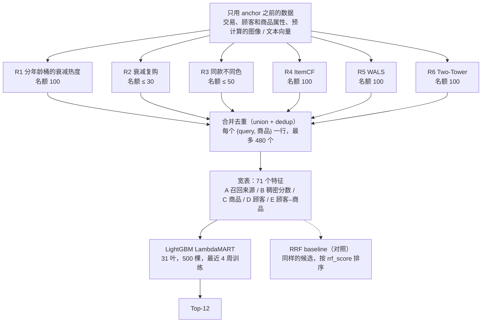

# H&M 个性化时尚推荐系统 — 最终报告

> **语言**：英文版（`docs/final_report.md`）是原稿，这份中文版是它的译本。两份的数字完全相同；有出入时以英文版为准。
> 日期：2026-11-19。Tag `v0.1`。
> 设计依据是 `docs/proposal.md`，过程中的每个决定记在 `docs/decisions.md`。这份报告面向没有参与项目的读者，可以独立阅读；需要细节时按文中给出的章节和文件去查。
> **数字的来源**：结果数字都来自 `results/` 下的文件或 `docs/decisions.md`，在表下或句末注明。由结果表算出的数（相对变化、按 query 数加权的合并值）注明算法。配置数值（名额、窗口、τ 等）来自 `configs/locks/` 下的四个锁定文件和 `configs/fold_manifest.yaml`。
> **这份报告不做的事**：不给出任何正式的 Kaggle 名次（T1–T4 的结果为什么不与 leaderboard 比较见 §7.3；§4.6 报告了一次赛后提交，并注明它的分数所处的位置不是正式名次）；不把相关关系写成因果（§5）。

---

## 1. 摘要

**系统**。任务是给每个顾客预测下一周会买的 12 件商品（Kaggle H&M 数据集，交易记录从 2018-09-20 到 2020-09-22），主指标是 MAP@12。系统分两段：六路 recall 各自给出候选，合并去重后每个 `(顾客, 商品)` 一行；再算 71 个特征，用一个 LightGBM LambdaMART 模型排序，取前 12 个。

**怎么评估**。数据的最后 16 周，每周一个 fold，分成四个阶段，每个阶段只选它该选的东西：

| 阶段 | 周 | 做什么 |
|---|---|---|
| D | D1–D4 | 选六路 recall 的配置，然后锁定 |
| F | F1–F4 | 用锁定的配置生成候选，只作为 Ranker 的训练数据，不选任何东西 |
| V | V1–V4 | 选 Ranker 的配置，然后锁定 |
| T | T1–T4 | 全部锁定之后做最终评估，**只运行一次** |

每一周的预测只用这一周第一天（anchor）之前的数据。T 周的 label 在最终评估之前从未被读取，这一点由代码强制（§3.5）。

**最终成绩**（T1–T4，2020-08-26 至 09-22，共 297,078 个 query）：

| | T1 | T2 | T3 | T4 | 4 周合并 |
|---|---|---|---|---|---|
| **LambdaMART MAP@12** | 0.034960 | 0.040270 | 0.039673 | 0.042435 | **0.039194** |
| RRF baseline MAP@12（不训练模型的对照） | 0.019151 | 0.021471 | 0.021848 | 0.022411 | 0.021154 |
| 六路 union recall | 27.88% | 29.08% | 29.09% | 30.69% | — |

来源：`results/t_phase_metrics.csv`、`results/t_phase_recall.csv`。"合并"是把 4 周的 query 放在一起平均（按 query 数加权）。合并 MAP@12 的 95% 区间是 0.038672–0.039721（`results/t_diag_bootstrap.csv`；只反映顾客抽样的不确定性，见 §4.5）。

**三个目标的结论**（判定标准在读取任何 T 周 label 之前写进 `configs/m8_final.yaml`；结论由代码写入 `results/t_phase_goals.csv`）：

| 目标 | 标准 | 实际 | 结论 |
|---|---|---|---|
| G1 | T1–T4 合并 MAP@12 ≥ 0.032 | 0.039194 | **达标** |
| G2 | T1–T4 每一周的六路 union recall ≥ 24% | 最低的一周（T1）27.88% | **达标** |
| G3 | LambdaMART 的 MAP@12 在 4 周中至少 3 周严格高于 RRF baseline | 4 周都更高 | **达标** |

**读这些数字时要知道的三件事**：

1. **T 比 V 高 19.8%**（V1–V4 合并 0.032713，`results/v_phase_metrics.csv`），与事先"V 偏乐观、T 可能低于 0.032"的预期相反。§5 用四张描述表给出与数字一致的解释；它是相关，不是经过验证的因果。V1–T4 单周的 MAP@12 从 0.030112 到 0.042435，成绩带有季节因素（§4.4、§7.2）。
2. **单次运行、单个 seed、只有离线评估**。没有线上 A/B，也没有重复实验给出的波动范围（§7.2）。
3. **T1–T4 是用过的数据**。它的 label 为最终评估读过，之后又在 4 个场合读过；每个场合都有记录（§7.2 第 5 条）。之后的任何改动只能在 V1–V4 上比较和选择（`AGENTS.md` §3.2）。

**第 2 阶段（2026-11-20 补充）：DeepFM 作为另一种 Ranker。** 在候选、特征和训练行都相同的条件下，把 DeepFM Ranker 与 LambdaMART 做了比较（§10）。在 V 上选定的配置（标准化的数值输入，listwise 损失）在 V1–V4 上的合并 MAP@12 是 0.032765，LambdaMART 是 0.032701（都是 3 个 seed 的均值）；在 T1–T4 上是 0.039341 对 0.039194（LambdaMART：1 个 seed）；两个差值的 95% 区间都含零。一次 Kaggle 赛后提交的 Private 分数是 0.03588 对 0.03600，相差 −0.33%，在运行之前固定的 1% 区间之内（Public：0.03492 对 0.03548，−1.58%）。在全部三个比较里，两个 Ranker 都无法区分，这不表示它们相等。系统的 Ranker 仍然是 LambdaMART。

---

## 2. 系统设计

### 2.1 流程



几个贯穿全文的定义（`docs/proposal.md` §2）：

- **Anchor** `a` 是预测周的第一天。输入只用 `t_dat < a` 的数据，label 是 `[a, a + 7 天)` 的购买。
- **Query** = `(顾客, anchor)`，前提是这个顾客在 label 周至少买了一件商品目录里的商品。所以每周的 query 是"这周买了东西的顾客"，每周 6.9 万–8.6 万个（F1–T4，`results/m6_candidates.csv`）。
- **Label 集合** = 这个顾客在 label 周买过的商品，去重。
- **活跃池** `A(a)` = 在 `[a − 28 天, a)` 内至少有 3 条购买记录的商品，是"近期在卖"的近似，不是真实库存。R1、R3、R4、R5、R6 只输出池内的商品；R2（复购）不过滤。
- **MAP@12**：每个 query 的 AP@12（分母是 `min(12, label 数)`，与 Kaggle H&M 比赛的定义一致），再对 query 平均。没有任何命中的 query 得 0 分，留在分母里。
- **Union recall**：六路合并去重后的全部候选覆盖 label 的比例，不截断。它是排序阶段能达到的 recall 的上限。
- **事件年龄** `age_days = anchor − 购买日`，昨天是 1。所有衰减都写成 `exp(−age_days / τ)`，τ 是时间常数。

### 2.2 六路 recall

每一路都在每周用 anchor 之前的数据重新统计或重新拟合，输出 `query_id, article_idx, rank, score`。下面的配置是锁定的最终配置（`configs/locks/channels.lock.yaml`、`configs/locks/twotower.lock.yaml`）；各路在 D 阶段的分数见 §4.1。

**R1 — 分年龄桶的时间衰减热度**（名额 100）。取最近 7 天的购买行，按顾客的年龄桶（7 个桶：18–24、25–34、35–44、45–54、55 以上、年龄异常、年龄缺失）分别统计每个商品的 `Σ exp(−age_days / τ)`，τ = 3 天。每个顾客拿自己年龄桶的前 100 个。它是唯一对所有顾客都有输出的统计类通道，没有购买历史的顾客主要靠它。

**R2 — 时间衰减复购**（名额最多 30，不补齐）。只推荐顾客自己在最近 365 天内买过的同一件商品，分数是 `Σ exp(−age_days / 30)`，买得越近、越多次，排得越前。没有历史的顾客输出为空。

**R3 — 同款不同色**（名额最多 50，不补齐）。顾客买过某个款式（`product_code`）的一个颜色，就推荐同款的其他颜色。分数 = 顾客对这个款式的偏好（最近 180 天的购买按 τ = 30 衰减求和）× `(1 + 这个商品最近 7 天的全站销量)^γ`，γ = 1.0。排除顾客已经买过的那一件，只输出活跃池内的商品。

**R4 — ItemCF**（名额 100）。用最近 365 天的"顾客–商品"0/1 矩阵算商品之间的相似度：共现按顾客的活跃度降权（买得多的顾客权重小），再用 `α = 0.7` 的不对称归一化；每个商品保留 100 个活跃池内的邻居。顾客的分数是他最近 365 天买过的每件商品（seed）对候选的相似度之和，seed 按最近一次购买的时间衰减（τ = 30）。

**R5 — WALS**（名额 100）。隐式反馈的矩阵分解（加权交替最小二乘，`implicit` 库）。交互强度是最近 180 天购买的衰减和（τ = 60），置信度 `1 + 60 × 强度`，128 维，正则 0.1，15 轮。顾客向量点乘商品向量，取活跃池内的前 100 个。窗口内没有购买的顾客输出为空。

**R6 — Two-Tower**（名额 100）。两个神经网络塔分别把顾客和商品映射成 128 维的单位向量，点积就是分数。

- 商品塔：图像向量（CLIP，512 维）、文本向量（MiniLM，384 维）、商品 ID、款式和 6 个类目字段，各自投影后拼接成 442 维，再经过 `Linear → ReLU → Linear` 和 L2 归一化（`docs/decisions.md` 2026-11-17 "Two-Tower model structure"）。
- 顾客塔：顾客在 anchor 之前最近 20 件购买，经过同一个商品塔，按位置加权平均，再拼上年龄桶等三个属性。
- 训练：batch 内 softmax，带 LogQ 修正（压低热门商品作为负样本的偏差），温度 0.05。
- **训练链**是 R6 与其他五路最大的不同：先用 2019-12-03 至 2020-06-02 的购买训练一个 base 模型（取第 4 个 epoch），之后每周"先预测这一周，再用这一周的购买 fine-tune 2 个 epoch"，fine-tune 的数据里一半是新的一周、一半是从前 4 周抽的旧样本（replay 50%）。整个项目只有这一条链，从 D1 一直走到 T4。每周的分数都是模型还没见过这一周时得到的。

### 2.3 候选合并

六路的输出按 `(query_id, article_idx)` 合并去重：同一个商品被三路召回，只有一行，三路各自的名次和分数是这一行的三组列。不采用"每路一行"（label 会被重复计算，排序的组里出现重复商品），也不采用"先用 RRF 截断"（被截掉的商品 Ranker 永远看不到）。合并后每个 query 平均 304–310 个候选（F1–T4，`results/m6_candidates.csv`）。

### 2.4 71 个特征

每一行是一个 `(query, 候选商品)`。所有特征只用 `t_dat < anchor` 的数据；不使用原始 ID；缺失值保留为 NaN。清单、顺序和 dtype 锁定在 `configs/locks/features.lock.yaml`，定义见 `docs/proposal.md` §8。

| 组 | 个数 | 内容 | 例子 |
|---|---|---|---|
| A 召回来源 | 14 | 这个候选在每一路的名次、四路的原始分数、被几路召回、最好的名次、RRF 分数 | `tt_rank`、`rep_score`、`best_rank`、`rrf_score` |
| B 稠密分数 | 7 | 不管候选来自哪一路，都计算的分数 | `tt_dot`（Two-Tower 点积）、`wals_dot`、候选与顾客最近 20 件购买的图像 / 文本 / Two-Tower 相似度 |
| C 商品 | 17 | 近期销量、上架和最近售出距今天数、均价、折扣比、线上占比、买家平均年龄、6 个类目 | `item_cnt_1w`、`item_days_since_first_sale`、`item_discount_ratio` |
| D 顾客 | 12 | 年龄、会员状态等属性，购买次数、距上次购买天数、均价、线上占比 | `user_days_since_last_purchase`、`user_cnt_4w` |
| E 顾客–商品交叉 | 21 | 顾客是否买过这件 / 这个款式、距今多久；顾客在这个类目上的购买占比和衰减和；价格、年龄、渠道的差距 | `ui_days_since_pcode`、`ui_decay_ptype`、`ui_price_ratio` |

特征最初是 56 个，在锁定之前、没有任何 Ranker 结果的时候增加到 71 个（主要是 E 组），这是设计修改，不是根据分数做的选择（`docs/decisions.md` 2026-11-17）。

### 2.5 Ranker

- **模型**：LightGBM，`objective = lambdarank`，`learning_rate` 0.05，`feature_fraction` 0.8，`bagging_fraction` 0.8，`max_bin` 255，`num_leaves` 31，`min_data_in_leaf` 500，**500 棵树**，seed 42（`configs/locks/ranker.lock.yaml`）。
- **训练数据**：预测某一周时，用它之前的 4 周从头训练（例如 T1 ← V1–V4，T4 ← V4、T1、T2、T3）。只用至少有一个正样本的 query；保留全部正样本，每个正样本在同一个 query 的候选里随机配 40 个负样本。
- **预测**：对预测周的全部候选打分，不采样，取每个 query 的前 12 个。
- **不做 early stopping**：树的棵数和 Two-Tower 的 epoch 数一样，作为超参数在 4 周上一次选定，然后锁住。
- **RRF baseline**：同样的候选，按 `rrf_score = Σ 1 / (60 + 各路名次)` 排序取前 12 个，不训练任何模型。它回答"Ranker 比简单的名次融合好多少"。

---

## 3. 评估协议

### 3.1 16 周的划分

| 阶段 | Fold | Label 日期（2020，含首尾） | 在这里被选择的东西 |
|---|---|---|---|
| D | D1–D4 | 06-03 至 06-30 | 六路 recall 的超参数 |
| F | F1–F4 | 07-01 至 07-28 | 无（只生成 Ranker 的训练数据） |
| V | V1–V4 | 07-29 至 08-25 | Ranker 的超参数 |
| T | T1–T4 | 08-26 至 09-22 | 无（最终评估） |

每周 7 天，相邻、不重叠（`configs/fold_manifest.yaml`，加载时校验）。Two-Tower 的 base 模型用更早的 26 周（2019-12-03 至 2020-06-02）训练，在 D1 之前结束。

**D1–D4 不进入 Ranker 的训练**：这几周的候选是用"在这几周上选出来的配置"生成的，带有选择偏差，所以专门留出 F1–F4 作为第一批训练数据。

### 3.2 三条规则

1. **每一周的预测只用 `t_dat < anchor` 的数据。** 模型权重、统计量、特征都一样。
2. **每个阶段只选它该选的东西。** D 选 recall，V 选 Ranker，F 和 T 只执行。
3. **超参数在 4 周上一次选定，然后锁住。** 包括 epoch 数和树的棵数。之后每周只更新模型参数（重新统计、fine-tune 或重新训练），不再重新选。

### 3.3 选择规则

写在 `configs/selection_rule.yaml`，在看到任何分数之前提交（`docs/proposal.md` §4.2）：

- 4 周合成一个分数：把 4 周的 query 放在一起平均。
- 只有同时满足两条，才把默认值换成候选：4 周合并分数**相对提升 ≥ 1%**，并且 **4 周中至少 3 周严格更好**。否则保留默认值。
- 一步有多个候选通过时，与最高分相差不到 1% 的视为"差不多"，从中选事先写好的优先顺序里最靠前的（更简单、更便宜的在前）。
- 一次只动一个参数，上一步的结果是下一步的默认值。网格从不自动扩展。
- Ranker 的树数：每组参数先定自己的棵数（与最高合并 MAP@12 相差不到 1% 的棵数里取最小的），再比较参数。这条规则在任何 Ranker 结果出现之前写进 `configs/hpo/v_phase.yaml`。

规则的效果是偏向保守：小于 1% 的差别不触发任何改动。

### 3.4 锁定文件

选完之后，配置写进 `configs/locks/`，这个目录只能新增，不能修改：

| 文件 | 内容 | 锁定日期 | git tag |
|---|---|---|---|
| `channels.lock.yaml` | R1–R5 的完整配置、对应的 trial、选择依据 | 2026-11-17 | `lock-channels-v1` |
| `twotower.lock.yaml` | R6 的完整配置；两个模型文件的 sha256 | 2026-11-17 | `lock-channels-v1` |
| `features.lock.yaml` | 71 个特征的名称、顺序、dtype 和决定取值的设置 | 2026-11-18 | `lock-features-v1` |
| `ranker.lock.yaml` | Ranker 的全部参数、采样方法、LightGBM 和 libomp 的版本；另外三个锁定文件的 sha256 | 2026-11-18 | `lock-ranker-v1` |

锁定之后，代码只能通过两个入口取配置：`src/hmrec/recall/locked.py`（六路 recall）和 `src/hmrec/ranker/locked.py`（Ranker）。入口在返回配置之前做核对：模型文件的 sha256、引用的锁定文件的 sha256、由设置重新算出的配置 id、本进程的库版本，任何一项不符就报错。测试会扫描后续阶段的代码，出现读默认配置或在结果表上重放选择的写法就失败。锁定文件本身也有核对：测试不读锁定文件，从结果表重放选择规则，推出"锁定文件应当写什么"，再逐项比较。

### 3.5 M8 的闸门和彩排

T1–T4 的最终评估（M8）只运行一次。顺序是：写代码和测试（只用小数据）→ 提交 → 彩排 → 正式运行。

**彩排**不读任何 T 周的 label：用 M8 的代码路径和锁定配置，把 V4 当作目标周跑一遍，结果必须与 V 阶段的记录**逐位相同**（指标、模型的前 500 棵树、保存的 Top-12、recall 监控）。彩排做了 18 项比较，全部相同（`results/m8_rehearsal_check.csv`）。它证明的是：正式运行要走的那段代码，在一个答案已知的周上能重现已有的记录。

**闸门**（`src/hmrec/final/gate.py`，用代码强制）：

1. 最近一次彩排必须通过、在干净的工作区里运行，并且当前的代码和配置与那次彩排的 commit 相同；否则正式运行拒绝开始，不读任何文件。
2. 正式运行开始时，在读任何 T 周 label 之前，先记下"T 周 label 首次读取"的时间和 commit（`results/t_phase_label_access.csv`：2026-11-18T22:14:34，commit `18d957f`）。
3. 这条记录存在之后，代码或配置一变，任何进程都拒绝运行。所以中断的正式运行可以续跑，但不能换了代码再跑。
4. T 周的 label 只有一个读取入口（`src/hmrec/eval/final_eval.py`），必须带着闸门签发的许可；此前各阶段的入口都拒绝 T fold。
5. T 周只在锁定的 500 棵处评估，其他棵数的指标不算出来，事后也就没有可供挑选的东西。

代码做不到的：不能阻止有人手工删除记录，或绕开入口直接读文件。

正式运行之后还做过一次**描述性诊断**（§5）。它再次读了 T 周的 label，走的是另一个入口（`src/hmrec/eval/diagnostic_labels.py`），条件是 G1–G3 的结论已经写下、M8 的代码和配置没有变，并且先把这次读取记进 `results/t_diag_label_access.csv`（2026-11-19T01:55:42，commit `cd07687`）。诊断只做描述，不用来选择或修改任何东西。

### 3.6 每一步怎样防止数据泄漏

"泄漏"在这里有两种：**时间泄漏**（预测某一周时用到了这一周或之后的数据）和**选择泄漏**（用来报告成绩的数据参与了配置的选择）。

| 环节 | 风险 | 做法 | 怎么强制或检查 |
|---|---|---|---|
| 按日期取交易 | 把 anchor 当天或之后的购买算进历史 | 所有按日期的过滤只通过 `src/hmrec/data/asof.py`；窗口是 `[a − N, a)`，anchor 当天属于 label 周 | 函数返回前检查结果里的最大日期小于 anchor，否则报错；每一路 recall、每个特征都有"投毒"测试：在 anchor 当天及之后加入交易，结果必须完全不变 |
| Label 的读取 | recall 或特征代码看到答案 | label 只在 `eval/` 和 Ranker 的采样代码里读取；宽表里没有 label 列，训练时才拼接 | 测试扫描代码，其他地方引用读 label 周的函数就失败 |
| recall 的选择 | 用选配置的周来训练或评估下游 | recall 只在 D1–D4 上选；这 4 周不进入 Ranker 的训练 | 阶段规则；F 阶段不做任何选择 |
| Two-Tower | 模型见过它要预测的那一周 | base 窗口在 D1 之前结束；训练链每周先预测、后 fine-tune；特征里的 `tt_dot` 用的是这一周 fine-tune 之前的模型 | 每周的模型必须存在、有记录、sha256 一致才能用来预测下一周，所以不能跳过一周，也不能用别的运行留下的模型 |
| 候选和特征 | 用后来的模型或数据重新生成早先的周 | 每周的候选和特征生成后冻结 | 每个特征文件记录 sha256；Ranker 读取之前必须先核对 |
| Ranker 的训练窗口 | 训练周晚于或等于预测周 | 每次用预测周之前的 4 周；每个训练周都在预测周开始之前结束。T2–T4 的训练数据里有 T1–T3 的 label，这是滚动重训的设计，不是泄漏 | 窗口函数在每个入口的第一步检查，不合规的 fold 在打开任何文件之前报错 |
| Ranker 的选择 | 用 T 周挑参数或棵数 | Ranker 只在 V1–V4 上选；做调参的模块里不能出现 T fold | 测试扫描；V 阶段的入口拒绝 T fold |
| 选择规则本身 | 看了分数再定规则 | 三份规则都先提交：`selection_rule.yaml`（任何分数之前）、`hpo/v_phase.yaml`（任何 Ranker 结果之前）、`m8_final.yaml`（任何 T label 之前） | git 历史 |
| 最终评估 | 反复看 T 的结果再改 | 彩排 + 闸门 + 只运行一次（§3.5） | `final/gate.py`；首次读取的记录 |
| 结果的可追溯 | 分不清结果出自哪份代码 | 新写或修改代码之后必须先提交，工作区干净才能在全量数据上运行 | 每一行结果记录 `git_commit` 和 `git_dirty`；本报告引用的各阶段结果行都是 `git_dirty = False` |
| 独立核对 | 被检查的代码和检查用的是同一个 bug | `scripts/checks/` 下的核对脚本不使用被检查的模块，用最朴素的循环重算特征和指标 | 12 周的特征各抽 1,000 行 × 25 个特征全部一致；V、T 最终配置的 8 个 trial 的三个指标与记录一致（`docs/decisions.md` 2026-11-18） |

还剩下的、协议本身消除不了的偏差：**D 周和 V 周的分数偏乐观**（配置就是在这些周上选的），所以系统表现以 T 为准；过程中有几处在看到结果之后才做的决定，如实列在 §7.1。

---

## 4. 结果

### 4.1 D 阶段：各路 recall 和 union

各路在 D1–D4 上的选择指标（Recall@名额，%），锁定的配置：

| 通道 | 指标 | D1 | D2 | D3 | D4 | 4 周合并 | 相对默认配置 |
|---|---|---|---|---|---|---|---|
| R1 Popularity | Recall@100 | 7.497 | 8.333 | 7.029 | 7.058 | **7.388** | 0（没有候选通过规则，保留默认） |
| R2 Repurchase | Recall@30 | 5.336 | 4.770 | 3.491 | 4.011 | **4.266** | +7.51% |
| R3 Sibling | Recall@50 | 3.526 | 3.574 | 2.890 | 3.188 | **3.240** | 见下 |
| R4 ItemCF | Recall@100 | 10.544 | 10.135 | 8.336 | 9.012 | **9.332** | +14.52% |
| R5 WALS | Recall@100 | 12.295 | 11.760 | 9.576 | 10.444 | **10.807** | +8.05% |
| R6 Two-Tower | Recall@100 | 14.478 | 15.912 | 13.970 | 14.575 | **14.634** | +23.57%（相对不更新的 base） |

来源：`results/d_phase.csv`（R3 为 `results/m4_trials.csv`）；"相对默认配置"取自 `docs/decisions.md` 2026-11-17 "Final D-phase selection for R1–R5"，R6 取自 `results/d_phase_steps/r6_twotower.csv`。D 阶段共 54 个 trial（R1–R6 分别 8、5、7、9、11、14 个）。

- R3：D 阶段规则选中的配置是 3.257%（相对默认 +2.34%）；之后按预先登记的规则改为只输出活跃池内的商品，分数变为 3.240%（§7.1）。
- R6：不更新的 base（第 4 个 epoch）合并 11.843%；每周 fine-tune 之后 14.634%。规则选中的是不加 replay 的配置（14.576%），最终采用的是加 50% replay 的配置，这是人工决定（§7.1）。
- D3、D4 两周的分数普遍低于 D1、D2，这两周的 query 数也明显更多（D1–D4：78,193 / 77,306 / 120,190 / 115,992），疑似促销周，在合并分数里占 60.3% 的权重（§7.2）。

**六路合并**（`results/m4_union_check_r3_active_pool.csv`，锁定的配置）：

| | D1 | D2 | D3 | D4 | 4 周合并 |
|---|---|---|---|---|---|
| Union recall | 26.51% | 27.15% | 23.46% | 24.97% | **25.24%** |

- 每个 query 去重后平均 307.1 个候选（P50 320，P90 364；上限 480）。
- **50.5% 的 query 没有任何一路命中任何 label**。这些 query 的 AP 必然是 0，是后面所有 MAP 数字的上限来源之一。
- 去掉一路之后 union recall 的下降（百分点，4 周合并）：R6 4.96、R1 3.03、R5 1.41、R4 1.15、R2 0.50、R3 0.48。R6 带来的"别的路没有的候选"最多。

**这些分数偏乐观**：配置就是在这 4 周上选的，R6 的 base 模型也紧接在这 4 周之前训练。它们只用来比较配置，不代表之后各周的表现；F、V、T 各周的实测见 §4.4。

### 4.2 V 阶段：Ranker 的 HPO 和 feature importance

**HPO**。两步，共 8 组配置，每组在 V1–V4 上各训练一个 1000 棵的模型，每 100 棵评估一次：

| 步骤 | `num_leaves`，`min_data_in_leaf`，负采样比例 | 选中的棵数 | V1–V4 合并 MAP@12 | 相对默认 | 更好的周数 | 最高分（所在棵数） |
|---|---|---|---|---|---|---|
| 默认 | **31，500，40** | **500** | **0.032713** | — | — | 0.032865（1000） |
| 1 | 31，100，40 | 500 | 0.032619 | −0.29% | 1 | 0.032849（1000） |
| 1 | 63，500，40 | 300 | 0.032645 | −0.21% | 1 | 0.032804（600） |
| 1 | 63，100，40 | 300 | 0.032555 | −0.48% | 0 | 0.032755（600） |
| 1 | 127，500，40 | 200 | 0.032536 | −0.54% | 1 | 0.032766（500） |
| 1 | 127，100，40 | 200 | 0.032528 | −0.56% | 1 | 0.032653（400） |
| 2 | 31，500，60 | 400 | 0.032664 | −0.15% | 2 | 0.032917（900） |
| 2 | 31，500，80 | 400 | 0.032698 | −0.04% | 2 | 0.032952（800） |

来源：`results/v_phase_steps.csv`。

- 两步都没有候选通过规则，**保留默认配置**，棵数 500。
- **Ranker 的这几个参数已经在平台期**：8 组配置在各自棵数上的合并 MAP@12 都在 0.0325–0.0330 之间，最多相差 0.56%。提升空间在候选和特征，不在这几个参数。
- 默认配置的曲线到后面几乎走平：合并 MAP@12 在 100、300、500、1000 棵时是 0.031210、0.032363、0.032713、0.032865（由 `results/v_phase_metrics.csv` 按 query 数加权算出）。
- 负采样比例越大，最高分略高，规则给它们选了更小的棵数，所以表里的差距是负的。在相同的 500 棵上，比例 80 是 0.032821，比默认高 0.33%，远低于 1% 的门槛（`docs/decisions.md` 2026-11-18）。

**V 上的成绩**（最终配置；`results/v_phase_metrics.csv`）：

| MAP@12 | V1 | V2 | V3 | V4 | 合并 |
|---|---|---|---|---|---|
| RRF baseline | 0.018511 | 0.019064 | 0.020604 | 0.019662 | 0.019419 |
| LambdaMART | 0.030112 | 0.031332 | 0.035029 | 0.034850 | **0.032713** |
| 去掉 R6 | 0.028727 | 0.029881 | 0.033603 | 0.033013 | 0.031193 |

G1（≥ 0.032）和 G3 在 V 上达标，但 G1 的余量只有 2.2%，而且 V 上的分数偏乐观（棵数和参数就是在这四周上选的）。所以当时的记录写的是"T 上有可能低于 0.032，以 M8 为准"。

**Feature importance**（最终配置的 4 个模型，前 500 棵，按 gain 的占比，四周平均；`results/v_phase_feature_importance.csv`；只用于分析，不用来增删特征）。前 10 个：

| 名次 | 特征 | 组 | 占比 | 名次 | 特征 | 组 | 占比 |
|---|---|---|---|---|---|---|---|
| 1 | `best_rank` | A | 12.01% | 6 | `product_type_no` | C | 5.39% |
| 2 | `rrf_score` | A | 10.80% | 7 | `ui_days_since_item` | E | 4.15% |
| 3 | `tt_dot` | B | 9.37% | 8 | `item_cnt_1w` | C | 3.21% |
| 4 | `ui_days_since_pcode` | E | 9.28% | 9 | `colour_group_code` | C | 3.07% |
| 5 | `tt_rank` | A | 7.57% | 10 | `user_days_since_last_purchase` | D | 2.97% |

| 组 | 特征数 | 占比（四周平均） | 四周的范围 |
|---|---|---|---|
| A 召回来源 | 14 | 33.85% | 33.09–35.14% |
| B 稠密分数 | 7 | 15.02% | 14.27–15.98% |
| C 商品 | 17 | 24.22% | 23.82–24.68% |
| D 顾客 | 12 | 5.27% | 4.93–5.82% |
| E 顾客–商品交叉 | 21 | 21.64% | 21.23–22.68% |

- 前 5 个特征合计 49.0%，前 20 个合计 85.1%。
- 4 个来自 R6 的特征（`tt_dot`、`tt_rank`、`tt_sim_max_hist`、`tt_sim_top5_hist`）合计约 19.0%。
- 贡献最小的几个：`fn`（0.0008%）、`active`（0.0013%）、`fashion_news_frequency`（0.0017%）、`pop_is_fallback`（0.0028%）、`index_group_no`（0.0040%）。

### 4.3 T 阶段：主表、RRF baseline、去掉 R6

正式运行在 2026-11-18 22:14:34 开始、22:49:38 结束，commit `18d957f`，工作区干净（`results/t_phase.csv`、`results/t_phase_label_access.csv`）。训练周：T1 ← V1–V4，T2 ← V2 V3 V4 T1，T3 ← V3 V4 T1 T2，T4 ← V4 T1 T2 T3。

| | T1 | T2 | T3 | T4 | 合并 | 四周等权平均 |
|---|---|---|---|---|---|---|
| query 数 | 80,253 | 75,822 | 72,019 | 68,984 | 297,078 | — |
| **LambdaMART MAP@12** | 0.034960 | 0.040270 | 0.039673 | 0.042435 | **0.039194** | 0.039335 |
| LambdaMART Recall@12 | 0.080965 | 0.088694 | 0.086791 | 0.092959 | 0.087135 | 0.087352 |
| LambdaMART NDCG@12 | 0.054734 | 0.061135 | 0.060277 | 0.063951 | 0.059852 | 0.060024 |
| RRF baseline MAP@12 | 0.019151 | 0.021471 | 0.021848 | 0.022411 | 0.021154 | 0.021220 |
| RRF baseline Recall@12 | 0.049777 | 0.055978 | 0.057542 | 0.059756 | 0.055559 | 0.055763 |
| RRF baseline NDCG@12 | 0.031942 | 0.035476 | 0.036235 | 0.037149 | 0.035094 | 0.035200 |
| LambdaMART 相对 baseline（MAP@12） | +82.6% | +87.6% | +81.6% | +89.4% | +85.3% | — |

来源：`results/t_phase_metrics.csv`；合并和等权平均由表中的行算出，与 `docs/decisions.md` 2026-11-18 的记录一致。

**去掉 R6**（预先登记的次要分析，只报告，不影响任何结论的判定）。做法：删掉只由 R6 召回的候选和 4 个 R6 特征，用其余五路重新计算聚合特征，重新采样、重新训练：

| | T1 | T2 | T3 | T4 | 合并 |
|---|---|---|---|---|---|
| 去掉 R6 的 MAP@12 | 0.033202 | 0.037679 | 0.037330 | 0.039141 | 0.036724 |
| 相对完整系统 | −5.03% | −6.43% | −5.91% | −7.76% | **−6.30%** |

合并 Recall@12 下降 8.37%（0.087135 → 0.079841），NDCG@12 下降 7.45%（0.059852 → 0.055392）。

**只报告 @12**：锁定的 Ranker 每个 query 只保留前 12 个，算不出 @20 的指标（§7.1）。

### 4.4 V1–T4 每周的成绩

合并值会掩盖周与周之间的差别，所以把 8 周放在同一张表里：

| 周 | Label 日期（2020，含首尾） | query 数 | union recall | LambdaMART MAP@12 | RRF baseline MAP@12 | 去掉 R6 MAP@12 | LambdaMART 相对 baseline |
|---|---|---|---|---|---|---|---|
| V1 | 07-29 至 08-04 | 82,802 | 25.44% | 0.030112 | 0.018511 | 0.028727 | +62.7% |
| V2 | 08-05 至 08-11 | 74,833 | 27.54% | 0.031332 | 0.019064 | 0.029881 | +64.4% |
| V3 | 08-12 至 08-18 | 71,094 | 26.38% | 0.035029 | 0.020604 | 0.033603 | +70.0% |
| V4 | 08-19 至 08-25 | 72,035 | 27.62% | 0.034850 | 0.019662 | 0.033013 | +77.2% |
| T1 | 08-26 至 09-01 | 80,253 | 27.88% | 0.034960 | 0.019151 | 0.033202 | +82.6% |
| T2 | 09-02 至 09-08 | 75,822 | 29.08% | 0.040270 | 0.021471 | 0.037679 | +87.6% |
| T3 | 09-09 至 09-15 | 72,019 | 29.09% | 0.039673 | 0.021848 | 0.037330 | +81.6% |
| T4 | 09-16 至 09-22 | 68,984 | 30.69% | 0.042435 | 0.022411 | 0.039141 | +89.4% |
| V 合并 | 07-29 至 08-25 | 300,764 | — | 0.032713 | 0.019419 | 0.031193 | +68.5% |
| T 合并 | 08-26 至 09-22 | 297,078 | — | 0.039194 | 0.021154 | 0.036724 | +85.3% |

来源：`results/v_phase_metrics.csv`、`results/t_phase_metrics.csv`、`results/m6_candidates.csv`（V 周的 union recall）、`results/t_phase_recall.csv`（T 周的 union recall）。最后一列由前两列算出。

- 8 周里 LambdaMART 的 MAP@12 从 0.030112（V1）到 0.042435（T4），**最高的一周比最低的一周高 41%**。单看一周的成绩说明不了系统的水平。
- V 阶段内部就有差别：V1、V2（约 0.030–0.031）明显低于 V3、V4（约 0.035）。
- T1（0.034960）与 V3、V4 在同一水平；T2–T4 更高。
- V 上的成绩是**选过配置之后**在同样四周上报告的，T 上的成绩是锁定之后第一次也是唯一一次评估。两者性质不同，T 才是系统表现的依据。

**各路 recall 在锁定之后 12 周的实测**（Recall@名额，%；只是监控，没有用来选择任何东西）：

| 周 | R1 | R2 | R3 | R4 | R5 | R6 | union | 无命中的 query |
|---|---|---|---|---|---|---|---|---|
| F1 | 6.55 | 4.90 | 3.49 | 9.90 | 11.52 | 14.52 | 25.61 | 51.64 |
| F2 | 7.33 | 4.49 | 3.48 | 9.56 | 10.96 | 14.77 | 25.89 | 51.74 |
| F3 | 7.67 | 4.33 | 3.56 | 9.61 | 10.86 | 15.43 | 26.33 | 51.31 |
| F4 | 8.25 | 4.20 | 3.62 | 9.59 | 10.62 | 15.24 | 26.13 | 51.50 |
| V1 | 7.81 | 3.87 | 3.41 | 9.07 | 10.15 | 15.53 | 25.44 | 52.09 |
| V2 | 9.16 | 4.00 | 3.41 | 9.14 | 10.53 | 16.68 | 27.54 | 49.00 |
| V3 | 8.15 | 4.29 | 3.48 | 9.15 | 10.22 | 16.25 | 26.38 | 52.14 |
| V4 | 11.00 | 4.13 | 3.34 | 8.82 | 9.50 | 16.01 | 27.62 | 50.70 |
| T1 | 12.22 | 3.74 | 2.99 | 8.03 | 8.41 | 17.33 | 27.88 | 50.29 |
| T2 | 12.47 | 4.24 | 2.99 | 8.58 | 9.06 | 19.00 | 29.08 | 49.34 |
| T3 | 11.22 | 4.39 | 3.16 | 8.71 | 9.48 | 18.90 | 29.09 | 49.21 |
| T4 | 12.79 | 4.48 | 3.06 | 8.91 | 9.78 | 20.46 | 30.69 | 48.14 |

来源：`results/m6_candidates.csv`（F、V）、`results/t_phase_recall.csv`（T）。G2 的标准（union recall ≥ 24%）在这 12 周每周都满足。

### 4.5 95% 区间

| 阶段 | 顾客数 | query 数 | 量 | 合并 MAP@12 | 95% 区间 |
|---|---|---|---|---|---|
| T | 233,174 | 297,078 | LambdaMART | 0.039194 | 0.038672 – 0.039721 |
| T | | | RRF baseline | 0.021154 | 0.020796 – 0.021510 |
| T | | | LambdaMART − baseline | 0.018040 | 0.017620 – 0.018474 |
| V | 234,382 | 300,764 | LambdaMART | 0.032713 | 0.032267 – 0.033155 |
| V | | | RRF baseline | 0.019419 | 0.019090 – 0.019752 |
| V | | | LambdaMART − baseline | 0.013294 | 0.012912 – 0.013665 |

来源：`results/t_diag_bootstrap.csv`。

**怎么算的**：按顾客的 cluster bootstrap。把一个阶段的 4 周合在一起，以顾客为单位有放回地抽；被抽中的顾客带上他在这 4 周里的全部 query（同一个顾客在几周里的 query 不是独立的，按 query 抽会把区间算窄）。重复 1000 次，seed 42，取 2.5% 和 97.5% 分位。"LambdaMART − baseline"用同一批抽样，是配对比较。

**这个区间只反映顾客抽样的不确定性。** 它回答的是"换一批顾客，这 4 周的合并分数会差多少"。它**不反映**：

- 周与周之间的差别（每一次重抽里都是同样的 4 周，而 §4.4 显示单周之间可以相差 41%）；
- 训练的随机性（每个模型只训练了一次、一个 seed）；
- 换一个时期、换一批商品之后的表现。

所以区间很窄不等于"成绩稳定在 0.039 上下"；它只说明在这 4 周、这一次训练的条件下，顾客样本的大小足以把合并值定到小数点后第三位。

---

### 4.6 Kaggle 赛后提交

T1–T4 的评估之后，用锁定的系统向 Kaggle 比赛 `h-and-m-personalized-fashion-recommendations` 做了**一次赛后提交（late submission）**。流程在运行之前先写入了记录；只提交了一次；分数只作报告，没有因为它调整、选择或改动任何东西。

| 项目 | 数值 |
|---|---|
| Public 分数（MAP@12，由 Kaggle 计算） | 0.03548 |
| Private 分数（以它为准） | **0.03600** |
| 提交时间 | 2026-11-19（Kaggle 收到的时间是 2026-11-18 18:24:50 UTC）；submission ref 58521284 |
| 产生文件的代码 | 分支 `kaggle-late-submission`，commit `507cff5d50b81eb388414ca45454c52ca7335986`（分数记录在该分支的 commit `84b25be`） |
| Private 分数所处的位置 | 在最终 leaderboard 的 2,954 支队伍中相当于第 4 位：**赛后提交，不是正式名次**（late submission, not an official rank） |

来源：`docs/decisions.md` 2026-11-19 "Kaggle late submission"。结果表（`results/kaggle_*.csv`）在分支 `kaggle-late-submission` 上，该分支不合并到 main。

提交周与 T1–T4 的不同：

- **周不同。** 2020-09-23 至 2020-09-29，是数据结束之后的那一周。它的 label 不在数据里，分数由 Kaggle 计算。T1–T4 是数据内部的最后 4 周，用项目自己的 label 评分。
- **顾客不同。** 文件给 `sample_submission.csv` 里全部 1,371,980 个顾客各预测 12 件商品。一个 T 周有 68,984–80,253 个 query，只是那一周有购买的顾客。
- **训练数据不同。** 用到 2020-09-22 为止的全部数据：R1–R5 按 2020-09-23 重新计算，R6 多做一次 fine-tune（在 T4 周上），Ranker 在 T1–T4 上从头训练。所以 T1–T4 的 label 在这里是训练 label；对 T4 来说这是新的（在 M8 里它只被评估）。
- **只有一周。** 这个分数是单独一周的；0.039194 是 4 周合并的，§4.4 显示单周之间相差很大。这里不比较这两个数。

正式运行之前，同一条代码路径先在 T4 上彩排：它训练出的 Ranker 与 M8 的相同（同样的 500 棵树），68,984 个 T4 query 中有 68,984 个的 Top-12 列表与 M8 保存的完全相同。

"位置"指的是 Private 分数放到榜上会排在哪里。Kaggle 不给赛后提交排名，而且这次提交是在比赛结束多年之后做的；这份报告不写其他任何名次。

**背景：其他模型的自主运行。** 在这个仓库之外，用户还做了三次由模型独立完成的运行。每个模型拿到的是数据集和同一份预先算好的文本、图像向量，没有任何设计上的指导。下表把它们的分数与这个项目的放在一起；这些分数是用户在 2026-11-19 报告的。

| 系统 | Public | Private |
|---|---|---|
| 这个项目（设计由人主导，Claude Code 负责实现） | 0.03548 | 0.03600 |
| Claude Fable 5.2，自主运行 | 0.03443 | 0.03486 |
| Gemini Hydrogen Extra，自主运行 | 0.03368 | 0.03330 |
| GPT 6.0 Astra Ultra，自主运行 | 未提交 | 未提交 |

- **有一次运行没有提交。** GPT 6.0 Astra Ultra 的那次运行没有 Kaggle 分数：按它自己的评估，T1–T4 上的离线 MAP@12 约为 0.029，用户没有提交它。这个离线数字不是 Kaggle 分数，不与表中的分数比较。
- **没有记录的内容。** 这三次运行的条件没有记下来：提交了的两次各自提交了多少次，以及每次运行的时间预算、提示词和日期。它们的代码不在这个仓库里。所以与这份报告里的其他数字不同，这几个分数无法追溯到 `results/` 下的文件或 `docs/decisions.md`。
- **差距。** 在 Private leaderboard 上，这个项目比 Claude Fable 5.2 的那次运行高 3.3%（0.03600 / 0.03486 − 1），比 Gemini Hydrogen Extra 的那次运行高 8.1%（0.03600 / 0.03330 − 1）。
- **这只是背景，不是对照实验。** 每个系统只有一个结果，而且各系统之间同时有很多处不同。这个差距不能归因于任何单一原因。

---

## 5. T 为什么高于 V

T1–T4 合并的 MAP@12 比 V1–V4 高 19.8%（0.032713 → 0.039194）。这与事先的预期相反：V 上的配置是在 V 上选的，本应偏乐观。正式运行之后做了四张描述表（`results/t_diag_*.csv`），下面按表说明。**这些表只描述已经记录的结果，没有做任何实验；它们没有、也不能用来选择或修改任何东西。**

### 5.1 涨幅的分解：一半来自 union recall，一半来自排序

Recall@12 可以拆成两个因子的乘积：`Recall@12 = union recall × (Recall@12 ÷ union recall)`。第一个因子是候选里有多少 label（recall 层的事），第二个因子是候选里的 label 有多少被排进了前 12（排序层的事）。

| | union recall | LambdaMART Recall@12 | LambdaMART 比值 | RRF baseline Recall@12 | RRF baseline 比值 |
|---|---|---|---|---|---|
| V1 | 0.254379 | 0.067410 | 0.2650 | 0.048789 | 0.1918 |
| V2 | 0.275415 | 0.071690 | 0.2603 | 0.050742 | 0.1842 |
| V3 | 0.263840 | 0.075796 | 0.2873 | 0.052952 | 0.2007 |
| V4 | 0.276163 | 0.077972 | 0.2823 | 0.051959 | 0.1881 |
| T1 | 0.278773 | 0.080965 | 0.2904 | 0.049777 | 0.1786 |
| T2 | 0.290767 | 0.088694 | 0.3050 | 0.055978 | 0.1925 |
| T3 | 0.290926 | 0.086791 | 0.2983 | 0.057542 | 0.1978 |
| T4 | 0.306944 | 0.092959 | 0.3029 | 0.059756 | 0.1947 |
| V 合并 | 0.267067 | 0.072987 | 0.2733 | 0.051018 | 0.1910 |
| T 合并 | 0.291322 | 0.087135 | 0.2991 | 0.055559 | 0.1907 |
| T 相对 V | **+9.1%** | +19.4% | **+9.4%** | +8.9% | **−0.2%** |

来源：`results/t_diag_decomposition.csv`（"比值"= Recall@12 ÷ union recall）。合并两行是把表中 4 周的值按 query 数加权算出的，合并的比值是两个合并值之比。

- LambdaMART 的 Recall@12 涨了 19.4%，MAP@12 涨了 19.8%，两者几乎相同，所以用 Recall@12 的分解来说明。
- 这 19.4% 里，**union recall 升高 9.1%，LambdaMART 把候选中的命中排进前 12 的比例升高 9.4%**。按对数分摊，两个因子各占约一半（49% 和 51%）。
- **RRF baseline 的比值没有变化**（0.1910 → 0.1907）。baseline 的 Recall@12 涨了 8.9%，全部来自 union recall。
- 也就是说：候选变好了，对两个系统都有利；在此之外，LambdaMART 从同样的候选里排出命中的能力也提高了，而不训练模型的 baseline 没有。LambdaMART 相对 baseline 的优势因此从 V 上的 +68.5% 扩大到 T 上的 +85.3%（§4.4）。

### 5.2 同一时期：购买更集中，新商品占比更高

这张表描述的是 label 周本身，与模型无关。"购买"是去重后的（顾客, 商品）对；"新商品"指首次销售在 anchor 之前 28 天以内的商品；"当周才开卖"指 anchor 之前没有任何销售的商品。

| 周 | 购买对数 | 销量前 100 的商品占购买的比例 | 前 1000 的比例 | 新商品占购买的比例 | 当周才开卖的商品占购买的比例 |
|---|---|---|---|---|---|
| D1 | 280,367 | 8.96% | 39.32% | 13.60% | 1.42% |
| D2 | 270,270 | 9.33% | 39.53% | 11.45% | 1.33% |
| D3 | 492,450 | 9.05% | 42.01% | 7.80% | 2.37% |
| D4 | 463,484 | 9.20% | 41.50% | 10.50% | 2.82% |
| F1 | 305,061 | 8.37% | 38.25% | 11.92% | 1.76% |
| F2 | 259,636 | 8.42% | 37.95% | 12.31% | 1.90% |
| F3 | 261,987 | 8.64% | 38.48% | 13.97% | 2.33% |
| F4 | 271,826 | 8.60% | 37.75% | 15.88% | 2.00% |
| V1 | 287,700 | 8.89% | 39.03% | 14.09% | 2.59% |
| V2 | 259,512 | 9.71% | 42.94% | 15.15% | 2.01% |
| V3 | 237,160 | 10.16% | 41.68% | 21.18% | 2.54% |
| V4 | 230,825 | 12.18% | 43.77% | 25.88% | 3.76% |
| T1 | 255,172 | 13.11% | 48.45% | 31.87% | 2.48% |
| T2 | 238,074 | 12.54% | 48.66% | 30.45% | 5.41% |
| T3 | 227,910 | 13.25% | 48.95% | 32.16% | 5.00% |
| T4 | 213,728 | 12.94% | 49.25% | 32.40% | 3.90% |

来源：`results/t_diag_concentration.csv`。

- **购买更集中**：销量前 100 的商品占购买的比例，在 D1–V2 的 10 周里是 8.37%–9.71%，V3 是 10.16%，V4 是 12.18%，T1–T4 是 12.54%–13.25%。前 1000 的比例在 T1–T4 是 48.45%–49.25%，此前 12 周是 37.75%–43.77%。
- **新商品占比更高**：在 D1–V2 的 10 周里是 7.80%–15.88%，V3 是 21.18%，V4 是 25.88%，T1–T4 是 30.45%–32.40%。
- **趋势从 V3 开始**，不是在 V 和 T 的交界处突然出现：这两项在 V3 都第一次超出此前 10 周的范围。§4.4 里 V3、V4 的成绩高于 V1、V2，是同一个时间点。

### 5.3 query 的构成基本没变

按 anchor 之前的历史把 query 分成三组，各组占当周 query 的比例：

| 周 | 无历史 | 最近 30 天内买过 | 其他 |
|---|---|---|---|
| V1 | 6.75% | 48.14% | 45.11% |
| V2 | 7.05% | 47.91% | 45.04% |
| V3 | 6.25% | 49.19% | 44.56% |
| V4 | 6.87% | 47.64% | 45.49% |
| T1 | 7.40% | 45.50% | 47.10% |
| T2 | 7.54% | 46.14% | 46.33% |
| T3 | 7.49% | 46.53% | 45.98% |
| T4 | 8.08% | 46.51% | 45.41% |

来源：`results/t_diag_query_groups.csv`。

三组的占比在 8 周里的变化都在 4 个百分点以内（无历史 6.25%–8.08%，最近 30 天内买过 45.50%–49.19%，其他 44.56%–47.10%）。成绩最高的一组是"最近 30 天内买过"（§6.1 的表），它在 T 上的占比略低于 V；按构成来看，T 并没有更多容易预测的顾客。

### 5.4 区间不重叠

T 合并 MAP@12 的 95% 区间是 0.038672–0.039721，V 是 0.032267–0.033155（§4.5），两者不重叠。所以 T 与 V 的差别不能用"顾客样本恰好不同"来解释。但这个区间不包含周与周之间的差别（§4.5），它说明不了"换另外 4 周会不会还是这样"。

### 5.5 这个解释的性质

把上面四点放在一起，与数字一致的解释是：从 V3 起，购买集中到更少的商品上，新商品的占比升高；同一时期，候选覆盖 label 的比例升高，LambdaMART 把候选中的命中排进前 12 的比例也升高，而 RRF baseline 的这一比例没有变；query 的构成基本没变；T 与 V 的差别超出了顾客抽样的不确定性。

**这是相关，不是因果。** 没有做任何实验来验证其中任何一步：没有固定候选只换 Ranker，没有固定 Ranker 只换候选，也没有在别的时期重复。"购买更集中、新商品更多"与"成绩更高"同时出现，不等于前者造成了后者；可能还有这四张表没有描述到的因素。这个解释也不说明系统在其他时期能达到 0.039。

---

## 6. 其他发现

### 6.1 没有历史的顾客：LambdaMART 与 RRF baseline 接近

三组 query 各自的成绩（8 周；`results/t_diag_query_groups.csv`）：

| 周 | 无历史：union recall | LambdaMART | RRF | 最近 30 天内买过：union recall | LambdaMART | RRF | 其他：union recall | LambdaMART | RRF |
|---|---|---|---|---|---|---|---|---|---|
| V1 | 0.1260 | 0.007816 | 0.006480 | 0.2967 | 0.042697 | 0.025361 | 0.2285 | 0.020020 | 0.013002 |
| V2 | 0.1501 | 0.006490 | 0.006463 | 0.3221 | 0.047013 | 0.027163 | 0.2454 | 0.018542 | 0.012422 |
| V3 | 0.1266 | 0.006242 | 0.007759 | 0.3106 | 0.051736 | 0.028970 | 0.2314 | 0.020625 | 0.013171 |
| V4 | 0.1502 | 0.011758 | 0.007489 | 0.3221 | 0.049976 | 0.028177 | 0.2471 | 0.022495 | 0.012582 |
| T1 | 0.1672 | 0.009211 | 0.010251 | 0.3223 | 0.050656 | 0.027052 | 0.2543 | 0.023845 | 0.012917 |
| T2 | 0.1805 | 0.011785 | 0.012398 | 0.3405 | 0.058674 | 0.031245 | 0.2592 | 0.026576 | 0.013212 |
| T3 | 0.1676 | 0.010298 | 0.009620 | 0.3428 | 0.059885 | 0.032798 | 0.2585 | 0.024004 | 0.012758 |
| T4 | 0.1741 | 0.010451 | 0.009129 | 0.3628 | 0.063659 | 0.034271 | 0.2734 | 0.026386 | 0.012625 |

（LambdaMART 和 RRF 两列是各组的 MAP@12。）

- **无历史的顾客**（anchor 之前没有任何购买，占 query 的 6.25%–8.08%）：LambdaMART 与 RRF baseline 的 MAP@12 很接近，8 周里有 3 周（V3、T1、T2）LambdaMART 更低。把 4 周按 query 数加权合并：V 上是 0.008088 对 0.007003，T 上是 0.010426 对 0.010366。
- 另外两组，LambdaMART 每一周都明显高于 baseline；合并后 V 上高 74%（最近 30 天内买过）和 59%（其他），T 上高 86% 和 95%（由表中的值按 query 数加权算出）。
- 这一组的 union recall 也最低（0.126–0.180）：对没有历史的顾客，R2、R3、R4、R5 都没有输出，候选只来自 R1 和只用顾客属性的 R6。
- 也就是说，Ranker 的增益几乎全部来自有购买历史的顾客。71 个特征里，E 组的交叉特征几乎都依赖购买历史，B 组的 `wals_dot` 和四个"与最近 20 件购买的相似度"也是；对没有历史的顾客，它们是缺失值或 0，不带信息。

### 6.2 R6 的贡献随时间增大

| 证据 | 数字 | 来源 |
|---|---|---|
| R6 的 Recall@100 | F1 14.52% → V4 16.01% → T4 20.46% | `results/m6_candidates.csv`、`results/t_phase_recall.csv` |
| 同期 R4、R5 | R4：F1 9.90% → T4 8.91%；R5：F1 11.52% → T4 9.78% | 同上 |
| R6 与 R5 的 Recall@100 之比 | F1 1.26 → V4 1.69 → T1–T4 1.99–2.10 | 由上面两个文件算出 |
| 去掉 R6 后 MAP@12 的下降 | V1–V4：4.60%、4.63%、4.07%、5.27%（合并 4.64%）；T1–T4：5.03%、6.43%、5.91%、7.76%（合并 6.30%） | `results/v_phase_metrics.csv`、`results/t_phase_metrics.csv` |
| D 阶段去掉 R6 后 union recall 的下降 | 4.96 个百分点，六路中最大 | `results/m4_union_check_r3_active_pool.csv` |
| R6 的 4 个特征在 gain 中的占比 | 约 19.0% | `results/v_phase_feature_importance.csv` |

R6 是六路中唯一每周 fine-tune 的模型，也是成本最高的一路。从 F1 到 T4 的 12 周里，它的 recall 逐步上升，而基于共现统计的 R4、R5 逐步下降；去掉它的代价在 T 上比在 V 上大。锁定之后的训练链没有出现退化的迹象：F1–T3 共 11 次 fine-tune 的训练 loss 在 5.503–5.575 之间（`results/m6_twotower_chain.csv`）。

去掉 R6 之后，T 上的合并 MAP@12 是 0.036724，仍然高于 G1 的 0.032；V 上是 0.031193，低于 0.032。

### 6.3 T1 上 R3、R4、R5 被标出

监控规则是：某一路某一周的 recall 比它前 4 周的平均低 10% 以上，就在报告里标出，**但不改任何配置**。锁定之后的 12 周里共标出 5 次（`results/m6_candidates.csv`、`results/t_phase_recall.csv`）：

| 周 | 通道 | 相对前 4 周的平均 |
|---|---|---|
| F1 | R1 | −12.4%（前 4 周是 D1–D4） |
| V1 | R2 | −13.6% |
| T1 | R3 | −12.5% |
| T1 | R4 | −11.2% |
| T1 | R5 | −16.7% |

T1 这一周，三路基于顾客历史的通道同时被标出，而 R1 比前 4 周的平均高 35.3%，R6 高 7.5%；六路的 union recall（27.88%）没有下降。T2–T4 没有再被标出的。T1 也是 T 阶段里 MAP@12 最低的一周（0.034960）。

同一周新商品占购买的比例是 31.87%（§5.2）。三路同时被标出的原因没有查。按规则，没有因此改动任何配置。

---

## 7. 偏离和局限

### 7.1 偏离事先的计划或规则的地方

| # | 事项 | 发生了什么 | 影响 |
|---|---|---|---|
| 1 | **R6 的更新方式是人工决定** | 规则在训练链的 4 个候选里选中的是（fine-tune 2 个 epoch，不加 replay），合并 Recall@100 14.576%；人工采用的是（2 个 epoch，replay 50%），14.634%。这是在看到全部结果（包括额外的 seed）之后做的。理由：链要连续跑 16 周，而规则只看 4 周；不加 replay 时 D4 低于 D3，有遗忘的迹象；3 个 seed 的波动更小。规则和它的结论没有改，照原样留在结果表里 | 选择偏差限于 D1–D4。base 的 epoch 数（4）和 fine-tune 的 epoch 数（2）是规则的结果，偏离规则的只有 replay 这一项 |
| 2 | **R3 改为只输出活跃池内的商品** | 这是按预先登记的规则执行的："去掉 R3 在活跃池外的候选后，4 周合并 union recall 下降小于 0.1 个百分点就改"。实测下降 0.045 个百分点，于是切换；切换后 union recall 实际只降了 0.025 个百分点（25.27% → 25.24%）。γ、τ 没有重新调 | 这条判定标准本身是在看过 D1 的 R3 结果之后制定的（`docs/decisions.md` 2026-11-16） |
| 3 | **D 阶段看到结果之后扩展的网格** | R2 增加 365 天的历史窗口（后来被选中）；R3 的 γ 增加 1.5、2.0；R5 的 `α_conf` 增加 60、80（60 被选中）；R4 的 seed 窗口选中了网格的最大值 365 天，决定不再往外扩 | 这些新增的值只在已经看过的 D1–D4 上评估，有选择偏差；配置锁定后不再改动，所以不影响 F、V、T |
| 4 | **树的上限从 2000 改为 1000** | 这是在看到 V1 的测速结果（默认配置 100、200、300 棵的 MAP@12）之后做的、计算预算上的决定，不是事先登记的。依据是增量逐次缩小到约六成，推算 900 → 1000 棵只增加约 0.03%；实测也是 0.03% | 选中的棵数是 500，不在上限上；"赢家的棵数等于上限就停下"的规则保留，没有触发 |
| 5 | **只报告 @12** | 最初的方案要求报告 @12 和 @20 两组指标。锁定的 Ranker 每个 query 只保留前 12 个，@20 算不出来。这一点在读取任何 T label 之前确定 | 没有 Recall@20、NDCG@20 |
| 6 | **两处时间戳不准** | `results/t_phase_goals.csv` 的 `decided_at` 写的是 22:14:34，实际判定的时间是 22:49:38；`results/m8_rehearsal_check.csv` 的 `checked_at` 写的是 22:05:40，实际是 22:14:04。原因是驱动在启动时取了一次时间，传给了后面写记录的函数。按"正式运行之后不改结果和 M8 的代码"的规则，只记录、不修改 | 只有这两个时间列不准，它们不参与任何数值和判定 |
| 7 | **特征从 56 个增加到 71 个** | 在特征锁定之前、没有任何 Ranker 结果时做的设计修改 | 不是根据分数做的选择 |
| 8 | **内存上限改过四次** | 约 6 GB → 7 GB → 8 GB → 12 GB。上限只是警戒线，不参与任何计算 | 不影响结果；分块设置没有随之放宽 |
| 9 | **描述性诊断不是预先登记的** | §5 的四张表是看到 T 的结果之后才设计的；区间的抽样单位在运行之前从"按 query"改成了"按顾客" | 诊断只做描述；它再次读取 T label 的时间和 commit 有记录（§3.5） |
| 10 | **计划了但没有做的诊断** | 方案里的"超参数漂移 regret"（用当周 label 重新挑 R6 的更新方式，看最多能多拿多少 recall）没有做；R6 的两个可选实验（只用 ID 不用图文向量；base 窗口改为 52 周）也没有做 | "6 月选出的超参数在 7–9 月仍然适用"这个假设没有被直接检验过 |

### 7.2 局限

**评估的范围**

1. **单次运行、单个 seed。** 每个 Ranker 模型只训练了一次（seed 42）；R6 的训练链在 F–T 阶段也只有一条（seed 42；只在 D 阶段用 3 个 seed 看过波动）。没有重复训练给出的波动范围。§4.5 的区间只覆盖顾客抽样。
2. **只有离线评估，没有线上 A/B。** MAP@12 衡量的是"推荐的商品是否出现在顾客实际购买的记录里"。它不衡量推荐是否改变了顾客的行为，也不衡量多样性、新颖性或收入。离线提升不保证线上有效。
3. **只评估"这周买了东西的顾客"。** Query 的定义是 label 周至少买了一件商品的顾客。系统没有被要求判断谁会来买，也没有在不购买的顾客上评估。
4. **成绩带有季节因素。** T1–T4 是 8 月底到 9 月下旬，购买集中度和新商品占比都处在 16 周里的最高水平（§5.2），而成绩与这两者同步升高。0.039 是这 4 周的成绩，不是系统在全年的水平；V1、V2 两周只有约 0.030–0.031（§4.4）。
5. **T1–T4 是用过的数据：它的 label 已经在 5 个场合被读取。** 每一个都有记录：(1) M8 的最终评估，2026-11-18，连同在同一个 commit 上做的独立核对（`results/t_phase_label_access.csv`）；(2) §5 的描述性诊断，2026-11-19（`results/t_diag_label_access.csv`）；(3) §4.6 的 Kaggle 赛后提交，2026-11-19，作为 Ranker 的训练 label（分支 `kaggle-late-submission` 上 `results/kaggle_label_access.csv` 的 3 行）；(4) §10.5 的第 2 阶段评估，2026-11-20，一个配置、3 个 seed（`results/m9_t_label_access.csv`）；(5) §10.6 的 DeepFM Kaggle 提交，2026-11-20，作为训练 label（分支 `kaggle-deepfm-submission` 上 `results/kaggle_deepfm_label_access.csv` 的 2 行）。场合 1 和 4 在 T 上评估了模型；在这两个场合里，T1–T3 的 label 同时也是后面各 T 周模型的训练 label。没有任何一个场合被用来选择或改动任何东西。之后的任何改动只能在 V1–V4 上比较和选择；T 的结果不能再用来挑选任何东西。
6. **T 阶段不是完全没见过的数据。** 这个项目重新开始之前的旧项目曾经看过 T3、T4 附近的周（`docs/proposal.md` §12）。新项目没有沿用旧的代码、配置或结论，但方案的设计者见过那段时间的数据。T 的结果应当按 retrospective test 来读。
7. **D 周和 V 周的分数偏乐观。** 它们参与了配置的选择，只能用来比较配置。D3、D4 疑似促销周（未核实），query 数比 16 周的平均多 46.9% 和 41.8%（`docs/decisions.md` 2026-11-16），在 D 阶段的合并分数里占 60.3% 的权重，所以选出的 recall 配置可能偏向这两周的购买模式。

**数据**

8. **`customers.csv` 是一份快照，顾客属性无法按 anchor 回溯。** 年龄、会员状态（`club_member_status`）、订阅频率（`fashion_news_frequency`）、`FN`、`Active` 在数据里各只有一个值，没有时间戳，大概是数据导出时的状态；`articles.csv`（款式、类目、颜色、描述）同样是没有时间戳的快照。系统在每个 anchor 都直接使用这些值：R1 的年龄桶、R6 顾客塔的三个属性、D 组的 5 个属性特征，以及由年龄得到的 `ui_age_gap` 和 `item_buyer_age_mean_4w`。如果这些属性在 anchor 之后变过（例如顾客在 9 月才成为会员），就把之后的信息带进了之前的预测。年龄的影响很小（最多差一两岁）；会员状态和订阅字段可能含有未来的信息。交易表有日期，不受影响。从 feature importance 看，受影响最直接的几个特征贡献很小（`club_member_status` 0.0045%、`fashion_news_frequency` 0.0017%、`active` 0.0013%、`fn` 0.0008%），但 R1 的分桶和 R6 的顾客属性的影响没有单独测过。这一条最早写在这份报告里，随后记入了 `docs/decisions.md`（2026-11-19）。
9. **活跃池不是真实库存。** 它只是"最近 28 天至少卖出 3 次"的近似。已经下架的商品可能被推荐，刚上架的商品要等卖出 3 次才能进入五路的候选。
10. **图像向量不全。** 105,542 个商品里有 442 个没有图像向量（`docs/decisions.md` 2026-11-15），R6 对它们只用文本、ID 和类目。

**系统**

11. **约一半的 query 没有任何候选命中。** 每周 48%–52% 的 query，六路都没有召回它的任何一个 label（§4.4），这些 query 的 AP 是 0。排序做得再好也改变不了这一半。
12. **没有历史的顾客几乎得不到 Ranker 的好处**（§6.1）。
13. **没有单独评估过新商品。** T 阶段约三成的购买落在上市不到 28 天的商品上（§5.2），但没有分别统计过新商品和老商品上的 recall 和 MAP@12。R3、R4、R5 依赖历史上的共现，它们在 T1 同时被标出（§6.3）；这与新商品有没有关系，没有查。另外，anchor 之前没有任何销售的商品（T 各周购买的 2.48%–5.41%，§5.2）按设计进不了任何一路的候选：五路只输出活跃池内的商品，R2 只输出顾客自己买过的商品。
14. **Ranker 的训练窗口只有 4 周**，受 F 阶段长度和当时的内存预算限制。
15. **特征分布随时间漂移**，没有处理。几个分数类特征的均值从 F 到 T 单向变化（例如 `tt_dot` 从 0.441 降到 0.379，`docs/decisions.md` 2026-11-18）；Ranker 在前面的周训练、在后面的周使用。
16. **没有逐路去掉的系统级实验。** 只做了去掉 R6；R1–R5 各自对 MAP@12 的贡献没有测，只有 D 阶段的 union recall。也没有使用 hard negative。
17. **逐位复现依赖运行环境。** LightGBM 用的 OpenMP 运行库（libomp 22.1.4）是 `uv.lock` 之外的系统依赖；线程数固定为 6。换了其中任何一个，重新生成的模型不保证与记录逐位相同，锁定入口会报错。

### 7.3 与 Kaggle leaderboard 不能直接比较

- **不是同一周。** 比赛的评分周是训练数据结束之后的那一周；这个项目的数据到 2020-09-22 为止，T1–T4 是数据内部的最后 4 周（08-26 至 09-22），比赛评分周的 label 不在数据里。§4.4 显示相邻的周之间 MAP@12 可以相差很多，所以不同周的分数不能放在一起比。
- **训练数据的截止点不同。** 这里预测 T4 时只用到 09-15 为止的数据；比赛的提交可以用到 09-22。
- 指标的定义（AP@12 的分母是 `min(12, label 数)`）与比赛一致，评估的也都是那一周有购买的顾客。但只凭这两点不足以把两个数放在同一张表里。

所以这份报告**不给 T1–T4 的结果写任何名次**，也不把 0.039194 与 leaderboard 上的任何分数比较。要得到 Kaggle 自己算出的数字，需要按 §9.1 做一次赛后提交；这次提交已经在之后完成，分数见 §4.6。

---

## 8. 复现

### 8.1 环境

| 项目 | 值 |
|---|---|
| 机器 | MacBook Pro，Apple M1 Max，物理内存 32 GB（`docs/decisions.md` 2026-11-18）；项目用 6 个线程；全部在 CPU 上运行（R6 也是：真实模型的 200 步测速里 CPU 每步 30.4 ms，MPS 45.2 ms，`docs/decisions.md` 2026-11-17） |
| Python | 3.12，由 uv 管理；依赖的精确版本在 `uv.lock` |
| LightGBM / libomp | 4.7.0 / 22.1.4（每一行 Ranker 结果都有记录；`results/v_phase.csv`、`results/t_phase.csv`）。libomp 用 `brew install libomp` 安装，不由 `uv.lock` 锁定 |
| 内存 | 项目预算 12 GB（单个进程真实峰值的警戒线）；实测最高 7.25 GB（§8.4） |
| 数据 | `data/raw/` 下的三个 CSV，以及预计算的图像（CLIP ViT-B/32）和文本（all-MiniLM-L6-v2）向量；`data/` 和 `artifacts/` 不进 git |

torch 和 LightGBM 各自带一份 OpenMP 运行库，不能在同一个进程里加载；Ranker 的代码不 import torch，测试也分两个进程跑。

### 8.2 Tag 和锁定文件

| Tag | 含义 |
|---|---|
| `lock-channels-v1` | 六路 recall 的配置锁定（`channels.lock.yaml`、`twotower.lock.yaml`） |
| `lock-features-v1` | 71 个特征锁定（`features.lock.yaml`） |
| `lock-ranker-v1` | Ranker 锁定（`ranker.lock.yaml`） |
| `m8-run-v1` | 彩排和正式运行所用的代码（commit `18d957f`） |

`artifacts/` 不进 git，所以关键文件用 sha256 确认：R6 的两个起点模型的 sha256 在 `twotower.lock.yaml`；之后每周的模型在 `results/m6_twotower_chain.csv`；每个特征文件在各 fold 的 `features.json`。

### 8.3 运行命令

按顺序，每一步都在干净的工作区里运行。长任务前面加 `caffeinate -i`。

```bash
make setup && brew install libomp          # 环境
make lint && make test                     # 检查

# M0：预处理，query 和 label
uv run python scripts/m0_preprocess.py
uv run python scripts/m0_build_queries.py

# M2–M3：D 阶段。R1–R5 的 HPO；R6 的 base、选 epoch、训练链
uv run python scripts/m2_recall_hpo.py --channels r1_popularity r2_repurchase r3_sibling r4_itemcf r5_wals
uv run python scripts/m3_build_twotower_data.py
caffeinate -i uv run python scripts/m3_twotower_base.py
caffeinate -i uv run python scripts/m2_recall_hpo.py --channels r6_twotower

# M4–M5：union 检查；核对锁定文件能重现记录（每路一次）
caffeinate -i uv run python scripts/m4_union_check.py --variant r3_active_pool
caffeinate -i uv run python scripts/m5_verify_locks.py --channel r1_popularity   # 其余五路同样

# M6：F1–T4 的候选（R6 沿训练链逐周推进），然后是每周的特征
caffeinate -i uv run python scripts/m6_run_folds.py --first-fold F1 --last-fold T4
caffeinate -i uv run python scripts/m6_build_features.py --fold F1               # F1 … T4 各一次
uv run python scripts/checks/check_features.py --fold F1                         # 独立核对

# M7：Ranker 在 V1–V4 上的测速、baseline、网格、去掉 R6、feature importance
caffeinate -i uv run python scripts/m7_speed_test.py
caffeinate -i uv run python scripts/m7_ranker_hpo.py --stage baseline
caffeinate -i uv run python scripts/m7_ranker_hpo.py --stage grid
caffeinate -i uv run python scripts/m7_ranker_hpo.py --stage minus_r6
caffeinate -i uv run python scripts/m7_ranker_hpo.py --stage importance

# M8：彩排，然后是正式运行（只做一次）
caffeinate -i uv run python scripts/m8_final_eval.py --stage rehearsal
caffeinate -i uv run python scripts/m8_final_eval.py --stage formal
uv run python scripts/m8_final_eval.py --stage report

# M8 之后的描述性诊断
caffeinate -i uv run python scripts/m8_diagnostics.py
```

三点说明：

- **在这个仓库里，M8 的正式运行不会再跑第二次。** 首次读取 T label 的记录已经存在，而当前 HEAD 的代码与那次运行的 commit 不同，闸门会拒绝。这是设计（§3.5）。要独立复现，需要从 tag `m8-run-v1` 的代码、空的 `results/` 和 `artifacts/` 开始。
- 独立核对脚本 `scripts/checks/check_ranker_eval.py --area t_phase` 读 T label 也要过同一道闸门，所以要先切回 tag `m8-run-v1` 才能运行。
- 重复运行的保护：候选、特征、采样文件、模型一旦存在就不覆盖；结果表只追加。

### 8.4 各阶段的耗时和真实内存峰值

"真实峰值"是操作系统记录的进程最大常驻内存（`ru_maxrss`），每个进程一个数。D 阶段的结果表只有采样峰值（定时采样，是下限），单独标出。

| 阶段 | 内容 | 耗时 | 内存峰值 | 来源 |
|---|---|---|---|---|
| D（M2–M3） | R1–R5 的 40 个 trial，每个 trial 跑 4 周 | 每个 trial：R1 10–13 秒，R2 2.5–3.5 秒，R3 5–6 秒，R4 70–115 秒，R5 262–1,059 秒 | 采样峰值最高 4.76 GB（R4） | `results/d_phase.csv` |
| D（M3） | R6 的 14 个 trial（选 epoch、训练链、额外的 seed） | 每个 trial 79–437 秒 | 采样峰值最高 6.28 GB | `results/d_phase.csv` |
| D 合计 | 54 个 trial | 约 2.3 小时（各 trial 耗时之和 8,265 秒；不含 R6 base 模型的训练） | — | 同上 |
| M5 | 六路在 D1 上各重新生成一次候选 | 生成一步：R1 0.5 秒，R2 0.3 秒，R3 0.4 秒，R4 25.8 秒，R5 169.6 秒，R6 13.6 秒 | 真实峰值 0.99–4.20 GB（最高是 R4） | `results/m5_lock_check.csv` |
| M6 候选 | F1–T4 共 12 周，每个（周，通道）一个进程 | 每周每路：R1、R2、R3 不到 2 秒，R4 23–27 秒，R5 170–180 秒，R6 18–95 秒（含每周 fine-tune 52–71 秒）；全部进程合计 3,371 秒，约 56 分钟 | 真实峰值最高 4.70 GB（F2 的 R6） | `results/m6_runs.csv`、`results/m6_twotower_chain.csv` |
| M6 特征 | 12 周的宽表，共 281,750,956 行，磁盘 17.8 GB | 每周 48–61 秒，合计 659 秒，约 11 分钟 | 真实峰值 6.10–7.25 GB（最高是 V2，**全项目最高**） | `results/m6_runs.csv`、`docs/decisions.md` 2026-11-18 |
| M7 | 采样；构建训练集 | 采样每周 20–24 秒（去掉 R6 的那一组 6–8 秒）；训练集每个 5–12 秒 | 真实峰值：采样 3.42–4.13 GB，训练集 1.55–2.92 GB | `results/m7_runs.csv` |
| M7 | 32 个 1000 棵的 trial（8 组配置 × 4 周） | 每个 433–706 秒（训练 0.27–0.53 秒/棵，打分加评估 148–286 秒） | 真实峰值 2.63–3.67 GB | `results/v_phase.csv` |
| M7 | 去掉 R6 的 4 个 500 棵的 trial | 每个 210–221 秒 | 真实峰值 3.45–3.84 GB | `results/v_phase.csv` |
| M7 合计 | 36 个 trial | 18,265 秒，约 5.1 小时 | 最高 3.84 GB | `results/v_phase.csv` |
| M8 彩排 | V4 上完整系统和去掉 R6 各一个 trial，加监控、baseline、训练集 | 约 8.5 分钟 | 真实峰值最高 3.75 GB | `results/m8_rehearsal.csv`、`docs/decisions.md` 2026-11-18 |
| M8 正式运行 | 完整系统 4 个 trial | 每个 267–279 秒（训练 154–161 秒，0.305–0.319 秒/棵） | 真实峰值 2.94–3.14 GB | `results/t_phase.csv` |
| M8 正式运行 | 去掉 R6 的 4 个 trial | 每个 199–230 秒 | 真实峰值 3.33–3.57 GB | `results/t_phase.csv` |
| M8 正式运行 | 采样、训练集、监控、baseline | 每个进程 1.5–8.2 秒 | 真实峰值 0.47–3.74 GB | `results/m8_runs.csv` |
| M8 正式运行合计 | — | 22:14:34 至 22:49:38，约 35 分钟 | 最高 3.74 GB | `results/t_phase.csv`、`results/m8_runs.csv` |

没有写进 `results/` 或 `docs/decisions.md` 的两项：R6 base 模型（6 个 epoch）训练的实际耗时（只有事先的推算：约 36–37 分钟，`docs/decisions.md` 2026-11-17）；描述性诊断的耗时和峰值（在运行日志 `artifacts/runs/m8_diagnostics/run.log` 里）。

把上表各项加起来（R6 base 的训练按推算值计），从 D 阶段到最终评估的计算合计约 10 小时，一台笔记本电脑可以完成；有真实峰值记录的进程里，最高是 7.25 GB。

---

## 9. 下一步

以下各项都**只能在 V1–V4 上比较和选择**，沿用 §3.3 的规则；T1–T4 不再用于任何选择。

### 9.1 得到可以与外部比较的数字

**已完成：赛后提交在 2026-11-19 做了，分数见 §4.6。** 本小节以下的内容是提交之前写下的计划。

**Kaggle 赛后提交。** 这是唯一能把这个系统与公开结果放在一起的办法（§7.3）。需要做的：

- 把训练链和各路统计推进一周（用到 2020-09-22 为止的全部数据），预测数据之后的那一周；Ranker 用最后 4 周（T1–T4）训练。配置全部沿用锁定文件，不调任何东西。
- **规模**。现在的流程只为"这周买了东西的顾客"生成候选；提交要覆盖提交文件里的全部顾客。`data/raw/sample_submission.csv` 有 1,371,980 个顾客，是平时一周 query 数（F1–T4 平均约 7.6 万，`results/m6_candidates.csv`）的 18 倍左右。按现在每个 query 约 307 个候选估算，候选约 4 亿行（现在一周是 2,100 万–2,640 万行，`results/m6_runs.csv`），所以候选、特征、打分都要分块。R1 对所有顾客都有输出，每个顾客都会有候选。

提交的规则：

- 流程事先写好并提交，然后才运行；
- 只提交一次；
- 以 Private 分数为准；
- 分数只用来报告，不用来回头选配置；
- 这部分代码在单独的分支上完成，**不合并回 main**：它用 T1–T4 的 label 训练，并且多出一个不在 `configs/fold_manifest.yaml` 里的预测周。

### 9.2 模型对比

**已完成：这个对比在第 2 阶段做了（2026-11-19 至 2026-11-20），结果见 §10。** 本小节余下的部分是在那项工作之前写下的计划。

**DeepFM 对比。** 用同样的候选、同样的 71 个特征、同样的 4 周训练窗口，把 LambdaMART 换成 DeepFM，在 V1–V4 上比较 MAP@12。对比的目的是理解 pointwise 的深度模型与 listwise 的 GBDT 的差别，**不以替换 LambdaMART 为目标**。它回答的问题是：在候选和特征不变的前提下，换一种排序模型有没有 1% 以上的差别。另做两个 ablation：去掉 FM 部分、去掉 deep 部分，看两部分各自贡献多少。§4.2 的平台期结论只覆盖了 LightGBM 的几个参数，不覆盖模型的类型。需要事先定好的：DeepFM 的超参数怎么选（同样的选择规则）、类别特征和缺失值怎么处理、随机性怎么控制（至少多个 seed，因为神经网络的波动比树模型大）。

### 9.3 `docs/decisions.md` 里已有的备选事项

这些是过程中记下、当时决定不做的：

| 事项 | 内容 | 来源 |
|---|---|---|
| 备选特征（6 个，作为一个整体评估，不逐个挑选） | 顾客的购买间隔以及"距上次购买天数 ÷ 平均间隔"；商品的典型复购间隔；顾客的折扣偏好；商品买家年龄的分布宽度；商品在类目内的热度排名；ItemCF 对全部候选的分数 | 2026-11-17 |
| `postal_code` 相关的特征 | 预处理时删掉了这一列，需要重跑预处理 | 2026-11-17 |
| `lambdarank_truncation_level` | 现在是默认值 30；LightGBM 文档建议略高于评估的 K | 2026-11-18 |
| 把漂移明显的分数类特征换算成 query 内的名次 | 针对 §7.2 第 15 条；需要先决定它与 `features.lock.yaml` 的关系 | 2026-11-18 |
| 删掉贡献接近 0 的特征 | §4.2 里贡献最小的几个 | 2026-11-18 |
| 特征生成只读用到的列 | 只影响内存，不影响结果 | 2026-11-18 |

另外，§7.1 第 10 条里没有做的诊断（超参数漂移 regret、R6 的内容 ablation、52 周的 base 窗口）可以补上；它们只用于报告，不改变选择。

从这次的结果看，值得优先考虑的方向（都需要先在 V 上验证）：

- **没有历史的顾客**（§6.1）是一个量出来的弱点。**新商品**上的表现没有单独评估过（§7.2 第 13 条），而它在购买里的占比在 T 上是 16 周里最高的；先把它量出来。
- **约一半的 query 没有任何候选命中**（§7.2 第 11 条）。Ranker 的参数已经在平台期，提升空间在候选和特征。
- **`customers.csv` 快照的问题**（§7.2 第 8 条）可以用一个实验量化：去掉受影响的属性，在 V 上看 MAP@12 变化多少。

### 9.4 MLOps

现在的系统是一组按顺序手工启动的脚本，结果的可追溯靠约定和测试。要让它每周自动运行，还缺：

- **调度**：把"每周的 recall → fine-tune → 特征 → 重训 → 预测"接成一条有依赖关系的流水线，失败时能停在出错的那一步并报警。现在的停止条件（内存超限、sha256 不一致、loss 异常）已经在代码里，可以直接用作流水线的检查。
- **监控**：§6.3 的 recall 监控和特征的缺失率、均值统计（`results/m6_features.csv`）已经每周产出，但只是写进表里。需要定下哪些变化要有人看，哪些变化要触发重新选配置。
- **模型和数据的版本管理**：现在用 sha256 写在结果表和锁定文件里。换成模型仓库之后，"每周的模型必须是上一周模型的延续"这条约束要保留。
- **重新选配置的节奏**：超参数锁定之后没有再选过。季节变化明显（§5.2），需要定一个规则：多久、在哪些周上、按什么标准重新选一次。
- **环境**：libomp 的版本固定下来（容器或锁定的系统依赖），去掉 §7.2 第 17 条的隐患。
- **线上评估**：离线指标之外，需要 A/B 实验的设计（§7.2 第 2 条）。

---

## 10. 第 2 阶段：DeepFM 作为另一种 Ranker

这一节是 2026-11-20 加上的，在上面的报告写完之后。它对应 `docs/proposal.md` §16 和 `docs/decisions.md` 里 2026-11-19、2026-11-20 的各条记录。**§2 的系统没有变：没有改动任何锁定文件、已有结果或 M0–M8 的代码，系统的 Ranker 仍然是 LightGBM LambdaMART。**

### 10.1 目的和受控的设计

**目的。** 看一看只换排序模型会改变什么：在完全相同的输入上，用深度模型（DeepFM）代替梯度提升树。目标不是替换 LambdaMART（按 §9.2 原来的计划）。

**保持不变的东西**（`docs/proposal.md` §16.1）：

| 项目 | 取值 |
|---|---|
| 候选 | M6 冻结的候选，与 LambdaMART 用的相同 |
| 特征 | 71 个锁定的特征，从冻结的宽表读取，先核对 sha256 |
| 训练窗口 | 目标周之前的 4 周 |
| 训练行 | 与 LambdaMART 训练用的行相同：每个正样本配 40 个负样本的样本文件。一个文件只有在 sha256 与它自己的记录、与该目标周 LightGBM Dataset 的记录都相等时才使用。不重新采样 |
| 打分和指标 | 对目标周的全部候选打分；按分数取 Top-12；用已有的评估代码算 MAP@12 |

**每份数据的用途：**

| 数据 | 用途 | 次数 |
|---|---|---|
| V1–V4 | 第 2 阶段的全部比较和全部选择 | 192 次 DeepFM 训练和 20 次 LightGBM 训练（`results/deepfm_trials.csv`、`results/m9_lgb_trials.csv`） |
| T1–T4 | 对在 V 上选定的那一个配置做一次检验；只作报告 | 12 次训练，只跑一次（`results/m9_t_trials.csv`） |
| Kaggle | 用同一个配置做一次赛后提交；只作报告 | 1 次提交（分支 `kaggle-deepfm-submission`） |

### 10.2 模型和训练设置

- **Field。** 71 个特征各是一个 field。8 个类别特征直接用它们的整数编码（0 = 缺失）。
- **数值输入，两种形式。** *分箱*（默认）：每个数值特征 32 个分位数箱，另加一个缺失箱；箱的边界取自窗口内的训练行。*标准化*（standardised）：`g(x) = sign(x) · log(1 + |x|)`，按训练行的第 0.1 和第 99.9 百分位截断，再算 `z = (clip(g(x)) − mean) / std`；缺失值取 `z = 0`，并有自己的指示量。统计量只来自训练行。
- **模型。** Embedding 维度 16。FM 部分：一阶权重加上所有 field 两两之间的二阶交互。Deep 部分：71 个 embedding 拼接 → 256 → 128 → 64（ReLU）→ 1。输出是两部分之和。
- **损失，两种形式。** *Pointwise*：对"label 周内是否购买"的二元交叉熵。*Listwise*：在一个 query 的候选上做 softmax 交叉熵。
- **训练。** Adam，学习率 1e-3，每批 4,096 行（listwise：把完整的 query 装进不超过 4,096 行的批），无 weight decay。学习率按 cosine 调度在整个运行内降到起始值的 1%；运行的长度（epoch 数）T ∈ {1, 2, 3} 是一个超参数，一次运行只在结束时评估一次。Seed 为 42、43、44。
- **设备。** CPU，6 线程。这偏离了事先记录的规则，按规则应当用 MPS（每个训练步快 1.92 倍，`results/deepfm_benchmark.csv`）：在 MPS 上同一个 seed 的训练不能重复出相同结果，在 CPU 上可以。这个决定是用户在看到基准测试和 V1 上一个 1-epoch 的数字之后做的（`docs/decisions.md` 2026-11-19）。
- **LightGBM 的两个臂。** 锁定的配置加 `lambdarank` 目标（500 棵树），以及只把目标换成 `binary` 的同一配置（pointwise；按 1% 的树数规则在 seed 42 上得到 500 棵树）。Seed 只通过 LightGBM 的 `seed` 参数设置。
- **Seed 不改变的东西。** 所有臂都在同一批采样行上训练（负采样只用 seed 42 做过一次），LightGBM 用的是以 seed 42 构建的 Dataset 的分箱边界。所以下面的 seed 间波动不包含采样和分箱边界。

### 10.3 按时间顺序发生了什么

标有 **（看到结果之后改动）** 的条目，是在已经看到 V1–V4 结果的情况下对计划做的改动。其中没有任何一项用到 T 的数据。每一项都在它所管的运行之前写入了 `docs/decisions.md`。

1. **最初的计划（2026-11-19，在任何 DeepFM 结果出现之前记录）。** 32 箱的 pointwise DeepFM 对锁定的 LambdaMART；学习率恒定、训练 5 个 epoch、每个 epoch 之后评估；一条 epoch 规则（与最好值相差不超过 1% 的最小 epoch）；一条停止规则：如果 3 个 seed 的合并 MAP@12 相差超过 1%，在任何调参之前停止。
2. **Step 0 让研究停了下来。** 用 seed 42、43、44，每个 seed 的合并 MAP@12 都在第 1 个 epoch 之后最高，之后每个 epoch 都下降（epoch 1：0.030704、0.030222、0.030147；epoch 5：0.028596、0.028717、0.028533）。Epoch 1 时的 seed 极差是 (0.030704 − 0.030147) / 0.030147 = **1.85%**，高于 1% 的上限，所以按记录的规则研究停止：没有调参，没有 ablation，没有比较（`docs/decisions.md` 2026-11-19 "step 0"；`results/deepfm_metrics.csv`）。
3. **训练方式和设计的修订（看到结果之后改动）。** 由用户在看到 step 0 的结果之后做出：(a) 撤销恒定学习率、5 个 epoch、在检查点上用的 epoch 规则和停止规则；(b) 改用 §10.2 的 cosine 调度，以调度长度 T 作为超参数；(c) 一条新的噪声规则：如果在选定的 T 上 seed 极差低于 1%，调参用 seed 42，否则每个候选都跑 3 个 seed；(d) **2×2 设计**，{LightGBM, DeepFM} × {listwise, pointwise}，使模型族和损失不混在一起（`docs/decisions.md` 2026-11-20 "M9 revised after step 0"）。
4. **2×2 研究按记录运行。** 新的 step 0：seed 均值的合并 MAP@12 为 0.031141（T = 1）、0.030921（T = 2）、0.030556（T = 3）；选中 T = 1，seed 极差 0.55%，所以调参用 seed 42。两个 DeepFM 臂都没有任何调参候选通过选择规则（§10.4）。
5. **输入表示的扩展（看到结果之后改动）。** 由用户在 2×2 的结果之后加上，原因是一个 ablation 数字：标准化输入在 seed 42 上高出 +3.59%。又跑了四个 DeepFM 臂，每个 3 个 seed：255 箱和标准化输入，各配两种损失。运行之前把它记录为"只训练、只报告"，并记下一个待检验的假设：32 箱让 DeepFM 看到的数值特征比 LightGBM 看到的更粗（锁定的 LightGBM 用 `max_bin: 255`）。
6. **用于 T 的配置是在 V 上选的。** 扩展之后，用户在六个 DeepFM 臂中选了 seed 均值的合并 MAP@12 最高的那个：标准化输入加 listwise 损失（0.032765；配置 id `f8811fb59b79`）。**这是在 V 上做的一个选择，不是最初记录的单因素选择规则得出的结果。**
7. **T 上的评估在为它读取任何 T label 之前，从七个臂缩小到一个。** 此前记录的计划（最后一版在 commit `c2abcb7`）要在 T1–T4 上评估 LightGBM binary 和全部六个 DeepFM 臂。用户把它缩小到选定的那一个配置。记录的理由是：T1–T4 是最终测试集，不是第二个验证集；其他臂只会增加对 T 的查看次数，而没有任何结论需要它们。缩小范围时，`results/m9_t_label_access.csv` 还不存在，这一步的彩排和训练都没有运行过（`docs/decisions.md` 2026-11-20 "narrowed before any T label was read"）。
8. **T 上的评估跑了一次**（§10.5），之后做了**一次 Kaggle 提交**（§10.6）。两者都在运行之前记录了流程，Kaggle 还事先记录了分数怎么读。

### 10.4 V1–V4 上的结果

**八个臂。** V1–V4（300,764 个 query）的合并 MAP@12，按 seed 列出，并给出 3 个 seed 的均值、样本标准差和极差 `(max − min) / min`；Recall@12 和 NDCG@12 是 seed 均值。

| 臂 | 数值输入 | 损失 | Seed 42 | Seed 43 | Seed 44 | 均值 | 标准差 | 极差 | Recall@12 | NDCG@12 |
|---|---|---|---|---|---|---|---|---|---|---|
| LightGBM lambdarank（锁定的系统） | LightGBM 分箱 | listwise | 0.032713 | 0.032691 | 0.032701 | 0.032701 | 0.000011 | 0.07% | 0.073117 | 0.050887 |
| LightGBM binary | LightGBM 分箱 | pointwise | 0.032183 | 0.032270 | 0.032256 | 0.032236 | 0.000047 | 0.27% | 0.072060 | 0.050226 |
| DeepFM | 32 箱 | listwise | 0.031563 | 0.031557 | 0.031580 | 0.031566 | 0.000012 | 0.07% | 0.071081 | 0.049342 |
| DeepFM | 32 箱 | pointwise | 0.031164 | 0.031215 | 0.031043 | 0.031141 | 0.000088 | 0.55% | 0.070221 | 0.048768 |
| DeepFM | 255 箱 | listwise | 0.030540 | 0.030297 | 0.030381 | 0.030406 | 0.000123 | 0.80% | 0.068858 | 0.047598 |
| DeepFM | 255 箱 | pointwise | 0.029945 | 0.029947 | 0.029888 | 0.029927 | 0.000034 | 0.20% | 0.068063 | 0.046990 |
| **DeepFM（选定）** | 标准化 | listwise | 0.032738 | 0.032739 | 0.032818 | **0.032765** | 0.000046 | 0.24% | 0.073030 | 0.050964 |
| DeepFM | 标准化 | pointwise | 0.032283 | 0.032257 | 0.032189 | 0.032243 | 0.000048 | 0.29% | 0.071960 | 0.050237 |

来源：`results/m9_ext_arms.csv`。LightGBM lambdarank 的 seed 42 是 §4.2 的 M7 记录，没有重跑。所有 DeepFM 臂：T = 1。

**调参结果。** 一次改一个因素，用 seed 42 和 §3.3 的选择规则（相对提升至少 1%，并且 4 周中至少 3 周严格更好），针对 32 箱的两个臂。没有候选通过，所以两个臂都保留学习率 1e-3、embedding 维度 16、dropout 0。

| 臂 | 因素 | 候选 | 合并 MAP@12 | 相对当前值的变化 | 更好的周数 |
|---|---|---|---|---|---|
| Pointwise（当前值：0.031164） | 学习率 | 3e-4，在它自己的 T = 2 上 | 0.031291 | +0.41% | 4 |
| | 学习率 | 3e-3，在它自己的 T = 1 上 | 0.030744 | −1.35% | 0 |
| | Embedding 维度 | 8 | 0.031100 | −0.21% | 2 |
| | Embedding 维度 | 32 | 0.031077 | −0.28% | 2 |
| | Dropout | 0.1 | 0.031049 | −0.37% | 1 |
| | Dropout | 0.3 | 0.030875 | −0.93% | 1 |
| Listwise（当前值：0.031563） | 学习率 | 3e-4，在它自己的 T = 2 上 | 0.031672 | +0.35% | 3 |
| | 学习率 | 3e-3，在它自己的 T = 1 上 | 0.030617 | −3.00% | 0 |

来源：`results/deepfm_study.csv`。在学习率这一步，每个候选都跑了 T = 1, 2, 3，并在 epoch 规则给它的 T 上比较。Listwise 臂用的是为 pointwise 臂保留的 embedding 维度和 dropout。

**各组成部分的 ablation。** 在 32 箱 pointwise 配置上，T = 1，seed 42，不单独调参；只作报告。完整模型的 3-seed 极差是 0.55%，下面每个差值都大于它。

| 变体 | 合并 MAP@12 | 相对完整模型（0.031164）的变化 |
|---|---|---|
| 只有一阶项 | 0.028557 | −8.36% |
| 只有 FM 部分（一阶和二阶） | 0.030362 | −2.57% |
| 只有 deep 部分 | 0.030426 | −2.37% |
| 完整模型，数值输入改为标准化 | 0.032283 | +3.59% |

来源：`results/deepfm_study.csv`。

**Bootstrap 对比。** Seed 均值上的合并 MAP@12 之差，用 §4.5 的按顾客成对 bootstrap（1,000 次重复，95%；234,382 个顾客）。区间只反映顾客抽样带来的不确定性。

| 对比（前者 − 后者） | 差值 | 95% 区间 | 区间含零 |
|---|---|---|---|
| DeepFM 32 箱 pointwise − LightGBM lambdarank | −0.001561 | [−0.001750, −0.001399] | 否 |
| DeepFM 32 箱 listwise − LightGBM lambdarank | −0.001135 | [−0.001313, −0.000972] | 否 |
| LightGBM lambdarank − LightGBM binary | +0.000465 | [+0.000330, +0.000596] | 否 |
| DeepFM 32 箱：listwise − pointwise | +0.000426 | [+0.000300, +0.000566] | 否 |
| DeepFM pointwise：标准化 − 32 箱 | +0.001103 | [+0.000952, +0.001261] | 否 |
| DeepFM listwise：标准化 − 32 箱 | +0.001199 | [+0.001035, +0.001367] | 否 |
| DeepFM pointwise：255 箱 − 32 箱 | −0.001214 | [−0.001385, −0.001047] | 否 |
| DeepFM listwise：255 箱 − 32 箱 | −0.001160 | [−0.001336, −0.000989] | 否 |
| DeepFM 标准化 pointwise − LightGBM binary | +0.000007 | [−0.000142, +0.000165] | **是** |
| DeepFM 标准化 listwise − LightGBM lambdarank | +0.000064 | [−0.000104, +0.000238] | **是** |

来源：`results/m9_contrasts.csv`（前 4 行）、`results/m9_ext_contrasts.csv`（其余 6 行）。

**三组 query。** Seed 均值上的 MAP@12，V1–V4 合并，按顾客在锚点之前的历史分组（§5.3 的分组）。

| 臂 | 无历史（20,257 个 query，6.74%） | 最近 30 天内有购买（144,999，48.21%） | 其他（135,508，45.05%） |
|---|---|---|---|
| LightGBM lambdarank | 0.007947 | 0.047688 | 0.020365 |
| LightGBM binary | 0.008298 | 0.047126 | 0.019883 |
| DeepFM 32 箱 listwise | 0.006897 | 0.046399 | 0.019383 |
| DeepFM 32 箱 pointwise | 0.006939 | 0.046003 | 0.018855 |
| DeepFM 255 箱 listwise | 0.006801 | 0.045020 | 0.018298 |
| DeepFM 255 箱 pointwise | 0.006849 | 0.044498 | 0.017784 |
| DeepFM 标准化 listwise（选定） | 0.007369 | 0.047824 | 0.020449 |
| DeepFM 标准化 pointwise | 0.006768 | 0.047337 | 0.019900 |

来源：`results/m9_ext_groups.csv`。没有按组计算区间。

### 10.5 T1–T4 上的结果

选定的配置（标准化输入，listwise 损失，T = 1）对每个 T 周用 seed 42、43、44 训练，训练窗口和样本文件与 M8 相同，只评估一次。在读取任何 T label 之前，同一条代码路径先以 V4 为目标周对 3 个 seed 运行：全部 12 项检查都与 V4 的记录逐位相同，然后才记录了对 T label 的读取（2026-11-20T15:55:13，`results/m9_t_label_access.csv`）。LightGBM lambdarank 是 §4.3 的 M8 记录（500 棵树，seed 42），没有重跑。

| 模型 | Seed | MAP@12 T1 | MAP@12 T2 | MAP@12 T3 | MAP@12 T4 | MAP@12 合并 |
|---|---|---|---|---|---|---|
| DeepFM | 42 | 0.035494 | 0.040229 | 0.039568 | 0.042256 | 0.039260 |
| DeepFM | 43 | 0.035674 | 0.040465 | 0.039577 | 0.042591 | 0.039449 |
| DeepFM | 44 | 0.035238 | 0.040335 | 0.039720 | 0.042505 | 0.039313 |
| DeepFM | 均值 | 0.035468 | 0.040343 | 0.039622 | 0.042451 | **0.039341** |
| LightGBM lambdarank（M8） | 42 | 0.034960 | 0.040270 | 0.039673 | 0.042435 | **0.039194** |

来源：`results/m9_t_arms.csv`；在 297,078 个 query 上合并。DeepFM 的合并 MAP@12 在 3 个 seed 上：标准差 0.000097，极差 0.48%。DeepFM 的 seed 均值：Recall@12 0.087564，NDCG@12 0.060095；M8 记录：0.087135 和 0.059852。

**区间。** DeepFM（seed 均值）− LightGBM lambdarank，合并 MAP@12，用同样的按顾客成对 bootstrap（1,000 次重复，95%；233,174 个顾客）：**+0.000147，95% 区间 [−0.000059, +0.000334]**（`results/m9_t_contrasts.csv`）。区间含零。

### 10.6 Kaggle 上的结果

用同一个配置做了一次赛后提交，做法与 §4.6 的 LightGBM 提交相同：2020-09-23 至 2020-09-29 这一周同样的候选和同样的 71 个特征，Ranker 在 T1–T4 上用同样的样本文件训练。**一次提交，一个模型，seed 42；赛后提交，不是正式名次。**

运行之前固定的内容（分支 `kaggle-deepfm-submission` 的 `docs/decisions.md`，commit `6f447b9`）：**以 Private 分数为准**；Private 分数的相对差低于 1% 时报告为"这一周无法区分"，更大时报告为单独一周上的差异；不论分数是多少，都不改动任何东西，也不再提交别的。

| | Public | Private |
|---|---|---|
| DeepFM（标准化输入，listwise 损失），seed 42 | 0.03492 | **0.03588** |
| LightGBM LambdaMART（§4.6） | 0.03548 | 0.03600 |
| 相对差，(DeepFM − LightGBM) / LightGBM | −1.58% | **−0.33%** |

- **读法。** Private 的差是 −0.33%，在事先固定的 1% 区间之内，所以按这个读法，两次提交**在这一周无法区分**。
- **Public 的差大于 1%**（−1.58%）。这里把它写出来，但它不改变任何东西：Private 分数事先被定为准绳，Public 分数只作记录。
- **Private 分数所处的位置。** 在最终 leaderboard 的 2,954 支队伍中相当于第 4 位，与 LightGBM 提交的位置相同：赛后提交，不是正式名次。
- **没有区间。** 一周，一个 seed。
- **正式运行之前在 T4 上的彩排。** 训练损失与 §10.5 的 T 评估在 T4、seed 42 上的损失相等，68,984 个 T4 query 中有 68,984 个的 Top-12 列表与那次评估保存的完全相同。

Submission ref 58603890，Kaggle 收到的时间是 2026-11-20 08:22:24 UTC。来源：`docs/decisions.md` 2026-11-20 "Kaggle late submission of the DeepFM configuration"；完整记录和结果表 `results/kaggle_deepfm_submission.csv` 在分支 `kaggle-deepfm-submission` 上（文件产生于 commit `e23eb7c`，分数记录在 commit `8d86cf4`），该分支不合并。

### 10.7 三个比较并排

三行里的 DeepFM 都是选定的那个配置。

| 比较 | DeepFM | LightGBM LambdaMART | 差值 | 怎么读 |
|---|---|---|---|---|
| V1–V4，合并 MAP@12 | 0.032765（3 个 seed 的均值） | 0.032701（3 个 seed 的均值） | +0.000064，区间 [−0.000104, +0.000238] | 区间含零 |
| T1–T4，合并 MAP@12 | 0.039341（3 个 seed 的均值） | 0.039194（seed 42） | +0.000147，区间 [−0.000059, +0.000334] | 区间含零 |
| Kaggle Private 分数 | 0.03588（seed 42） | 0.03600（seed 42） | −0.00012（−0.33%），没有区间 | 在事先固定的 1% 区间之内 |

三行是不同的周、不同的顾客集合（§7.3），所以它们的水平之间不互相比较。在 V 上，这个配置是在同样这几周上从六个臂里选出来的，所以它在 V 上的数值偏乐观。

### 10.8 能得出和不能得出的结论

**用词。** 区间含零，或者差值落在事先固定的区间之内，意思是用这些数据**无法区分**两者。它不表示两者相等。

结果支持的：

1. **在候选、特征和训练行都相同的条件下，选定的 DeepFM 配置和 LambdaMART 无法区分**：在 V 上、在 T 上、在 Kaggle 的 Private 分数上（§10.7）。差值的符号在两个离线比较里为正，在 Kaggle 上为负。
2. **在 V 上，listwise 损失的得分高于 pointwise 损失**：LightGBM（+0.000465）和 32 箱的 DeepFM（+0.000426）都是如此，两个区间都不含零。另外两种输入下，listwise 臂的均值也更高（§10.4），但没有区间。
3. **在 V 上，数值特征的输入表示在 DeepFM 各臂之间造成的差别最大**：标准化输入高于 32 箱（+0.001103 和 +0.001199），255 箱低于 32 箱（−0.001214 和 −0.001160）；四个区间都不含零。
4. **"32 箱太粗"的猜测被否定了。** 如果它成立，255 箱的得分应当至少与 32 箱一样高；实际上在两种损失下都更低。
5. **在 V 上，用默认 32 箱输入的 DeepFM 低于 LambdaMART**（pointwise −0.001561，listwise −0.001135；两个区间都不含零）。

结果不支持的：

- **损失和输入表示的效应只是 V 上的发现。** 它们没有在 T 上检验：那里只评估了一个配置（§10.3 第 7 条）。
- **没有检验任何机制。** 为什么分箱不如标准化输入、为什么箱更多反而更差、为什么恒定学习率下 MAP@12 在第一个 epoch 之后下降：对这些的每一种解释都是假设。修订时记下的那个解释（恒定学习率下第 1 个 epoch 之后过拟合）也是其中之一。
- **没有任何结果说明 DeepFM 比 LambdaMART 好，或者差。** 三个比较都没有把它们分开。
- **Kaggle 的结果是一周、一个 seed。** 它既不证实也不否定离线的比较。
- **§4.2 的平台期结论没有推广到所有模型。** 比较的是两个模型族，各取一个调好或选定的配置。

### 10.9 局限

1. **标准化的两个臂没有单独调参。** 它们的学习率、embedding 维度、dropout 和调度长度沿用为 32 箱 pointwise 臂保留的值。
2. **选中的调度长度 T = 1 在其网格 {1, 2, 3} 的下边缘。** 网格没有扩展（事先记录的规则）；dropout 0 也在边缘上。
3. **更低的学习率配更长的调度在网格边缘显示出约 1% 的提升，没有继续追。** 学习率 3e-4、seed 42 时，32 箱的两个臂在 T = 3（上边缘）得分最高：pointwise 0.031545（相对 0.031164 为 +1.22%），listwise 0.031803（相对 0.031563 为 +0.76%）（`results/deepfm_study.csv`；变化量是这里算的）。按 epoch 规则，这些候选在 T = 2 上比较，没有通过选择规则。标准化的两个臂从未用这个设置跑过。
4. **LightGBM 在 T 上只有一个 seed**（M8 记录）。§10.5 的区间覆盖顾客抽样，不覆盖 LightGBM 的 seed。
5. **Kaggle 的比较是一周、一个 seed**，没有区间。
6. **标准化路径的内存峰值接近上限。** 训练进程的真实峰值在一次不改变任何结果的降内存改动之前最高为 11.66 GB，改动之后在 V 上为 9.08–11.36 GB（低于 10 GB 的目标没有达到），在 T 上为 8.98–10.29 GB；上限是 12 GB（`results/deepfm_trials.csv`、`results/m9_t_trials.csv`）。
7. **Ablation 和调参只用了一个 seed**（42）。
8. **在 T 和 Kaggle 上检验的配置是在 V 上从六个臂里选的**，而且是在一次看到结果之后才加上的扩展之后（§10.3 第 5、6 条）。
9. **Seed 间的波动不包含负采样和分箱边界**（§10.2）。
10. **主系统仍然是 LightGBM LambdaMART，没有被替换。** 第 2 阶段没有改动任何锁定文件；§1–§6 的结果保持原样。
