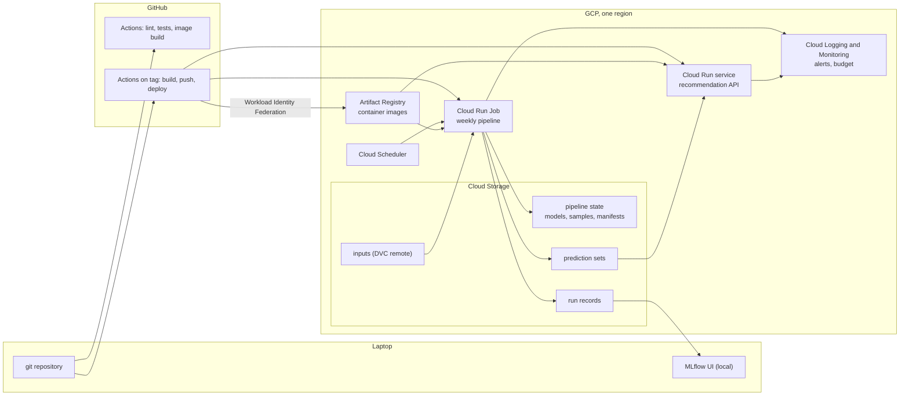

# Stage 3: MLOps on GCP

> **Status.** Approved by the user on 2026-11-21. Stage 3 starts with M10; progress and every later change are recorded in `docs/decisions.md`.
> **M10 (container and CI) was closed on 2026-11-22.** The acceptance of container and cloud results was simplified by the user on that day (§8.3); the calibration it rests on is described there as it was carried out, and the sections that referred to the earlier, tiered tolerance were aligned with it.
> **M11 (versioning) was closed on 2026-11-22**: §7 describes DVC, the bootstrap state, the run manifest and the MLflow view as they were built, and S2 states the verification that was used.
> **M12 (the weekly pipeline, local) was closed on 2026-11-22**: §6 and §7 describe the pipeline as it was built, §8.5 holds what the replay of eight weeks and one `serve` tick measured, and §10 the monitoring rules that were fixed before the first tick.
> **M13 (the pipeline on Cloud Run) was closed on 2026-11-23**: the job, its storage and its trigger are described as they were built (§5, §6.4, §7.2, §11), §8.6 holds the calibration of x86-64 and what the replay on Cloud Run measured, and §12 the measured cost and what is left in the project.
> **M14 (serving, rollback, alerting, deployment on a tag) was built and measured on 2026-11-23**: §9.1 describes the service as built and holds what was measured, §10.1 the alert lines, the alert policies and the provoked alerts, §11 the deploy workflow, and §12 the cost and what is left in the project.
> **Stage 3 was closed on 2026-11-23 (M15)**: the report section on stage 3 is `docs/final_report.md` §11, the designs that were written and not implemented are `docs/stage3_designs.md`, and by the user's decision the cloud is kept as a small live demo instead of being torn down (goal S8 as decided, §2; the demo state and its cost at rest, §12).
> Cloud limits and prices quoted below were read from the Cloud Run quota and pricing pages on 2026-11-21. What was written as an estimate before a milestone stays in the text as the estimate; where a measurement exists it is stated next to it.

---

## 1. Purpose and scope

Stages 1 and 2 produced a system that runs as a sequence of scripts started by hand on one laptop. Stage 3 turns the same system into something that runs every week without a person: in a container, on a schedule, with versioned inputs, recorded runs, automatic checks, a serving endpoint and alerts.

**Stage 3 changes how the system runs, not what it computes.** The six recall channels, the 71 features, the LambdaMART ranker and every lock file stay exactly as they are at tag `v0.2.1`.

The data end on 2020-09-22, so there is no live traffic. "Every week" is therefore simulated: the pipeline is given a date and behaves as if that date were today (§6.3).

## 2. Goals and acceptance criteria

| # | Goal | Accepted when |
|---|---|---|
| S1 | A reproducible runtime environment | One container image builds from the repository alone; `make lint` and `make test` pass inside it; the calibration week of §8.3 inside the container meets the acceptance of §8.3. **Met on 2026-11-22 for the arm64 container** (§8.3) |
| S2 | Versioned data and recorded runs | On a clean clone, `dvc pull` restores every pipeline input and the sha256 values match the records; every pipeline run is visible in MLflow with the same metrics as the result tables. **Met on 2026-11-22 for what exists before the pipeline** (§7.4): the remote holds every tracked file; a clean clone pulled `data/processed` and the category code table and their sha256 equal the data manifest; every metric of the MLflow view equals its source table. The view held imported records only at that time. **The rest was met in M12** (§8.5): the nine ticks of the replay are nine pipeline runs in the view, the model registry mirrors 17 model versions, and `make mlflow-check` reports 0 differences over 54 runs and 1,659 metric values |
| S3 | A weekly pipeline that is one command | `weekly --anchor DATE` runs a whole week, stops at the first failed check with the reason, and can be resumed; each of the eight replayed weeks, and their pooled MAP@12, meets the acceptance of §8.3 (relative difference at most 1.0% on the four quantities; the two structural checks pass). **Met on 2026-11-22 in the arm64 container** (§8.5): the largest difference of a weekly quantity is 0.74% (MAP@12 of T4), the pooled MAP@12 differs by +0.042%, and both structural checks pass in all nine ticks; stopping and resuming are shown by the tests and by the first tick of the replay, which was resumed |
| S4 | The pipeline runs on GCP on a schedule | A run triggered by Cloud Scheduler completes on Cloud Run Jobs, reads and writes only Cloud Storage, and meets the acceptance of §8.3; its run time and cost are recorded. **Met on 2026-11-22** (§8.6): the tick of V2 was started by Cloud Scheduler and completed on Cloud Run Jobs; every tick read its inputs from the bucket and wrote only into it; all eight weeks and the pooled MAP@12 are inside §8.3 (largest weekly difference 0.80%, MAP@12 of T4; pooled −0.11%); run time and cost of every execution are in `results/m13_cloud/executions.csv` |
| S5 | A serving endpoint | The endpoint returns the Top-12 of a customer from the latest published prediction set, falls back for unknown customers, and has measured cold-start and p95 latency. **Met on 2026-11-23** (§9.1): the service on Cloud Run answered 2,000 synthetic requests as the prediction set and the fallback list say (0 differences); the first request after scale to zero took 5.98 s and 6.31 s; warm p95 is 0.77 ms as the service measures it and 236 ms as a laptop on another continent sees it |
| S6 | Monitoring and alerts | A failed step, a failed data check, a quality flag and a budget threshold each produce an alert; this is shown by provoking each one once. **Shown on 2026-11-23** (§10.1) for a failed step, a failed input-data check, a quality alert and a failed load of a prediction set: each wrote its log line and its alert policy opened an incident; a failed execution of the job opened one too. **The budget threshold was not provoked**: the budget and its alerts exist since before M13 (§12). **The user confirmed on 2026-11-23 that the emails of the drills arrived, which completes the drill** |
| S7 | CI and CD | Every push runs lint, tests and an image build; a version tag builds, pushes and deploys without stored keys. From M13 a tag `image-*` builds and pushes the image without a stored key (§11); deploying on a tag is M14. **Met on 2026-11-23** (§11): a tag `deploy-*` built and pushed both images and updated the job and the service to the two digests, twice (2 min 45 s and 2 min 36 s), with Workload Identity Federation and no stored key |
| S8 | It stays cheap and leaves nothing that bills by the hour | Originally: "total spend stays under the budget of §12; at the end no billable resource remains". **Changed by the user on 2026-11-23**: the cloud is not torn down at the close; it is kept as a small live demo and torn down later with `infra/teardown.sh`. **Met as decided**: stage 3 used about 4.15 USD of compute at list prices (4.04 USD in M13, about 0.11 USD in M14), under the 50 USD of guardrail 1 (§12); nothing bills by the hour (no instance runs, the service scales to zero, the scheduler job is paused); the budget alert stays; and the cost at rest is recorded (§12: about 0.70 USD a month for 35.2 GiB of objects, at most 0.28 USD a month for the images) |

## 3. Non-goals

- **No change to models, features or locked configurations**, and no new experiment that selects anything.
- **No hyperparameter search**, neither inside the weekly pipeline nor as a separate job (decision D11). The weekly pipeline refits model parameters with locked hyperparameters (continuous training). When to re-select hyperparameters is a human decision; M15 wrote down a proposed rule as a design only (`docs/stage3_designs.md` §3).
- **No online A/B test.** There is no traffic. M15 delivered a written design only (`docs/stage3_designs.md` §1).
- **No real-time feature computation or online ranking.** §9 explains why the endpoint serves precomputed results.
- **No managed ML platform** (Vertex AI / Agent Platform pipelines or model registry) and **no Kubernetes**. The base stays DVC, MLflow, Docker and GitHub Actions, as decided on 2026-11-20.
- **No high availability**: one region, no always-on resource, scale to zero.
- **DeepFM is not deployed.** It cannot be told apart from LambdaMART and costs more memory (`docs/final_report.md` §10).
- **No Kaggle submission** in stage 3.

## 4. Invariants

These hold for all of stage 3 and are checked in code or in review:

1. Every prediction for an anchor uses only data from before the anchor. The simulated clock makes this the normal case, not a special rule.
2. Lock files, existing result tables and `docs/decisions.md` history are not modified. New records go to new tables.
3. **T1–T4 labels are read only by the replay** (the closing steps C1 and C2, the `eval`-mode query set, and the comparison with the M8 records), **never to select or tune anything.** The user approved this on 2026-11-21 (decision D1). Alert thresholds and flag rules are fixed and recorded before the first replay tick and are not changed after any T result is seen. T numbers produced by the replay are reported as a verification of the pipeline, not as a new evaluation.
4. The stage-1 records made on the laptop remain the reference. Container and cloud runs are accepted against them by §8.3: a relative difference of at most 1.0% on four quantities, and two structural checks. Bit-identity with the laptop is not the goal, and bit-identical repetition on one platform is not required (the environments differ; decision of 2026-11-22).
5. Code does not name a cloud project, bucket or region. They come from configuration.
6. No token, key or credential file is written to the repository, an image, a log or a document.
7. Full-data runs start from committed code; every run records its commit and image digest.
8. A budget alert exists before any billable resource is created (§12).

## 5. Target architecture



| Component | Choice | Why this one |
|---|---|---|
| Batch compute | Cloud Run Jobs | Runs a container to completion and bills per second; nothing to keep running. A job instance can have up to 8 vCPU and 32 GiB and a task can run for days, which covers the measured peak of about 8 GB with room to spare. Measured in M13: 6 vCPU and 24 GiB are enough (highest true peak of a process 7.53 GB); an `eval` tick takes 25 to 29 minutes, the `serve` tick 2 h 39 min |
| Fallback for batch | Compute Engine Spot VM | Only if a step does not fit Cloud Run Jobs, most likely because of local file space (§8.4) |
| Trigger | Cloud Scheduler | A cron entry that starts the job; also used to drive the replay |
| Storage | Cloud Storage | One place for inputs, state, predictions and run records; DVC and MLflow both work with it. As built in M13: three prefixes of one bucket, mounted into the job as volumes (§7.2) |
| Images | Artifact Registry | The registry Cloud Run pulls from |
| Serving | Cloud Run service, minimum instances 0 | Scales to zero, so an idle endpoint costs nothing |
| Observability | Cloud Logging and Cloud Monitoring | Already collects job and service logs; alert policies and budget alerts need no extra service |
| CI/CD | GitHub Actions with Workload Identity Federation | No long-lived key stored in GitHub |
| Run tracking | MLflow, viewed locally | No server to host or pay for (§7.3) |

**As built in M13** (`infra/`, `infra/README.md`):

- **One Cloud Run job** runs the pipeline's image, 6 vCPU and 24 GiB, one task, no automatic retry, a time limit of 6 hours. It is created from an image **digest**. Its own arguments are `scripts/weekly.py --next --mode eval`; the operator overrides them for one execution to run a given anchor, the `serve` tick, a calibration tick or the smoke test.
- **One bucket, three prefixes mounted as volumes** (Cloud Storage FUSE, each limited to its prefix): `inputs/` read-only, `pipeline/` (the state) and `pipeline-calibration/`. The pipeline reads and writes files; it has no Cloud Storage client and no new dependency. The DVC remote (`dvc/`) is not mounted.
- **One Cloud Scheduler job**, weekly (Wednesday 06:00 UTC), **paused**: it calls the Cloud Run API "run this job" as an account that may do nothing else. The job takes its anchor from the state (`--next`), so the request is the same every week.
- **Images** come from GitHub Actions through Workload Identity Federation (§11) into one Artifact Registry repository.
- **Five identities**: the job's runtime account (objects of the bucket, writing logs), the scheduler account (start a job), the deployer account (push images), the operator account (create and run the job and the scheduler job, read logs and metrics; used by impersonation, without a key), and the owner, who alone changes IAM (`infra/setup.sh`). No key file exists and nothing is public.
- **Not built in M13**: the serving endpoint, alert policies and deployment on a tag (M14).

**As built in M14** (`infra/`, `infra/README.md`; §9.1, §10.1, §11):

- **One Cloud Run service** runs the service's own image (§9.1): 1 vCPU, 1 GiB, minimum instances 0, maximum 2, authenticated calls only, and ONE volume: the state prefix `pipeline/`, read-only. It is created by the operator and gets its image from the deploy workflow.
- **A sixth identity**: the runtime account of the service, which can read objects of the bucket and write logs. The deployer account may now also update the job and the service (`roles/run.developer`) and attach their two runtime accounts; the operator may create the service and call it.
- **One email notification channel and five alert policies** (§10.1), created by `infra/setup.sh`.
- **A drill prefix** `pipeline-drill/` in the bucket: the states of the provoked alerts. The job and the service of the drills were deleted after them.

## 6. The weekly pipeline

### 6.1 One tick

The pipeline is called once per week with an anchor date `a` (the first day of the week to predict). One call is a **tick** and has two halves. Labels of a week exist only after the week has ended, so a week's predictions are scored by the next tick.

**Close the previous week** (its labels are now known):

| Step | What it does | Check that stops the pipeline |
|---|---|---|
| C1 Ingest | Make transactions up to `a − 1` available | Row count and date range of the new week; no row on or after `a` |
| C2 Evaluate | Score last week's published predictions against last week's purchases: per-channel recall, union recall, MAP@12 of the ranker and of the RRF baseline, hit value (§10). Skipped when no earlier prediction set exists (the first tick) | None; quality flags only (§10) |
| C3 Sample | Build the ranker training sample of last week with the locked method | sha256 recorded; row counts plausible |
| C4 Fine-tune R6 | Advance the Two-Tower chain by one week from the previous model | Previous model exists and matches its sha256; loss below the recorded stop limit |

**Open the new week:**

| Step | What it does | Check that stops the pipeline |
|---|---|---|
| O1 Recall | R1–R6 candidates as of `a` | Schema validation; scores equal to dot products of saved vectors |
| O2 Features | The 71 features | Row count equals the deduplicated candidates of this run; no duplicate key; feature lock matches |
| O3 Train ranker | LambdaMART on the last 4 closed weeks, locked configuration | Locked entry point checks (configuration id, lock sha256, library versions) |
| O4 Score | Top-12 per customer | 12 distinct valid article ids per customer; output signals of §10 recorded |
| O5 Publish | Write a new prediction set and switch the `current` pointer | The switch happens only if every earlier step passed |
| O6 Record | Write the run manifest: commit, image digest, inputs, outputs, metrics, timings, peak memory | — |

Every check in the right-hand column already exists in the code as a stop condition. Stage 3 wires them into one driver; it does not invent new ones.

**As built in M12** (`src/hmrec/weekly/`; `scripts/weekly.py --anchor DATE --mode eval|serve`, in the container `make image-weekly ARGS="…"`):

- **Every step is one process and one folder.** The driver starts `scripts/m12_step.py` once per step, so a step's process max RSS is its true memory peak and torch and LightGBM never share a process. O1 is seven processes (the query list, then one per channel); O3 is two (the binary Dataset, then the model); the model is saved and O4 loads it again, as the sharded path always did.
- **The steps call the stage-1 functions**, with the paths of the tick (`hmrec.paths.PipelinePaths`). Nothing of the system is computed by new code.
- **C4 before O1.** In stage 1 one process predicted a week with R6 and then fine-tuned on it. In a weekly pipeline the purchases of a week exist only after it, so the tick fine-tunes on the week it closes (C4) and predicts the new week with the resulting model (O1). The function and its seeds are the same.
- **The Ranker's configuration** comes through the tolerance-accepted entry in mode `accepted` (§8.3) on Linux, and through the strict entry on macOS.
- **C2 scores the published prediction set** (`predictions/{anchor}/`), builds the label sets of the closed week from the transactions the tick ingested, and requires the query list written a week earlier to be the one those purchases give.
- **The input-data check of C1 stops the tick** (row count of the new week outside 50%–200% of the mean of the previous 4 weeks, or a wrong date range; §10). Every other monitoring rule only records.

### 6.2 Two modes

| Mode | Customers | Purpose | Cost |
|---|---|---|---|
| `eval` | Only the customers who bought in the predicted week | Compare with the stage-1 records week by week; this is the acceptance test of S3 and S4 | About a normal week of stage 1. Measured in the arm64 container (M12): 14 to 15 minutes per tick, peak 7.25 GB |
| `serve` | All 1,371,980 customers | Produce the prediction set the endpoint serves | About 18 times more candidates; the Kaggle run took 56 minutes on the laptop. Measured in the arm64 container (M12): 86 minutes, peak 6.15 GB, 20 shards |

`eval` mode knows who will buy, which a real system cannot know; it exists only to make the replay comparable with recorded numbers. This does not distort the metrics: a customer's candidates, features and score depend only on that customer and on data before the anchor, not on which other customers are in the run, so a buyer receives the same Top-12 in both modes. `serve` mode is what production would run. Its sharded code path existed on branch `kaggle-late-submission` and was brought into main in M12 without the Kaggle-specific parts (`hmrec.weekly.shard_recall`, `hmrec.weekly.shard_features`; no submission file, no Kaggle id handling).

### 6.3 Simulated clock and replay

- The anchor date is the only clock. The pipeline never asks for the real date.
- **The clock is enforced by construction** (M12). Step C1 copies every purchase line with `t_dat` before the anchor from `data/processed/transactions.parquet` into the tick's own folder, in the same row order. Every later step is given that file as its transactions table and cannot read a later row: its input does not hold one. The as-of filters of stage 1 still run on top of it, unchanged. **Two readers of the full table exist**: C1 itself, and the query list of `eval` mode, which by definition needs to know who buys in the predicted week (§6.2); a test counts the callers. The container of a tick mounts only the DVC-tracked inputs (`data/processed`, `data/bootstrap`, the category code table), read-only, so no stage-1 candidate, feature, label or model can be read either.
- **Bootstrap state** is the state at the end of F4: the R6 chain model after F4, the ranker samples of F1–F4, and the monitoring history. It is stored once, in `data/bootstrap/` (§7.1 lists its files). F4 is closed in that state, so the V1 tick only opens a week: its closing half has nothing to do.
- **Replay: eight ticks in `eval` mode, V1, V2, V3, V4, T1, T2, T3, T4** (decision D1), followed by **one `serve` tick at anchor 2020-09-23**, the week after the data end and the same week as the Kaggle submission. The `serve` tick closes T4 (so T4 is scored too) and produces the prediction set for the endpoint. Its labels do not exist.
- Eight weeks give the monitoring rules of §10 enough history to act on, and the V-to-T shift recorded in `docs/final_report.md` (T about 20% above V, with more concentrated purchases and more new articles) is a real distribution change for the monitoring to see.
- **Replay acceptance** (§8.3): for each week, the recall of every channel, the union recall and MAP@12 of the `eval`-mode run differ from the stage-1 record by at most 1.0% relative; so does the pooled MAP@12 over the replayed weeks, compared with the same pooling of the stage-1 records; and in every tick the feature rows equal the deduplicated candidates of the same run with no duplicate key. The records are `results/m6_candidates.csv` and `results/v_phase_metrics.csv` for V1–V4 and the M8 result tables for T1–T4. Pair overlap of the candidates, the deduplicated candidate count and bit-equality of scores are reported for every week and are not acceptance criteria.
- **`serve` tick diagnostic** (reported, not an acceptance criterion): the Top-12 overlap with the saved Kaggle prediction set, which used the same locked configuration, the same R6 chain and a ranker trained on T1–T4. Nothing is submitted.

### 6.4 State and resuming

- All state lives in Cloud Storage under a prefix per anchor. A step writes its outputs under a temporary name and renames them when its checks pass; an output that exists is never overwritten.
- `state/current.json` points to the latest closed week, the model files with their sha256, and the current prediction set. It is replaced only by step O5.
- Running the same tick again skips finished steps. A tick for week `w + 1` refuses to start if week `w` is not closed, so a week cannot be skipped. This is the same rule the R6 chain already enforces.

**As built in M12** (`hmrec.weekly.storage`, `hmrec.weekly.state`, `hmrec.weekly.driver`):

- **In M12 the state is a local folder**, `artifacts/pipeline/`, behind a small interface (`StateStore`: exists, read, write once, replace, commit a folder, set a folder aside, discard a folder). M13 keeps the same keys in Cloud Storage (below).
- **Staging**: a step writes into `weeks/{anchor}/.staging/{step}/`. The driver renames the folder to `weeks/{anchor}/{step}/` when the step's process ended without an error; a rename is the only way an output appears, and it refuses an existing target.
- **A failed attempt is kept**: its staging folder is moved to `weeks/{anchor}/.failed/{step}.{n}/`. It is never deleted and never reused; the next run of the tick starts that step again.
- **Every run of a tick has its own id and manifest** (`{anchor}-{mode}-a{n}`; no clock is asked). A failed run writes a manifest too, with the step that stopped it and the reason the step's process gave.
- **"The previous week is not closed"** is checked as "the tick before this one has finished": the previous week must have published predictions. A tick closes the week before its anchor itself, so this is the condition that can be checked before it starts. The first tick starts from the bootstrap state.
- **A week keeps the mode of its first run**, and **a week opened in `serve` mode cannot be closed**: closing needs the features of the customers who bought, and a `serve` tick removes a shard's features after scoring (§8.4). The replay ends with its `serve` tick, so it does not meet this; a pipeline that serves every week has to decide whether to keep the buyers' features or to build them again at closing.

**As built in M13** (`hmrec.paths.tick_root_paths`, `hmrec.weekly.storage.MountedStateStore`, `hmrec.weekly.state.next_tick_anchor`):

- **Where a tick reads and writes comes from two environment variables**: `HMREC_PIPELINE_INPUTS_ROOT` (a folder with `data/processed/`, `data/bootstrap/` and `artifacts/features/category_codes.json` in their plain layout) and `HMREC_PIPELINE_STATE_ROOT` (the state and, inside it, the result tables). On Cloud Run they are the mount points of two prefixes of the bucket. Neither is set on the laptop, where a tick is the tick of M12. Code names no bucket.
- **The state root lies directly on the mounted bucket**; no in-memory working copy is used (the smoke test of §8.6 decided this).
- **A bucket has no folders, so no folder is renamed there** (the mount refuses it). A finished step is committed by moving its files one by one and its record (`step.json`, which the step writes last) **last**; an output is complete if and only if its record is there. A commit that began and did not end is completed by the next run of the tick, and the step is not computed again. On a local disk the rename of M12 is unchanged.
- **`--next`** takes the anchor from `state/current.json`: one week after the current prediction set, or the first tick if nothing is published. A tick that stopped did not move the pointer, so the same request resumes it. This is what the scheduler runs.
- **A calibration tick** (`--calibration`) writes everything under a state of its own next to the state (`pipeline-calibration/`) and gets the Ranker configuration in calibration mode (§8.3). Its run manifest carries the metric `tick/calibration`.
- **A run manifest names a file by its key in the bucket** (`inputs/data/processed/...`, `pipeline/weeks/...`) and holds the image digest of the job.

**Changed in M14** (`hmrec.weekly.rollback`, `hmrec.weekly.state.next_tick_anchor`):

- **`state/current.json` has a second writer: the rollback command** (§9.1). It points the file at another PUBLISHED prediction set and writes nothing else; step O5 stays the only writer that publishes.
- **`--next` follows the latest published week, not a rolled-back pointer.** It walks from the pointer's week over the weeks that have a published marker, so the tick after a rollback is the one that was due anyway and its step O5 moves the pointer forward again. Without a rollback the answer is the one of M13. That tick closes the latest published week by scoring the set that was PUBLISHED for it, not the older set that was served during the rollback.

## 7. Data, state and run versioning

### 7.1 What is versioned with DVC

| Tracked with DVC (remote: Cloud Storage) | Files | Size | Not tracked |
|---|---|---|---|
| `data/raw/`: `articles.csv`, `customers.csv`, `transactions_train.csv` | 3 | 3.73 GB | `data/raw/sample_submission.csv`: no step of the pipeline reads it (`.dvcignore`) |
| `data/processed/`, the whole folder: the five tables and id maps with `metadata.json`, the article embeddings by index, and the two folders of precomputed embeddings (`image_features/`, `text_features/`) | 19 | 1.37 GB | Candidates and features of stage 1 (17.8 GB): they are regenerated by the pipeline |
| `data/bootstrap/`: the bootstrap state of §6.3 | 15 | 1.07 GB | `artifacts/kaggle/` (about 30 GB) |
| `artifacts/features/category_codes.json` | 1 | 3.6 kB | Models and samples the pipeline creates: they are pipeline state, recorded by manifest and sha256 |

**Correction of the first version of this table** (2026-11-22): it placed "the two embedding files" in `data/raw/`. They are `data/processed/image_features/image_embeddings.npy` and `data/processed/text_features/text_embeddings.npy` and are tracked with the folder `data/processed/`. That folder is tracked whole, so it also holds two FAISS index files (377 MB) that no step reads; leaving them out would have meant a tracked folder that is not the folder on disk.

- **git holds four pointer files** (`data/raw.dvc`, `data/processed.dvc`, `data/bootstrap.dvc`, `artifacts/features/category_codes.json.dvc`) **and the data manifest `configs/data_manifest.json`**: path, size, sha256 and md5 of each of the 38 tracked files. DVC names a file by md5; the project records files by sha256, and the raw CSV files, the id maps and the embedding files had no sha256 record in stage 1. The manifest is written from the files on disk (`make data-manifest`); a file whose md5 is not the one DVC tracks stops it. After a pull, `make data-verify` compares the files with the manifest.
- **The remote is the prefix `dvc/` of a private bucket.** The repository is public, so the bucket's name is not in it: the tracked `.dvc/config` holds the remote's name (`storage`), and its URL is in `.dvc/config.local`, which git does not track. The competition data are not redistributed.
- **`.gitignore` ignores `/data/?*` and `/artifacts/?*`** and lets the pointer files back in. `?*` and not `*`: DVC reads `.gitignore` with its own matcher, which takes the folder `data/` itself as ignored by `/data/*` and then finds no pointer file (`dvc status` and `dvc pull` saw no tracked data until this was changed).
- **DVC and MLflow are not in the pipeline image and not in the development environment.** They are in two dependency groups of `pyproject.toml` (`versioning`, `tracking`) and are installed into a second environment, `.venv-tools` (`make setup-tools`). Adding them changed no version of an existing package (`uv export` of the runtime and dev dependencies is byte-identical before and after). They stay out of `.venv` because, with pandas installed, the type checker reads LightGBM's optional types differently and reports an error in unchanged M7 code.

**The bootstrap state** (`data/bootstrap/`, built by `scripts/m11_bootstrap_state.py`; `hmrec.bootstrap_state` holds the reasoning). Its files are what the V1 tick reads, traced through the stage-1 code:

| File in `data/bootstrap/` | Stage-1 source | Why the first tick needs it | sha256 checked against |
|---|---|---|---|
| `models/twotower/base/epoch_4.pt` | `artifacts/models/twotower/base/epoch_4.pt` | Loading any R6 model first reads the base checkpoint | the R6 lock |
| `models/twotower/chain_locked/F4.pt` | `artifacts/models/twotower/chain_locked/F4.pt` | The chain model after the F4 fine-tune predicts V1 and is the start of the next fine-tune | `results/m6_twotower_chain.csv`, row F4 |
| `twotower/data/base/customer_idx.npy` | `artifacts/twotower/data/base/customer_idx.npy` | The alarm users of every fine-tune are drawn from this array | the R6 lock |
| `ranker/samples/full/{F1,F2,F3,F4}/r40.parquet` and `r40.json` | `artifacts/ranker/samples/full/…` | The ranker that predicts V1 is trained on these four weeks (window and ratio from the ranker lock) | the record `r40.json` of each sample |
| `monitoring/m6_twotower_chain.csv` | `results/m6_twotower_chain.csv`, rows F1–F4 | The history of the R6 chain | — |
| `monitoring/m6_candidates.csv` | `results/m6_candidates.csv`, rows F1–F4 | Recall of each channel, union recall and candidates per query of the four weeks before V1: what the rules of §10 compare V1 with | — |
| `monitoring/m6_features.csv` | `results/m6_features.csv`, rows F1–F4 | Missing rate and mean of every feature in those weeks | — |
| `manifest.json` | — | For every file above: source path, size, sha256, the sha256 of the source and where stage 1 recorded it | — |

- Stage-1 files are copied, never moved or changed: each source is compared with its stage-1 sha256 record before the copy, and the copy with the source after it. The three tables are not copied whole; only the header and the rows of F1–F4 are kept, byte for byte, so the state holds nothing of a later week.
- R1–R5, the features and the query sets need no state: they are computed from `data/processed/`.
- **The output signals of §10 that need a ranking** (share of recommended items among the 100 most popular, number of distinct articles, share served by the fallback) **have no history before V1**: stage 1 ranked no F week. Their bands start with the first ticks; how the rule treats the first four weeks is fixed in M12 with the other thresholds, before the first replay tick.

### 7.2 Storage layout

```
gs://<bucket>/
  dvc/                         DVC remote (content-addressed)
  state/current.json           pointer to the latest closed week and prediction set
  weeks/<anchor>/              candidates, features (see §8.4), samples, models, checks
  predictions/<anchor>/        one prediction set: ids, Top-12, manifest
  runs/<run-id>/manifest.json  one record per tick
```

On the laptop the same layout lies under `artifacts/pipeline/` (`artifacts/pipeline/runs/<run-id>/manifest.json`); the DVC remote is the only prefix that exists in the bucket before M13.

**The bucket as built in M13.** The state has a prefix of its own, so that the job can be given exactly the prefixes it needs:

```
gs://<bucket>/
  dvc/                     DVC remote (M11); never mounted
  inputs/                  the pipeline's inputs in their plain layout: data/processed/,
                           data/bootstrap/, artifacts/features/category_codes.json
                           (35 objects, 2.43 GB; size and md5 equal configs/data_manifest.json)
  pipeline/                the state: state/current.json, weeks/<anchor>/, predictions/<anchor>/,
                           runs/<run-id>/, and results/ (the pipeline's tables)
  pipeline-calibration/    the same layout, written only by calibration ticks
```

The small records of a state (manifests, step records, markers, tables) are copied to the laptop with `bash infra/operate.sh download-records` (`artifacts/m13_cloud/`, not in git); the tables are committed under `results/m13_cloud/`. Candidates, features, samples, models and vectors stay in the bucket.

**The folder of a week, as built in M12** (a week is named by its anchor; `hmrec.paths.StateLayout`):

```
weeks/2020-08-05/                written by the tick at 2020-08-05 (it opens this week)
  tick.json                      the mode of the week's tick
  ingest/                        C1: transactions.parquet (every row before the anchor), ingest.json
  queries/                       O1: queries.parquet
  recall_{channel}/              O1: candidates.parquet; R1's bucket score table; R5 and R6 vectors
  features/                      O2: part-*.parquet, features.json, feature_stats.csv
  ranker_dataset/, ranker_model/ O3: train.bin, dataset.json; model.txt, model.json
  scores/                        O4: top.parquet, signals.json
  published.json                 O5 is done
  monitoring.json                the findings of this tick
                                 written by the tick at 2020-08-12 (it closes this week)
  evaluation/                    C2: labels.parquet, metrics.json, per_query.parquet
  sample/                        C3: r40.parquet, r40.json
  twotower/                      C4: the chain model fine-tuned on this week, chain_record.csv
  closed.json                    C2-C4 are done
  .staging/, .failed/            running and failed attempts of steps
predictions/2020-08-05/          top.parquet (customer_idx, rank, article_idx), manifest.json
  serving/                       M14: the same predictions as the service loads them (§9.1):
                                 customer_ids.npy, top_articles.npy, article_ids.npy, serving.json
runs/2020-08-05-eval-a1/         manifest.json, logs/{step}.log, failures/{step}.txt
```

- Every step folder holds a `step.json`: seconds, the true memory peak and the platform fields of the step's process, the metric values it measured and the files it wants recorded.
- In `serve` mode a channel's folder holds `shards/{k}/` with the candidates and vectors of each shard, and the week has `features_shared/` and `shards/{k}/top/`; `shards/{k}/features/` exists only while shard k is being scored.
- **The prediction set holds the dense indexes of `data/processed/`**, not the 64-character customer ids, and names the two id-map files with their sha256 in its manifest.
- The pipeline's result tables are `results/m12_replay/` (run steps, metric values, monitoring findings, label access, the comparison with the stage-1 records, the R6 chain records).

### 7.3 Run tracking

- Every tick writes a manifest and appends to the result tables, exactly as stage 1 does. These files are the source of truth.
- **The run manifest** (`hmrec.run_manifest`, schema version 1; one JSON file per tick, written once under a temporary name and renamed, never replaced):

  | Field | Content |
  |---|---|
  | `run_id`, `anchor`, `mode` | Which tick; `eval` or `serve` |
  | `status`, `failure` | `succeeded`, or `failed` with the reason |
  | `git_commit`, `git_dirty`, `code_tree_sha256` | The code: inside an image the image's commit and its verified code-tree hash |
  | `image_digest` | The registry digest, when the runner passed it (`HMREC_IMAGE_DIGEST`); `null` otherwise. An image cannot know its own digest when it is built |
  | `platform` | The platform fields of the driver process (`hmrec.platform_fields`) |
  | `inputs`, `outputs` | Files with role, path, size and sha256 |
  | `metrics` | Name, **week** and value. A metric names the week it describes, because a week's predictions are scored by the next tick |
  | `steps` | Per step: status, seconds, the true peak memory of the step's process, and the platform fields of that process (the OpenMP runtime differs between steps, §8.1) |
  | `started_at_utc`, `finished_at_utc`, `total_seconds` | Timings of the tick |
  | `driver_max_rss_gb`, `max_process_rss_gb` | True peak memory of the driver, and the largest of any process of the tick |

  The reader refuses another schema version, a missing or unknown key, and a `max_process_rss_gb` that is not the largest recorded peak. The peak and the platform fields come from the existing run-record code (`hmrec.memory`, `hmrec.platform_fields`, `hmrec.git_state`).
- MLflow is the **view**: a local command (`make mlflow-sync`) reads the manifests and the result tables and logs each run (parameters, metrics, tags for commit and image digest) into a local MLflow store. No tracking server runs in the cloud. In M11 the manifests are read from the local folder; from M13 on they are first copied from Cloud Storage.
- **The store is one SQLite file** (`artifacts/mlflow/mlflow.db`, not in git): the pinned MLflow version (3.18) refuses a plain folder of files as a store. It can be deleted and rebuilt at any time; a sync never changes a run that is already there. `make mlflow-ui` serves the UI on this machine only.
- **First content, imported records**: the stage-1 weekly records of V1–V4 and T1–T4 (recall of each channel, union recall, MAP@12 of the ranker and of the RRF baseline; 8 runs) and the M10 calibration (one run per calibration run, item and scope; 37 runs). They are logged with the tag `hmrec.record_kind = imported_record` in experiments named "(imported)", because they were made before the pipeline existed. Reading the stage-1 result tables of the T weeks reads recorded numbers; no label is read.
- **`make mlflow-check` compares every metric in the store with its source.** Every metric carries a tag that names the file, the row and the column it came from; the check reads that row again with its own reader and requires equal float64 values, not close ones. It also reports a missing run, a run that is not expected, and a differing set of metric keys.
- Reason for a local view: a hosted tracking server needs an always-on service and a database, which breaks goal S8. If a team used this system, the server would be the first thing to add.
- The MLflow model registry records each weekly ranker and each R6 chain model by storage path and sha256, with one alias for "the model behind the current prediction set". **The registry is a mirror.** The pipeline and the endpoint never read MLflow; what is deployed is decided by `state/current.json`. Reports and interviews describe it that way. **The registry is set up in M12**, when the pipeline produces models; M11 registers nothing.
- **The registry as built in M12** (`hmrec.tracking.registry`): two registered models, `hmrec-ranker` and `hmrec-twotower-chain`. A version is created for every model file a succeeded tick recorded in its run manifest (output roles `ranker_model` and `r6_chain_model`); its source is the file's path and its tags hold the sha256, the size, the run id and the tick's anchor. No file is copied. The alias `current` is set on the two versions `state/current.json` names, matched by sha256. `make mlflow-check` compares the registry with the manifests, hashes every mirrored file again, and compares the alias with the state.
- **Flags and alerts in a run manifest** (M12) are metric entries: `monitor/flag/{rule}/{subject}` and `monitor/alert/{rule}/{subject}` with the value 1 and the week they describe, and the two counts `monitor/flags_raised` and `monitor/alerts_raised`. The manifest schema stays at version 1. A metric two steps measure is recorded once; two steps that report different values for one metric stop the tick.
- **The replay on Cloud Run in the view** (M13, `hmrec.tracking.cloud`): the run manifests copied from the bucket are logged as pipeline runs in experiments of their own (`weekly-pipeline (cloud run)`, and `weekly-pipeline calibration (cloud run)` for the two calibration ticks), with the platform, the commit and the image digest as tags. The laptop's replay and the cloud's have the same run ids, so their records and their registered models are kept apart (`hmrec-ranker-cloud-run`, `hmrec-twotower-chain-cloud-run`). A cloud model version points to the object's key and carries the sha256 the manifest recorded; **its file is in the bucket and is not hashed again on the laptop**, which `make mlflow-check` says in its result.
- Neither tool reports usage from this repository: DVC's analytics and MLflow's telemetry are switched off.

### 7.4 What M11 verified

Measured on 2026-11-22 on the laptop. No label was read and no model was trained.

| Check | Result |
|---|---|
| Tracked with DVC | 38 files, 6,164,751,861 bytes: `data/raw` 3 files, 3.731 GB; `data/processed` 19 files, 1.365 GB; `data/bootstrap` 15 files, 1.068 GB; the category code table, 3,575 bytes |
| Upload | Two `dvc push` runs: 38 min 07 s (raw, processed, category codes) and 8 min 24 s (the bootstrap state); 46 min 31 s in all, about 2.2 MB per second |
| In the bucket | 40 objects, 6,002,642,515 bytes, all under `dvc/`: 37 file contents and 3 folder records. Two tracked files are byte-identical (`data/processed/embeddings/text_by_article_idx.npy` and `data/processed/text_features/text_embeddings.npy`) and are stored once |
| `dvc status --cloud` | "Cache and remote 'storage' are in sync." |
| Clean clone | A fresh clone of the branch in a temporary folder, with the remote set in its own `.dvc/config.local`; `dvc pull data/processed artifacts/features/category_codes.json` fetched 20 files in 1 min 49 s. `scripts/m11_data_manifest.py verify --only …`, run with the clone's code: 20 files, 1,365,150,885 bytes, 0 problems |
| Manifest against the stage-1 records | The 10 files that `configs/m10_calibration.yaml` records by sha256 have the same sha256 in the manifest; the base checkpoint, the F4 chain model and the alarm-user array of the bootstrap state equal the R6 lock and `results/m6_twotower_chain.csv`; each sample equals its record. The 3 raw CSV files and 11 of the 19 processed files had no sha256 record before |
| MLflow view | `make mlflow-sync` wrote 45 records (8 weekly records, 37 calibration records); a second sync wrote none. `make mlflow-check`: 45 runs, 905 metric values, 0 differences |

**What this does not show.**

- `data/raw` and `data/bootstrap` were uploaded and DVC reports them in sync, which compares the names of the objects (the md5 of each file); they were not downloaded and hashed again, because download from Cloud Storage is charged (§12).
- No pipeline run exists yet. That a run manifest becomes an MLflow run whose metrics equal the manifest is shown by the tests with a synthetic manifest; the first real one is the V1 tick of M12.
- The view was checked against the tables it was built from. It says nothing about whether those tables are right.

## 8. Environment and reproducibility

### 8.1 The image

- Base: a slim Python 3.12 image, pinned by digest. Dependencies installed with `uv sync --frozen` from `uv.lock`. The OpenMP runtime LightGBM runs on comes from the image and is pinned there (the Debian package `libgomp1`, by exact version in the `Dockerfile`). This removes the limitation that libomp sits outside `uv.lock` (`docs/final_report.md` §7.2 item 17).
- **torch on Linux comes from the PyTorch CPU-only index.** The default PyPI wheel for Linux x86-64 pulls several GB of CUDA libraries that this project never uses. The index is set in `pyproject.toml` for Linux only and `uv.lock` is regenerated; macOS resolution must stay unchanged, which is checked by comparing the macOS entries of the lock before and after. This is a dependency change (D6).
- **The image carries its commit.** There is no `.git` inside a container, so an image is built only from a clean, committed tree, and the commit hash is stored in the image (label and environment variable). Run records take the commit from there and add the image digest (invariant 7).
- **The image carries the hash of its code tree** (decision of 2026-11-22). It is computed at build time over the files that may enter the image (without `results/`), stored in the image, computed again at the start of a run and compared; a mismatch refuses the run, and run records hold the hash next to the commit. **It guards against accidental mounts and edits, not against deliberate replacement**: the stored hash and the commit are both read from inside the container, so someone who replaces both is not detected.
- **Which OpenMP runtime each process uses** (measured in the arm64 image, recorded in every row of `results/m10_calibration/runs.csv`):

  | Process | OpenMP runtime | Pinned by |
  |---|---|---|
  | LightGBM (Dataset, training, scoring) | the system GNU runtime, `libgomp1 14.2.0-19` | the package version in the `Dockerfile` |
  | Recall, R1–R6 (`implicit` for R5, torch for R6) | the copy of libgomp inside the torch wheel. These processes import torch first, and the loader keeps that copy for the whole process | the torch version in `uv.lock` (`2.15.0+cpu`); the platform record identifies it by that version |
  | Feature build | none (polars and numpy only; numpy uses the OpenBLAS inside its wheel) | `uv.lock` |

- **Two runtime settings apply on Linux only; the laptop runs exactly as in stage 1.**
  - **R6 fine-tuning uses `torch.use_deterministic_algorithms(True)`**, for the duration of the fine-tune only. Without it two fine-tunes of the same week give different weights; with it they are bit-identical (measured on arm64 with real data and on x86-64 with the synthetic reproducer, 2026-11-22). The setting costs no measurable time on a real week (199 s and 200 s with it, 198 s and 200 s without). It stays because it is implemented and free; bit-identical repetition is not an acceptance criterion (§8.3).
  - **During an R5 fit the BLAS of scipy runs on one thread**; `implicit` keeps its 6 OpenMP threads. Only scipy's BLAS is limited: limiting every BLAS also changes torch's thread count on arm64. `implicit` still prints its warning once, because it looks at every BLAS of the process.
- No data, model or credential is copied into the image. Data are mounted (laptop) or read from Cloud Storage (cloud).
- torch and LightGBM stay in separate processes, as today.
- `num_threads` stays 6. A Cloud Run job with 6 vCPU can have 4 to 24 GiB of memory; 6 vCPU and 24 GiB is the starting shape.

### 8.2 Three environments

| Environment | CPU and OS | Role |
|---|---|---|
| Laptop, native | Apple silicon, macOS, libomp | Where the stage-1 records were made; they are the reference of §8.3 |
| Container on the laptop | arm64 Linux | Development and the acceptance of S1 and S3 |
| Cloud Run | x86-64 Linux | The acceptance of S4. Accepted platform since 2026-11-22 (`configs/platforms/linux-amd64.yaml`, §8.6) |

The cloud image is built for x86-64 by CI, not on the laptop (emulation is too slow to be useful). CI also runs lint and both test suites inside that image, so x86-64 problems show up from M10 on, long before M13. The image that runs on Cloud Run is built the same way by a second workflow, from a tagged commit, and pushed to the registry (§11).

### 8.3 Acceptance across environments

Different operating systems, CPU architectures, OpenMP runtimes and BLAS libraries change the order of floating-point sums, so a container or cloud result is not bit-identical to the laptop. **The environments differ, so bit-level reproduction is not the goal; a difference within 1% is acceptable** (the user's decision of 2026-11-22, `docs/decisions.md`). This section replaces the tiered, provisional tolerance of the first version of this document.

**Acceptance criteria.** A container or cloud result is accepted against the stage-1 record when the relative difference, |result − record| / record, is at most **1.0%** for each of:

| # | Quantity |
|---|---|
| 1 | Recall of a channel in a week (each of R1–R6) |
| 2 | Union recall of a week |
| 3 | MAP@12 of a single week |
| 4 | Pooled MAP@12 over the replayed weeks |

**Two structural checks stay**, because they detect bugs and not numeric differences:

| # | Check |
|---|---|
| 5 | The feature rows of a run equal the deduplicated candidates of the same run |
| 6 | No (query, article) key repeats in the features |

**Reported, not an acceptance criterion**: the pair overlap of the candidates of every channel with the record, the deduplicated candidate count, and bit-equality of scores. **Bit-identical repetition on the same platform is not required**, and no extra run is made to verify it.

- These are engineering thresholds, not statistical tests. For scale: LambdaMART varies by 0.07% across seeds on V, and one week differs from another by up to 41%.
- **The thresholds are fixed for the arm64 container** (platform record `configs/platforms/linux-arm64.yaml`) **and are not changed after a replay result is seen.** The same thresholds hold for x86-64 on Cloud Run (`configs/platforms/linux-amd64.yaml`, M13).
- A difference above 1.0% on an acceptance quantity, or a failed structural check, stops the milestone and is investigated step by step, starting from the first step that differs; it is not explained away.
- Calibration and replay outputs go to new locations and new tables. They never overwrite a stage-1 artifact or result.

**The calibration these thresholds rest on** (M10, 2026-11-22; week V4; arm64 container on the laptop, `--cpus 6 --memory 12g`, inputs mounted read-only; one item per container; tables in `results/m10_calibration/`, records in `docs/decisions.md`). No label of a T week was read; nothing was tuned or selected.

| Item | What was run | Acceptance quantity | Measured against the stage-1 record |
|---|---|---|---|
| A | R1, R2, R3, R4 candidates of V4 | recall of each channel | 0% (the files have the same sha256 as the stage-1 files) |
| B | One R5 fit as of V4, with its candidates | Recall@100 | −0.0036% |
| C1 | R6 candidates of V4 from the **recorded** model of V3, no training | Recall@100 | 0% |
| C2 | The stage-1 R6 process of V3 replayed (the recorded model of V2 predicts V3 and is fine-tuned on it), then R6 candidates of V4 from the resulting model; run four times | Recall@100 | −0.017% and −0.048% (without the deterministic setting); −0.019% twice (with it) |
| Union | The run's own six channels of V4, fused | union recall | −0.022% |
| D | LightGBM trained on the four recorded sample files, scoring the **frozen** stage-1 features of V4 | MAP@12 | 0% (the model has the same sha256 as the stage-1 model) |
| E | End to end: features built from the container's own candidates, scored with the model of item D | MAP@12 | +0.0054% |
| E | | feature rows = deduplicated candidates of the run; duplicate keys | 22,293,932 = 22,293,932; 0 |

The largest relative difference on any acceptance quantity was 0.048%. The pooled MAP@12 (quantity 4) needs several weeks and was first measured by the replay of M12 (§8.5).

Reported in the same calibration, for information:

| Quantity | Measured |
|---|---|
| Recorded (customer, article) pairs present | R1–R4 100%; R5 99.98%; R6 from the recorded model 99.99997%; R6 after one fine-tune 99.75% |
| Deduplicated candidates of V4 | 22,294,520 and 22,293,932 in two runs against 22,293,247 (+0.0057%, +0.0031%) |
| Bit-equality of scores | R1–R4 yes; R5 and R6 no |
| End to end (item E) | Recall@12 +0.100%, NDCG@12 +0.038%; 72.5% of the queries have an identical Top-12 list, 93.4% the same 12 articles; mean Top-12 overlap 99.45% |
| Two container runs of the same item | R5 and LightGBM bit-identical; the R6 fine-tune only with the deterministic setting of §8.1 |

**Procedure.**

1. M10 measured the items above in the arm64 container; the user fixed the criteria on 2026-11-22 and the platform record was written. Done.
2. M13 starts with a calibration on Cloud Run (x86-64), declared in advance as calibration, and a platform record for that platform. Until then x86-64 is covered only by CI (lint, tests, and the synthetic R6 reproducer). **Done on 2026-11-22** (§8.6): two ticks in calibration mode; every quantity of V1 inside 1.0% (largest 0.013%); platform record `configs/platforms/linux-amd64.yaml`, with the thresholds of the arm64 record.
3. Thresholds are not changed after any replay result is seen.

**What the calibration does not show**: one week and one R6 update, not the eight chained updates of the replay (measured in M12, §8.5); one platform for the full-data items; and nothing about whether the results are good (§16).

### 8.4 A constraint to design around: local files on Cloud Run use memory

On Cloud Run the writable filesystem is in memory, so every file a step writes locally counts against the instance's memory limit. One week's features are about 1.5 GB (measured in the container for V4: 1.4 GB); a `serve` run produces about 26 GB of features in total.

- `eval` mode: files of one week plus the process peak fit in 24 GiB by estimate. Measured in the arm64 container for V4: the highest true peak of any process was 6.02 GB (the feature build; 5.67 GB when the fused table of the six channels is built in one piece), with files on a mounted disk. **Measured over the eight `eval` ticks of the replay (M12)**: the highest true peak of any process was 7.25 GB (the feature build of T1; 5.24 to 7.25 GB over the weeks), and the files one tick writes are about 2.6 GB (features 1.3 GB, Ranker Dataset 0.6 GB, sample 0.2 GB, the ingested transactions 0.16 GB, candidates 0.25 GB). With in-memory files on Cloud Run it is to be measured in M13.
- `serve` mode: features are produced and scored shard by shard and each shard's features are deleted after scoring, so local files stay near one shard (about 1.5 GB). This needed a change to the sharded driver, but no change to any computation. **Measured in the `serve` tick of the replay (M12)**: 20 shards of 70,000 customers; the highest true peak of any process was 6.15 GB (the feature build of a shard; the R6 recall step 6.11 GB); the files the tick keeps are 5.3 GB (the candidates of the six channels 4.2 GB, the Ranker Dataset 0.6 GB, the scores of the Top-12 0.15 GB), and the features of a shard exist only between its two steps.
- If this is still not enough: mount the bucket as a volume, or run that step on a Spot VM with a disk. The choice is made on measurements in M13, not now.

**Measured in M13** (§8.6). The bucket is mounted as a volume and the state lies directly on it, so a step's output files are written through the mount and are not kept on the instance's in-memory file system. This was the first design tried and it was enough:

- **Memory.** The highest true peak of a process on Cloud Run was 7.53 GB in an `eval` tick (the feature build of T1) and 6.35 GB in the `serve` tick, as in the arm64 container. Cloud Monitoring, which samples the instance once a minute, saw at most 4.3 GiB of the 24 GiB (18%) in any tick. 24 GiB is far more than is used; a smaller shape was not tried, because the shape is decision D10 and nothing required a change.
- **What the mount can and cannot do** (the smoke test, one execution): sequential writes at 52 MB/s and reads at 210 MB/s for a 1 GB file; parquet, npy, a write at an offset, appending, renaming and replacing a file, listing and existence all behave as on a disk. **Renaming a folder is refused**; the pipeline does not need it (§6.4). The mount logs `fallocate: function not implemented` once per tick, from a library that asks for space in advance and then writes normally.
- **What it costs in time**: the steps that mostly move bytes are the ones that got slower. Copying the transactions (C1) takes 61 to 80 s on the mount against 2 s on a local disk; the driver's closing work (hashing a tick's outputs for the run manifest, the monitoring) takes one to three minutes at the end of a tick.
- The Spot VM fallback and an in-memory working copy were not needed and were not built.

### 8.5 What the replay of M12 measured

The replay of §6.3 was run on 2026-11-22 in the arm64 container on the laptop (`make image-weekly`, `--cpus 6 --memory 12g`, the mounts of §6.3): eight `eval` ticks V1 … T4 and one `serve` tick at 2020-09-23, each tick one command, in order, from the bootstrap state. The tables are in `results/m12_replay/` (`comparison.csv`, `metrics.csv`, `steps.csv`, `monitoring.csv`, `twotower_chain.csv`, `label_access.csv`, `serve_overlap.csv`); the record of the run is in `docs/decisions.md`. Nothing was tuned or selected, no run was repeated with other settings, and no threshold was changed.

**Acceptance (§8.3).** Each closed week against its stage-1 record (`results/m6_candidates.csv` and `results/v_phase_metrics.csv` for V1–V4, the M8 tables for T1–T4). The differences are signed: (run − record) / record.

| Week | Recall R1–R4 | Recall R5 | Recall R6 | Union recall, run / record | Difference | MAP@12, run / record | Difference | Feature rows − deduplicated candidates | Duplicate keys |
|---|---|---|---|---|---|---|---|---|---|
| V1 | 0% | +0.0116% | 0% | 0.254391 / 0.254379 | +0.0047% | 0.030111 / 0.030112 | −0.0039% | 0 | 0 |
| V2 | 0% | −0.0222% | +0.0359% | 0.275444 / 0.275415 | +0.0106% | 0.031167 / 0.031332 | −0.5291% | 0 | 0 |
| V3 | 0% | +0.0125% | +0.0361% | 0.263897 / 0.263840 | +0.0216% | 0.035153 / 0.035029 | +0.3533% | 0 | 0 |
| V4 | 0% | −0.0036% | −0.0307% | 0.276152 / 0.276163 | −0.0039% | 0.034911 / 0.034850 | +0.1757% | 0 | 0 |
| T1 | 0% | +0.0074% | +0.0170% | 0.278699 / 0.278773 | −0.0266% | 0.035163 / 0.034960 | +0.5801% | 0 | 0 |
| T2 | 0% | +0.0010% | −0.0274% | 0.290751 / 0.290767 | −0.0056% | 0.040388 / 0.040270 | +0.2915% | 0 | 0 |
| T3 | 0% | +0.0073% | −0.0397% | 0.290884 / 0.290926 | −0.0147% | 0.039737 / 0.039673 | +0.1621% | 0 | 0 |
| T4 | 0% | +0.0074% | +0.0050% | 0.306919 / 0.306944 | −0.0084% | 0.042123 / 0.042435 | −0.7358% | 0 | 0 |
| **Pooled, 8 weeks** | | | | | | **0.035948 / 0.035933** | **+0.0418%** | | |

- **Every acceptance quantity is inside 1.0%**: 64 weekly quantities (six channels, the union and MAP@12 in eight weeks) and the pooled MAP@12. The largest is MAP@12 of T4 (−0.74%); the largest recall difference is 0.04% (R6 of T3). Both structural checks pass in all nine ticks (the `serve` tick included: 366.8 million feature rows in 20 shards).
- The recall of R1–R4 equals the record to the last digit in every week: these channels are deterministic and their candidate files hold the same pairs with the same scores.
- **MAP@12 differs more than recall does** (0.004% to 0.74% against at most 0.04%), and its sign changes from week to week (five weeks above the record, three below), which is why the pooled value is only 0.04% away. From V2 on, a week's Ranker is trained on sample files the container made (one of the four training weeks for V2, all four from T1 on), so it is another model than the laptop's, not the same model with rounding differences. V1 shows the other case: its four training weeks are the frozen stage-1 sample files of the bootstrap state, and it differs by 0.004%.

**Reported, not an acceptance criterion.**

| Week | Queries | Deduplicated candidates, run / record | RRF baseline MAP@12, run / record | Recorded pairs present, R5 | Recorded pairs present, R6 | Common pairs with the same score, R5 | the same, R6 |
|---|---|---|---|---|---|---|---|
| V1 | 82,802 | 25,226,142 / 25,226,147 | 0.018510 / 0.018511 | 99.976% | 99.99995% | 0.070% | 61.56% |
| V2 | 74,833 | 22,936,072 / 22,935,793 | 0.019076 / 0.019064 | 99.979% | 99.766% | 0.075% | 0.008% |
| V3 | 71,094 | 21,965,861 / 21,965,434 | 0.020612 / 0.020604 | 99.983% | 99.701% | 0.087% | 0.010% |
| V4 | 72,035 | 22,293,742 / 22,293,247 | 0.019656 / 0.019662 | 99.980% | 99.638% | 0.072% | 0.007% |
| T1 | 80,253 | 24,592,232 / 24,592,808 | 0.019163 / 0.019151 | 99.983% | 99.559% | 0.086% | 0.005% |
| T2 | 75,822 | 23,186,908 / 23,186,146 | 0.021480 / 0.021471 | 99.984% | 99.556% | 0.090% | 0.005% |
| T3 | 72,019 | 22,204,809 / 22,204,166 | 0.021868 / 0.021848 | 99.984% | 99.464% | 0.092% | 0.004% |
| T4 | 68,984 | 20,984,328 / 20,984,180 | 0.022397 / 0.022411 | 99.983% | 99.444% | 0.091% | 0.007% |

- R1–R4: every recorded pair is present with the same score in every week. The deduplicated candidate count differs from the record by at most 0.0033%.
- **The R6 chain over eight updates.** V1 is predicted with the recorded model of F4 (bootstrap state), so its candidates are the record's up to 4 pairs in 8.3 million. From V2 on the model is the pipeline's own: the share of recorded pairs that are present falls from 99.77% after one update to 99.44% after eight, by about 0.05 percentage points per update, while the recall stays within 0.04% of the record in every week and does not trend. The risk of §15 (differences that grow along the chain) is visible in the pairs and not in the recall.
- The hit value of §10 (recorded only): 415, 400, 424, 488, 605, 652, 644 and 672 for V1 … T4, in the price unit of the data.

**Monitoring (§10), rules as fixed before the first tick.** 1,323 findings were recorded; **5 flags and no alert**:

| Tick | Layer | Rule | Subject | Week judged | Value | Mean of the 4 weeks before | Consecutive |
|---|---|---|---|---|---|---|---|
| 2020-08-05 | labelled | channel recall more than 10% below | R2 | V1 | 0.0387 | 0.0448 (F1–F4, bootstrap history) | 1 |
| 2020-08-26 | same week | output signal more than 25% away | share of recommendations among the 100 most popular articles | T1 | 0.509 | 0.371 | — |
| 2020-09-02 | labelled | channel recall more than 10% below | R3 | T1 | 0.0299 | 0.0341 | 1 |
| 2020-09-02 | labelled | channel recall more than 10% below | R4 | T1 | 0.0803 | 0.0904 | 1 |
| 2020-09-02 | labelled | channel recall more than 10% below | R5 | T1 | 0.0841 | 0.1010 | 1 |

No flag repeated in the following week, so no alert was raised. The union recall stayed above 24% and the Ranker stayed above the RRF baseline in every week; no input check and no feature rule raised anything. The `serve` tick has no history of its own population (§10: `eval` and `serve` populations are not compared with each other), so its output signals were recorded only. The flags describe the weeks (in T1 the recall of R1 rises to 12.2%, the highest of the weeks so far, while R3, R4 and R5 fall, and the recommendations move towards the popular articles; the stage-1 records of T1 show the same recalls); they changed nothing.

**The `serve` tick** (anchor 2020-09-23; it closes T4 and predicts for every customer):

| Quantity | Measured |
|---|---|
| Run time | 86 minutes (5,186 s): recall 17 min (R6 9.1 min, R5 6.2 min, R4 1.4 min), features 35 min (20 shards, 106 s each), scoring 27 min (80 s a shard), R6 fine-tune 3.2 min, Ranker training 3.0 min |
| Highest true peak of a process | 6.15 GB (feature build of a shard); R6 recall 6.11 GB |
| Candidates | 137.2 million rows each for R1 and R6, 99.3 million for R4, 74.1 million for R5; 366.8 million deduplicated (267.3 per customer) |
| Prediction set | 1,371,980 customers × 12 articles = 16,463,760 rows, 30 MB as Parquet; 20,650 distinct articles; 53.2% of the recommendations are among the 100 most popular articles |
| Against the saved Kaggle prediction set (reported only) | mean Top-12 overlap 87.8%; the same first article for 82.1% of the customers; the same 12 articles for 14.0%; an identical list for 0.09% |

The Kaggle set was made on the laptop from another Ranker (trained on the stage-1 features) and the recorded R6 chain; the two sets are two runs of the same design on two platforms with two chains, so a difference in order is expected and is not judged.

**Run time and memory of an `eval` tick** (seven ticks, V2 … T4, in the arm64 container; V1 has no closing steps and took 11 minutes):

| Step | Seconds, median (range) | Highest true peak, GB |
|---|---|---|
| C1 ingest | 1.4 (1.2–1.6) | 1.43 |
| C2 evaluate | 5.6 (5.0–7.5) | 2.54 |
| C3 sample | 11.6 (10.3–12.0) | 4.40 |
| C4 fine-tune R6 | 218 (203–251) | 3.03 |
| O1 queries and R1, R2, R3 | 6.6 together | 2.45 |
| O1 R4 | 31.0 (30.1–32.6) | 3.45 |
| O1 R5 | 118 (117–120) | 2.73 |
| O1 R6 | 33.7 (32.0–35.9) | 3.12 |
| O2 features | 134 (122–151) | 7.25 |
| O3 Dataset | 14.1 (13.5–16.0) | 1.63 |
| O3 train | 184 (181–190) | 2.02 |
| O4 score | 102 (97–113) | 2.91 |
| O5 publish | 0.4 | 0.32 |
| **A tick** | **872 (840–906)**, 14 to 15 minutes | **7.25** |

The whole replay took 3 hours 20 minutes of run time: 11 minutes for V1, 102 minutes for the seven other `eval` ticks, 86 minutes for the `serve` tick, and a few seconds for each comparison.

**What happened in the run that is not a number.**

- **The first tick ran twice as a run, once as a computation.** The first run of V1 (`2020-07-29-eval-a1`, image of commit `b32037b`) finished every step and published, then the driver stopped while writing the run manifest: two steps had reported the same metric (`output/candidates_per_query`), which the manifest refuses. Nothing of the state was touched; the driver was corrected (a quantity two steps measure is recorded once, and two steps that disagree stop the tick), the image was built again from commit `c6a9887`, and the same command resumed the tick as run `2020-07-29-eval-a2`: every step was skipped because its output existed, and the manifest was written. **So V1's step outputs were computed by the image of `b32037b` and its manifest was written by the image of `c6a9887`**; the manifest names the second commit, the monitoring rows of the first run name the first, and the step times of V1 are in the step records of the state, not in `steps.csv`. Every other tick ran once, from `c6a9887`. The change between the two commits is in the driver and the feature step's metric list and touches no computation.
- The image digest of a run manifest is empty in M12: a locally built image has no registry digest. The manifest holds the commit and the code-tree hash instead (§8.1). M13 fills it.

**What the replay does not show**: another platform (x86-64 is M13, §8.6); a second run of the same replay (not required, §8.3); the behaviour of the monitoring rules on a real incident (the four provoked alerts are M14); and nothing about whether the results are good (§16).

### 8.6 What M13 measured on Cloud Run

Everything below ran on 2026-11-22 as executions of one Cloud Run job (x86-64, 6 vCPU, 24 GiB, state on the mounted bucket), one execution at a time. The tables are `results/m13_cloud/` (`comparison.csv`, `metrics.csv`, `steps.csv`, `monitoring.csv`, `label_access.csv`, `twotower_chain.csv`, `executions.csv`, and `calibration/`); the records are in `docs/decisions.md`. Nothing was tuned or selected, no tick was repeated with other settings, and no threshold was changed.

**Smoke test** (one execution of `scripts/m13_volume_check.py`, 188 s): the platform report of both sides (Linux x86-64, 9 logical CPUs visible, 23.47 GiB; LightGBM 4.7.0 on `libgomp1 14.2.0-19`, the package version of the arm64 image; torch 2.15.0+cpu), every file operation the pipeline uses on the mounted state (§8.4), and the 35 input files read through the mount with the sha256 of `configs/data_manifest.json`.

**Calibration of x86-64** (§8.3, procedure step 2; declared in `docs/decisions.md` before it ran). Two ticks in calibration mode, V1 and then V2, which closes and scores V1; image of commit `99abd62`:

| Quantity of V1 | Cloud Run | Stage-1 record | Difference |
|---|---|---|---|
| Recall R1, R2, R3, R4, R6 | equal to the record | | 0% |
| Recall R5 | 0.101489 | 0.101477 | +0.0113% |
| Union recall | 0.254391 | 0.254379 | +0.0047% |
| MAP@12 | 0.030108 | 0.030112 | −0.0134% |
| Feature rows − deduplicated candidates; duplicate keys | 0; 0 | | |

Every quantity is inside 1.0%, so the platform record `configs/platforms/linux-amd64.yaml` was written with the fields and thresholds of the arm64 record, a new image was built from the commit that holds the record (`07220a7`), and the replay ran with it in mode `accepted`.

**Replay: acceptance (§8.3).** Eight `eval` ticks V1 … T4, then the `serve` tick at 2020-09-23, from the bootstrap state. Differences are signed, (run − record) / record. The last but one column repeats the arm64 container of M12 (§8.5) for the same week.

| Week | Recall R1–R4 | Recall R5 | Recall R6 | Union recall, run / record | Difference | MAP@12, run / record | Difference | arm64 (M12): R5, R6, union, MAP@12 | Structural checks |
|---|---|---|---|---|---|---|---|---|---|
| V1 | 0% | +0.0113% | 0% | 0.254391 / 0.254379 | +0.0047% | 0.030108 / 0.030112 | −0.0134% | +0.0116%, 0%, +0.0047%, −0.0039% | 0, 0 |
| V2 | 0% | −0.0159% | −0.0299% | 0.275405 / 0.275415 | −0.0038% | 0.031275 / 0.031332 | −0.1841% | −0.0222%, +0.0359%, +0.0106%, −0.5291% | 0, 0 |
| V3 | 0% | +0.0124% | −0.0085% | 0.263875 / 0.263840 | +0.0132% | 0.035155 / 0.035029 | +0.3588% | +0.0125%, +0.0361%, +0.0216%, +0.3533% | 0, 0 |
| V4 | 0% | −0.0024% | −0.0749% | 0.276085 / 0.276163 | −0.0281% | 0.034694 / 0.034850 | −0.4459% | −0.0036%, −0.0307%, −0.0039%, +0.1757% | 0, 0 |
| T1 | 0% | +0.0074% | +0.0297% | 0.278734 / 0.278773 | −0.0139% | 0.034968 / 0.034960 | +0.0229% | +0.0074%, +0.0170%, −0.0266%, +0.5801% | 0, 0 |
| T2 | 0% | +0.0119% | −0.0521% | 0.290758 / 0.290767 | −0.0031% | 0.040399 / 0.040270 | +0.3191% | +0.0010%, −0.0274%, −0.0056%, +0.2915% | 0, 0 |
| T3 | 0% | 0% | −0.0232% | 0.290889 / 0.290926 | −0.0127% | 0.039617 / 0.039673 | −0.1398% | +0.0073%, −0.0397%, −0.0147%, +0.1621% | 0, 0 |
| T4 | 0% | +0.0167% | +0.0076% | 0.306919 / 0.306944 | −0.0083% | 0.042095 / 0.042435 | −0.8025% | +0.0074%, +0.0050%, −0.0084%, −0.7358% | 0, 0 |
| **Pooled, 8 weeks** | | | | | | **0.035893 / 0.035933** | **−0.1118%** | +0.0418% | |

- **Every acceptance quantity is inside 1.0%**: the 64 weekly quantities and the pooled MAP@12. The largest is MAP@12 of T4 (−0.80%; −0.74% in the arm64 container); the largest recall difference is 0.075% (R6 of V4). Both structural checks pass in all nine ticks.
- The recall of R1–R4 equals the record in every week, as on arm64.
- As on arm64, MAP@12 differs more than recall and its sign changes from week to week (three weeks above the record, five below). The two platforms have the same sign in six of the eight weeks and another one in V4 and T3; T4 is the largest on both and negative on both.
- **T numbers of this replay verify the pipeline; they are not a new evaluation** (invariant 3). T labels were read by the closing steps and the `eval` query lists only; every read is in `label_access.csv`.

**Reported, not an acceptance criterion.**

| Week | Queries | Deduplicated candidates, run / record | RRF baseline MAP@12, run / record | Hit value |
|---|---|---|---|---|
| V1 | 82,802 | 25,226,168 / 25,226,147 | 0.018511 / 0.018511 | 415 |
| V2 | 74,833 | 22,935,908 / 22,935,793 | 0.019071 / 0.019064 | 397 |
| V3 | 71,094 | 21,965,348 / 21,965,434 | 0.020600 / 0.020604 | 423 |
| V4 | 72,035 | 22,294,800 / 22,293,247 | 0.019651 / 0.019662 | 480 |
| T1 | 80,253 | 24,593,091 / 24,592,808 | 0.019151 / 0.019151 | 600 |
| T2 | 75,822 | 23,186,275 / 23,186,146 | 0.021466 / 0.021471 | 656 |
| T3 | 72,019 | 22,205,435 / 22,204,166 | 0.021853 / 0.021848 | 639 |
| T4 | 68,984 | 20,984,130 / 20,984,180 | 0.022410 / 0.022411 | 670 |

- The deduplicated candidate count is within 0.007% of the record in every week, the RRF baseline within 0.06%.
- **The pair overlap of the candidates and the `serve` tick's overlap with the Kaggle set were not measured in the cloud.** Both need large files of the two sides on one machine (the pipeline's candidates and the stage-1 ones; the prediction set and the Kaggle set), and only manifests and small tables are downloaded from the bucket (§12, guardrail 5). They were measured for the arm64 container (§8.5).
- **Two executions of the same tick are not always bit-identical on Cloud Run** (not required, §8.3; seen because the calibration and the replay both ran V1 and V2). For V1 every data file was the same in both: the candidates of all six channels, the Ranker model, the Top-12. For V2 the R6 fine-tune gave other weights and the R5 candidates differed, and what follows from them differed too. The deterministic setting of §8.1 makes an R6 fine-tune repeatable on one machine; two executions of a Cloud Run job need not run on the same CPU.

**Monitoring (§10), the rules of M12 unchanged.** 1,323 findings, **5 flags, no alert**, and they are the five flags of the arm64 replay: the recall of R2 for V1 (0.0387 against a mean of 0.0448 over F1–F4), the share of recommendations among the 100 most popular articles at the tick of 2020-08-26 (0.517 against 0.371), and the recalls of R3, R4 and R5 for T1. None repeated in the following week. No flag changed anything.

**The tick the scheduler started.** The tick of V2 was started by Cloud Scheduler: the scheduler job (weekly, paused) was resumed, run by hand and paused again, its request started the job with the job's own arguments, and the pipeline took the anchor from the state (`anchor 2020-08-05 (from the state)`). A paused scheduler job cannot be run by hand (`Job.state must be ENABLED`), which is why it is resumed for the few seconds of the request. The other eight ticks were started by the operator with their anchor.

**Run time, memory and cost of every execution.** The run time is from the start of the execution to its completion; the cost is run time × (6 vCPU × 0.000018 + 24 GiB × 0.000002) USD, list prices, without the free tier.

| Execution | Started by | Run time | vCPU-seconds | GiB-seconds | Cost (list price) | Highest true peak of a process | Instance memory seen by Cloud Monitoring | State in the bucket afterwards |
|---|---|---|---|---|---|---|---|---|
| smoke test | operator | 188 s (3 min) | 1,130 | 4,519 | 0.029 USD | | 0.2 GiB | |
| V1 (calibration) | operator | 1,564 s (26 min) | 9,384 | 37,534 | 0.244 USD | 7.32 GB | 3.6 GiB | 2.7 GiB |
| V2 (calibration; it closes V1) | operator | 1,754 s (29 min) | 10,523 | 42,093 | 0.274 USD | 7.38 GB | 2.9 GiB | 5.4 GiB |
| V1 | operator | 1,540 s (26 min) | 9,240 | 36,960 | 0.240 USD | 6.78 GB | 4.3 GiB | 2.7 GiB |
| V2 | **scheduler** | 1,579 s (26 min) | 9,477 | 37,906 | 0.246 USD | 6.85 GB | 3.8 GiB | 5.4 GiB |
| V3 | operator | 1,658 s (28 min) | 9,950 | 39,801 | 0.259 USD | 5.15 GB | 4.1 GiB | 8.1 GiB |
| V4 | operator | 1,559 s (26 min) | 9,353 | 37,413 | 0.243 USD | 6.96 GB | 3.4 GiB | 10.8 GiB |
| T1 | operator | 1,767 s (29 min) | 10,605 | 42,418 | 0.276 USD | 7.53 GB | 3.6 GiB | 13.6 GiB |
| T2 | operator | 1,522 s (25 min) | 9,132 | 36,527 | 0.237 USD | 7.06 GB | 3.6 GiB | 16.4 GiB |
| T3 | operator | 1,602 s (27 min) | 9,613 | 38,453 | 0.250 USD | 6.78 GB | 3.8 GiB | 19.0 GiB |
| T4 | operator | 1,599 s (27 min) | 9,596 | 38,384 | 0.249 USD | 5.23 GB | 2.6 GiB | 21.6 GiB |
| `serve` | operator | 9,543 s (159 min) | 57,258 | 229,033 | 1.489 USD | 6.35 GB | 3.8 GiB | 27.2 GiB |
| **Total** | | **25,877 s (7.2 h)** | **155,260** | **621,042** | **4.04 USD** | | | |

- **An `eval` tick takes 25 to 29 minutes on Cloud Run and costs 0.24 to 0.28 USD**; the eight ticks of the replay took 3.6 hours and 2.00 USD. The `serve` tick took 2 h 39 min and 1.49 USD; the calibration 0.52 USD; the smoke test 0.03 USD.
- **Cloud Monitoring sees less than a process's true peak**, because it samples the instance once a minute and the peak of the feature build lasts seconds. The true peak is the one each step records (`ru_maxrss`).
- The state grows by about 2.7 GiB with every `eval` week; the `serve` tick added 5.6 GiB.

**Where the time goes** (seven `eval` ticks V2 … T4; seconds, median and range; the arm64 container of M12 for comparison):

| Step | Cloud Run | arm64 container on the laptop | Highest true peak, Cloud Run |
|---|---|---|---|
| C1 ingest | 73 (61–77) | 1.4 | 1.10 GB |
| C2 evaluate | 63 (54–67) | 5.6 | 2.31 GB |
| C3 sample | 24 (18–27) | 11.6 | 3.79 GB |
| C4 fine-tune R6 | 170 (137–196) | 218 | 2.70 GB |
| O1 queries and R1, R2, R3 | 14 together | 6.6 | 2.22 GB |
| O1 R4 | 51 (47–55) | 31 | 3.15 GB |
| O1 R5 | 91 (85–94) | 118 | 2.47 GB |
| O1 R6 | 34 (24–36) | 34 | 2.89 GB |
| O2 features | 216 (171–228) | 134 | 7.53 GB |
| O3 Dataset | 41 (34–46) | 14 | 1.55 GB |
| O3 train | 409 (396–633) | 184 | 1.99 GB |
| O4 score | 204 (142–212) | 102 | 2.32 GB |
| O5 publish | 1.8 | 0.4 | 0.18 GB |
| **A tick, in the pipeline** | **1,473 to 1,615** | 840 to 906 | **7.53 GB** |

Ranker training is the largest difference (2.2 times the laptop's container), then scoring and the feature build; the R6 fine-tune and R5 are faster on Cloud Run. The steps that mostly read and write files (C1, C2, the Dataset) pay for the mount. The `serve` tick: recall 17 min (R6 8.0, R5 5.5, R4 2.5), features 68 min (20 shards, 205 s each), scoring 53 min (159 s a shard), Ranker training 6.6 min; 9,434 s in the pipeline against 5,186 s in the arm64 container; 1,371,980 customers × 12 articles, 20,480 distinct articles.

**What M13 does not show**: a second run of the replay in the cloud (not required); the pair overlap of the candidates and the `serve` overlap (above); the bill itself (the cost is computed from run times and list prices; storage, operations on the bucket and the free tier are not in it, §12); a tick that the scheduler starts at its own time (it stays paused: the replay's weeks are simulated, not calendar weeks); and nothing about whether the results are good (§16).

## 9. Serving

**Design: the pipeline precomputes the Top-12 of every customer once a week; the endpoint only looks it up.**

Why not rank at request time: the features of one customer–article pair need aggregates over two years of transactions and the outputs of six channels, and the system changes once a week by design. Computing at request time would add an online feature store and model server for no gain in freshness. The trade-off is stated plainly: a customer's new purchase does not change their recommendations until the next weekly run.

| Item | Proposal |
|---|---|
| API | `GET /v1/recommendations/{customer_id}` returns 12 article ids, the prediction-set id (anchor and model version) and `source` (`ranker` or `fallback`); `GET /healthz` |
| Unknown customer | Fallback: the popularity list of R1 for the "age missing" bucket of the current week |
| Data | At start-up the service loads the current prediction set from Cloud Storage: 1.37 million customers × 12 ids, under 100 MB in memory (estimate; **measured in M14: 155 MB of files and 0.19 GiB of instance memory**, §9.1). The served set is the one from the `serve` tick of §6.3 |
| New prediction set | The service checks the `current` pointer on a timer and loads a new set without redeploying |
| Rollback | Point `current` back to the previous prediction set; one command, tested in M14 |
| Access | Authenticated calls only (an identity token). A public endpoint could run up cost |
| Scaling | Minimum instances 0, a small maximum |
| Measured in M14 | Cold-start time, p50 and p95 latency when warm, memory, using synthetic requests |

### 9.1 As built and measured in M14

**The service** (`src/hmrec/serving/`, FastAPI on uvicorn; `Dockerfile.serving`):

- `GET /v1/recommendations/{customer_id}` returns `{"articles": [12 ids], "prediction_set": {"anchor", "model_version"}, "source": "ranker" | "fallback"}`. The ids are the original customer and article ids of the dataset. **The model version is the first 12 characters of the sha256 of the Ranker file** behind the set: the service reads no registry, and that sha256 is what the pointer and the run manifest record.
- **Health: `GET /healthz` and `GET /v1/health`, the same answer.** On a Cloud Run `run.app` address Google's front end answers `/healthz` itself with a 404 page and the request never reaches the container (found when the service was first called in the cloud). `/healthz` works wherever the server is reached directly; `/v1/health` is the route to call through Cloud Run.
- **The serving form of a prediction set** (`hmrec.serving_set`): step O5 writes `predictions/{anchor}/serving/` next to the prediction file: the customer ids as bytes, sorted, so that a customer is found by binary search; the Top-12 as an int32 matrix of article positions; the article ids; and a record `serving.json` with the sha256, dtype and shape of each file, written last. Why a second form: the prediction set holds dense indexes and the id maps are inputs, not state; the service mounts only the state prefix and its image has no parquet reader. Loading checks every checksum.
- **Unknown customers get R1's list for the "age missing" bucket of the same week, read from the tick's own output.** R1 gives every query the list of its customer's age bucket, so the R1 candidates of any query whose customer has no age ARE that bucket's list; its first 12 rows are stored in the serving record (`hmrec.weekly.serving_build`; in `serve` mode from the first shard with such a customer, 836 of them in the real set). Nothing is computed again. A week none of whose queries has such a customer stops O5.
- **The sets published before M14** (the replay's) got their serving form once, with `scripts/m14_serving_set.py`, as one execution of the job each (81 s for the `serve` set, 117 s for the set of 2020-09-16); no step of a tick ran again.
- **The pointer**: the service loads the set `state/current.json` names when it starts, before it accepts a request, and looks at the pointer every 60 seconds in a thread. A new set is loaded completely next to the old one and then swapped in. A set that fails to load leaves the old one in place and writes one alert line (§10.1); without any set the service answers 503.
- **Logs**: one JSON line per request with the route's template, the status, the latency, the source and the prediction-set id. No customer id is in a line of the service, and uvicorn's access log is off. **Cloud Run's own request log holds the URL of a request and so the customer id** (a hash in this dataset); that log is the platform's and was not changed (recorded as a limitation by the user's decision of 2026-11-23; `docs/final_report.md` §11.12).
- **The image** holds Python, numpy, FastAPI, uvicorn and five source files; no torch, LightGBM, polars or config. It uses the base image and uv of the pipeline image by the same digests and installs only the dependency group `serving`. **70 MB in the registry** (the pipeline image: 640 MB); 319 MB unpacked for arm64.
- **Rollback** (`scripts/m14_rollback.py --to previous|next|DATE`; in the cloud `bash infra/operate.sh rollback ...`, one execution of the job, because the checksums are computed where the state is mounted): the pointer is rebuilt from the target set's own manifest. A target is refused unless it exists, was published, its prediction file has the recorded sha256 and its serving form loads with every check. A move is a row of `pointer_moves.csv`.

**The service on Cloud Run** (`infra/operate.sh create-service`): 1 vCPU, 1 GiB, second-generation execution environment (a mounted bucket needs it), start-up CPU boost, minimum instances 0, maximum 2, authenticated calls only; the state prefix mounted read-only; a runtime account that can read objects and write logs.

**Measured on 2026-11-23** with synthetic requests, authenticated as the operator, from a laptop on another continent, over one kept-alive HTTPS connection (`scripts/m14_probe_service.py`; tables `results/m14_serving/probe_summary.csv` and `probe_requests.csv`). Percentiles are nearest-rank. The served set is the `serve` set of the cloud replay: 1,371,980 customers × 12 articles, anchor 2020-09-23, model version `53a9bab5d2e6`.

| Quantity | Measured | How |
|---|---|---|
| Cold start, as the laptop sees it | **5.98 s** and **6.31 s** | The first request after the service had no instance for several minutes (Cloud Monitoring's instance count was 0); it includes opening the connection |
| Cold start, inside the service | **5.4 s** and **5.8 s** from "instance starting" to "ready": 3.1 s and 3.4 s until the server process runs (container, mount, imports), 2.3 s and 2.4 s to read and checksum the 155 MB of the set | The service's log of the two cold starts. The start at a deployment took 4.5 s |
| Latency when warm, as the service logs it | **p50 0.47 ms, p95 0.77 ms** (n = 1,998; maximum 26 ms); second series p50 0.51 ms, p95 0.83 ms (n = 500) | Its own request lines for the two series (2 of the first 2,000 lines were not returned by the log query) |
| Latency when warm, as the laptop sees it | **p50 211 ms, p95 236 ms** (n = 1,999; minimum 187 ms, maximum 1,088 ms); second series p50 211 ms, p95 239 ms (n = 499) | Almost all of it is the network between the laptop and the region: the lookup itself is under a millisecond |
| Memory of the instance | **0.19 GiB** with the `serve` set (19% of the 1 GiB limit); 0.06 GiB with the set of 2020-09-16 (68,984 customers) | Cloud Monitoring, 99th percentile per minute, also during the two switches of the rollback drill |
| A known customer | 1,500 of 1,500 answers (and 370 of 370 in the second series) equal the customer's rows of the prediction file, translated with the id maps; `source` is `ranker` | The expected answers are derived on the laptop from `top.parquet` (its sha256 equals the manifest's), not from the serving form |
| An unknown customer | 500 of 500 answers (and 130 of 130 in the second series) equal the 12 best articles of the "age missing" bucket in R1's score table of the tick; `source` is `fallback` | Derived from `r1_bucket_scores.parquet`; the list is `0719530003 0854818005 0889550002 0762143011 0890022002 0448509014 0806131012 0862751001 0866731001 0871311002 0911870009 0919499001` |

- **Memory: 1 GiB was kept** (confirmed by the user on 2026-11-23). The `serve` set needs 0.19 GiB, so 512 MiB (the smallest size of this execution environment) would hold it; but a switch between two full `serve` sets holds both for a moment (about 0.45 GiB by estimate), which was not measured, because the replay has one `serve` set. An idle service costs nothing at either size.
- **Rollback drill** (`results/m14_serving/rollback_drill.csv`, `pointer_moves.csv`): the replay left ONE `serve` set, so the drill rolled back to the `eval` set of 2020-09-16, which holds the 68,984 buyers of that week; everyone else is an unknown customer for it. The pointer was replaced at 02:26:18 UTC (an execution of 27 s) and the service had loaded the older set 41 s later, on the same instance; 400 requests against it (300 of its customers, 100 unknown ids) were all as expected. Rolled forward at 02:35:17 (43 s); the first answer from the newer set came at most 59 s later, and no request failed in between. Afterwards `state/current.json` was byte-identical to the file step O5 had written.
- **What this does not show**: load. The requests came one after another over one connection; nothing is known about concurrent traffic, about a second instance, or about latency inside the region (§16).

## 10. Monitoring and alerting

Monitoring has two layers. Same-week signals need no labels and can alert as soon as a tick runs. Quality signals need the purchases of the predicted week, so they arrive one tick later, as in any system that predicts future purchases.

**Same week (no labels needed)**

| Area | Signal | Action |
|---|---|---|
| Pipeline health | A step fails, a check stops the pipeline, a tick does not finish in the expected time | Alert |
| Input data | Row count or date range of the new week outside the expected band | Alert |
| Features | Missing rate or mean of a feature far from the previous 4 weeks | Flag only (drift is known to exist, `docs/final_report.md` §7.2 item 15) |
| Recommendation output | Candidates per query (about 307 in stage 1); share of customers served by the fallback; share of recommended items among the 100 most popular articles of the week; number of distinct articles recommended | Flag when outside the band of the previous 4 weeks |
| Serving | 5xx rate, p95 latency, failed load of a prediction set | Alert |
| Cost | Budget thresholds of §12 | Alert |

**One week late (labelled)**

| Signal | Action |
|---|---|
| A channel's recall more than 10% below its mean of the previous 4 weeks (the existing rule); union recall below 24%; ranker MAP@12 not above the RRF baseline | Flag in the run record; alert if any flag persists for 3 consecutive weeks |
| **Hit value**: the sum of the prices of recommended articles that the customer bought in the week, in the dataset's normalised price units | Tracked only, no threshold. It is closer to business language than MAP@12 but is **not** GMV caused by the recommendations (§16) |

- All thresholds and bands above are fixed and recorded before the first replay tick (invariant 3).
- **The rules as fixed by the user on 2026-11-22, before the first replay tick** (`configs/m12_monitoring.yaml`; `docs/decisions.md`). They are not changed afterwards.

  | Layer | Rule | Raised when | It is |
  |---|---|---|---|
  | Same week | Transaction rows of the new week | below 50% or above 200% of the mean of the previous 4 weeks | an alert; the tick stops |
  | Same week | Date range of the new week | the week has no purchase line on its first day or on its last day | an alert; the tick stops |
  | Same week | A feature's missing rate | it moves by more than 5 percentage points against the mean of the previous 4 weeks | a flag |
  | Same week | A feature's mean | it changes by more than 50% (relative) against that mean | a flag |
  | Same week | An output signal: candidates per query; share of recommended items among the 100 most popular articles of the week; distinct articles recommended | it is more than 25% away from its mean of the previous 4 weeks | a flag |
  | One week late | Recall of a channel | more than 10% below its mean of the previous 4 weeks | a flag |
  | One week late | Union recall | below 24% | a flag |
  | One week late | MAP@12 of the Ranker | not above the RRF baseline | a flag |
  | One week late | Any labelled flag | the same flag in 3 consecutive weeks | an alert |
  | One week late | Hit value | — | recorded only |
  | Pipeline | A step fails or a check stops the tick | — | an alert; the run manifest says "failed" with the reason |

- **A rule with fewer than 4 previous weeks of history records its value and raises nothing.** F1–F4 of the bootstrap state supply the 4 weeks before V1 where stage 1 recorded the quantity (recall of each channel, feature statistics, candidates per query). The two output signals that need a ranking start with V1 and can be flagged from T1 on.
- **Readings fixed with the rules**: "the 100 most popular articles of the week" are the articles with the most purchase lines in the 7 days before the anchor; the count of consecutive weeks runs over the weeks the pipeline closed; `eval` weeks and `serve` weeks are different populations and are never each other's history, so the one `serve` tick of the replay records its same-week numbers and raises nothing; the share of customers served by the fallback belongs to the endpoint of M14 and is not a signal of the pipeline.
- **In M12 an alert is a row** of `results/m12_replay/monitoring.csv` **and a metric line of the run manifest** (`monitor/alert/…` with the value 1; `monitor/flags_raised` and `monitor/alerts_raised` count them). Sending it anywhere is M14.
- Alerts go to one email notification channel.
- **No alert changes a configuration.** Re-selecting hyperparameters stays a human decision. M15 wrote down a proposed rule for when to re-select (`docs/stage3_designs.md` §3); it is a design, not an implementation.
- S6 is accepted by provoking each kind of alert once: a deliberately failing step, a corrupted input week, a quality flag forced in a replay, and a budget threshold set low.

### 10.1 Alerting as built in M14, and the provoked alerts

- **An alert is one structured log line** (`hmrec.structured_logs`): a JSON object with the fixed field `hmrec_alert` and one of four kinds. The driver writes `step_failed` for a tick that stopped, or `input_check_failed` when the input-data check of C1 stopped it (one line, not both), and `quality_alert` for every labelled flag that was raised in 3 consecutive weeks; the service writes `prediction_set_load_failed`. A line changes nothing: the rows of the monitoring table and the metric lines of the run manifest are as in M12, and the rules of `configs/m12_monitoring.yaml` are untouched.
- **Five alert policies and one email channel** (`infra/setup.sh`, run by the owner): four policies match `jsonPayload.hmrec_alert` = one kind each (at most one notification in 5 minutes, an incident closes itself after 30 minutes); the fifth is a metric policy on executions of a Cloud Run job that ended as failed. The channel is the address `ALERT_EMAIL` of `infra/.env`.
- **Not built**: policies on the service's 5xx rate and p95 latency (the table above lists them; the milestone's task named the five; the user decided on 2026-11-23 that no further policy is added in stage 3). The budget alert is the billing budget's own.

**The provoked alerts** (2026-11-23; `results/m14_serving/alert_drills.csv`). Every drill ran in a state of its own under `pipeline-drill/`, with a job and a service of their own, so the replay's state was not touched; every line carries the note `provoked on purpose - alert drill of M14 - not a real failure` (`HMREC_ALERT_NOTE`). No T label was read: the weeks involved are V1 and V3.

| Alert | How it was provoked | Log line (UTC) | Incident opened |
|---|---|---|---|
| A failed step | A tick at 2020-07-29 whose inputs hold a `metadata.json` with another config hash: the existing check of step C1 fails | `step_failed`, 02:02:19 | "hmrec: a tick stopped", 02:02:45 |
| A failed input-data check | A tick at 2020-07-29 whose transactions table keeps 30% of the rows of the week before the anchor: 89,841 rows against a mean of 357,762 over the previous 4 weeks, below the 50% band | `input_check_failed`, 02:08:08 | "hmrec: the input data check stopped a tick", 02:09:05 |
| A quality alert | The finished tick of 2020-08-19 run again in a copy of its state (every step is skipped) with a doctored history: the R3 recall of V1 and V2 multiplied by 1.5 and the R3 flag set in the records of the ticks that closed them. V3's real recall (0.03484) is then more than 10% below the mean (0.04353) for the third week in a row. The tick succeeded: a flag never stops one | `quality_alert`, 02:12:35 | "hmrec: a quality flag in 3 consecutive weeks", 02:13:28 |
| A prediction set the service cannot load | A second, temporary service on a drill state: it served the set of 2020-09-16, then the pointer was moved to a set whose `top_articles.npy` had been replaced by a text file. The checksum failed and the service kept serving the older set | `prediction_set_load_failed`, 02:42:21 | "hmrec: the service could not load a prediction set", 02:43:30 |
| A failed execution of the job | The two drill executions that ended as failed (02:02:27 and 02:08:15) | not a log line | "hmrec: an execution of the pipeline job failed", 02:06:29 and 02:12:51: four to five minutes after the execution ended, the delay of the metric |
| A budget threshold | **Not provoked.** The billing budget of guardrail 1 (§12) was set up by the user before the first job ran and was not changed. It cannot be read with the operator's access, so no record of this project shows it | | |

- A log-line incident opened 26 to 69 seconds after its line. The incidents were read from the Monitoring API as the operator; **that the emails arrived was confirmed by the user on 2026-11-23**, not by a tool; this completes the drill.
- **What this does not show**: alerting over months of operation, a missed alert, or how often an alert would be noise (§16).

## 11. CI and CD

| Trigger | What runs |
|---|---|
| Every push and pull request | Build the x86-64 image (not pushed to a registry); run `make lint` and the torch-side and LightGBM-side tests, in two processes, inside it |
| A tag `image-*`, or a manual run (M13) | Build the x86-64 image as above, push it to Artifact Registry under the commit hash, publish its digest as a notice. The operator deploys the job from the digest |
| A tag `deploy-*` or a version tag `v*`, or a manual run (M14) | Build the x86-64 pipeline image and the service image, push both to Artifact Registry, update the Cloud Run job and the Cloud Run service to the two digests |

- GitHub authenticates to GCP with Workload Identity Federation, restricted to this repository; no service-account key exists.
- Workflows use the minimum permissions and pin third-party actions by commit hash. The M10 workflow needs no secret at all.
- **The image workflow as built in M13** (`.github/workflows/image.yml`): the permissions are `contents: read` and `id-token: write`; a provider of a workload identity pool accepts tokens of this one repository; they may act as a deployer account whose only role is writing to the one image repository. **The names of the project come from three repository secrets, not from the file and not from repository variables**: the log of a public repository is public, a secret is masked in it, and a variable would be printed in the head of every step. They are names, not credentials. Two images were built this way in M13 (the calibration image and the image with the platform record).
- **The deploy workflow as built in M14** (`.github/workflows/deploy.yml`): the pipeline image is built exactly as CI builds it, the service image from `Dockerfile.serving`; both are pushed under the commit hash and their digests published as notices before anything is deployed. Then `gcloud run jobs update` (the image, and the digest in the job's environment, which every run manifest records) and `gcloud run services update` (the image; Cloud Run starts a new revision and moves the traffic when it is ready), and both are read back and compared with the digests of the run. **It changes images only**: the job and the service, with their mounts, accounts and limits, are created by the operator. It uses the four actions of the image workflow at the same commits, the permissions `contents: read` and `id-token: write`, **no new secret** (the region and the project id are parts of the image repository's name), and it keeps gcloud's output out of the public log unless a command fails.
- **Two deployments on 2026-11-23**: tag `deploy-m14-1` (commit `d855a6a`; 2 min 45 s: the pipeline image 1 min 48 s from the cache of CI, the service image 10 s, the two updates 27 s) replaced Google's placeholder image in the new service and the image of the job; tag `deploy-m14-2` (commit `b6d2f37`; 2 min 36 s) brought the second health route. The pipeline image for the first serving sets had been built by the image workflow (tag `image-m14-1`), so that the sets existed before the service started.
- Rollback: redeploy the previous image digest (the deploy workflow on the earlier commit, or `infra/operate.sh update-job` / `update-service` with the earlier digest); for data, point `current` back to the previous prediction set (§9.1). Both are one command and are written in the runbook.
- Infrastructure is created by scripts of `gcloud` commands kept in `infra/`, with a matching teardown script (decision D7).

## 12. Security and cost

**Guardrails**

1. Before anything else: a billing budget of 50 USD on the project with alerts at 20%, 50%, 80% and 100%. Credits do not stop charges when they run out.
2. No always-on resource: no minimum instance, no VM left running, no managed database.
3. One region. `us-central1`, a Tier 1 price region (decision D4).
4. Separate service accounts for the job, the service and the deployer, each with only the roles it needs. Claude Code operates through a service account by impersonation, without a key file; deleting resources, changing IAM and changing billing require the user's approval.
5. Avoid downloading large objects from Cloud Storage to the laptop; outbound transfer is charged. Uploads are not.
6. M15 runs the teardown script and checks that nothing billable remains. **Changed by the user's decision of 2026-11-23** (S8, §2): the cloud is kept as a small live demo and torn down later with the same script; at the close the calibration state and the drill states were deleted and the cost at rest was recorded (below).

**Cost estimate** (Tier 1 prices for jobs: 0.000018 USD per vCPU-second and 0.000002 USD per GiB-second; all run times are estimates until M13 measures them)

| Item | Assumption | Estimate |
|---|---|---|
| One `eval` tick | 30 minutes at 6 vCPU and 24 GiB. **Measured in the arm64 container on the laptop (M12, §8.5): 14 to 15 minutes for a whole tick**, all sixteen steps, peak 7.25 GB. **Measured on Cloud Run (M13, §8.6): 25 to 29 minutes** per execution | estimate about 0.3 USD; **measured 0.24 to 0.28 USD** |
| x86 calibration (§8.3) | about one tick. Measured: two ticks (the second one closes and scores the first) and a smoke test | estimate about 0.3 USD; **measured 0.55 USD** |
| Replay of 8 weeks, run twice | 16 ticks. Measured: run once, 8 ticks, 3.6 hours | estimate about 4.6 USD for two runs; **measured 2.00 USD for one** |
| One `serve` tick | 2 hours at 6 vCPU and 24 GiB. Measured in the arm64 container on the laptop (M12, §8.5): 86 minutes, peak 6.15 GB; **measured on Cloud Run (M13): 2 h 39 min** | estimate about 1.1 USD; **measured 1.49 USD** |
| Storage | 20 GB for two months. Measured: 43.4 GB in the bucket after the replay (40.5 GiB: state 27.2, DVC remote 5.6, calibration state 5.4, inputs 2.3), about 0.81 USD a month at 0.020 USD per GiB-month | under 1 USD; at the measured size about 0.8 USD a month while it is kept |
| Images, scheduler, logs, endpoint tests | small. Measured: two images of 635 MB each (the first 0.5 GiB of a billing account is free, then about 0.10 USD per GiB-month: at most 0.07 USD a month); one scheduler job (the first three of a billing account are free) | a few USD at most; the part measured in M13 is under 0.1 USD a month |
| **Total** | | **about 10 USD, under 15 USD**, before the monthly free tier of Cloud Run. **M13 used 4.04 USD of compute at list prices** (7.2 hours of the job), of the 10 USD approved for the milestone |

The free tier of Cloud Run (240,000 vCPU-seconds and 450,000 GiB-seconds per month for this billing type) covers roughly 11 hours of CPU but only about 5 hours of memory at 6 vCPU and 24 GiB, so part of the compute above may cost nothing. The estimate is deliberately stated without it.

**What the measured cost is and is not** (M13). It is computed from the run time of every execution and the list prices above (`hmrec.cloud_costs`, `results/m13_cloud/executions.csv`): 155,260 vCPU-seconds and 621,042 GiB-seconds. The bill itself was not read. Not in it: storage (cents for the days of the milestone), operations on the bucket through the mount (0.005 USD per 1,000 writes and listings, 0.0004 USD per 1,000 reads; not counted), and the monthly free tier, which would cover all of the vCPU-seconds and most of the GiB-seconds of M13 if nothing else used it.

**What exists in the project after M13, and what it costs at rest** (listed on 2026-11-22 after the last execution; prices read from the pricing pages on 2026-11-22):

| Resource | State | Cost at rest |
|---|---|---|
| Cloud Run job (12 executions, none running) | idle | nothing |
| Cloud Scheduler job, weekly | **paused** | nothing (within the three free jobs of a billing account; a paused job counts as a job) |
| Artifact Registry repository, two images of 635 MB | kept | at most 0.07 USD a month |
| Bucket: `inputs/` 2.3 GiB, `pipeline/` 27.2 GiB, `pipeline-calibration/` 5.4 GiB, `dvc/` 5.6 GiB | kept | about 0.81 USD a month |
| Three service accounts, one custom role, a workload identity pool and provider | kept | nothing |
| Logs of the executions | kept by Cloud Logging for its default period | nothing (far below the free allowance) |

Nothing runs and nothing is billed by the hour. `infra/teardown.sh` removes all of it except the bucket and the DVC data; with `--delete-objects` also the three pipeline prefixes.

**What M14 cost** (2026-11-23; list prices, without the free tier; the bill was not read). Seven executions of a Cloud Run job, 637 seconds in all (`results/m14_serving/executions.csv`): two serving sets (198 s), three alert drills (369 s), two pointer moves (70 s): **0.10 USD**. The service and the drill service were billed for about 450 seconds of instance time (Cloud Monitoring's billable instance time showed 333 seconds before the last series of about 110 seconds was in it; request-based billing, 0.000024 USD per vCPU-second and 0.0000025 USD per GiB-second for 1 vCPU and 1 GiB): **about 0.01 USD**. Three workflow runs on GitHub's runners cost nothing. Not in it: the storage of the new images and of the drill prefix (cents a month, below) and operations on the bucket. **About 0.11 USD of the 3 USD approved for the milestone.**

**What exists in the project after M14, and what it costs at rest** (listed on 2026-11-23 after the last request):

| Resource | State | Cost at rest |
|---|---|---|
| Cloud Run job (16 executions, none running) | idle | nothing |
| Cloud Run service, minimum instances 0 | **no instance** | nothing while no request arrives |
| Cloud Scheduler job, weekly | **paused** | nothing |
| Artifact Registry: five pipeline images (635 to 640 MB each) and two service images (70 MB each); images share layers, so the stored size is smaller than the sum | kept | at most 0.3 USD a month if no layer were shared |
| Bucket: `inputs/` 2.3 GiB, `pipeline/` 27.3 GiB (0.16 GiB of serving sets were added), `pipeline-calibration/` 5.4 GiB, `pipeline-drill/` 3.2 GiB, `dvc/` 5.6 GiB | kept | about 0.88 USD a month |
| One email notification channel, five alert policies | enabled | nothing |
| Four service accounts, one custom role, a workload identity pool and provider | kept | nothing |

The job and the service of the drills were deleted. `infra/teardown.sh` removes everything above except the bucket and the DVC data; with `--delete-objects` also the pipeline's prefixes, the drill prefix included.

**After M15: the demo state** (2026-11-23; `infra/README.md`, "The demo state"). At the close the objects under `pipeline-calibration/` (203 objects, 5.43 GiB) and under `pipeline-drill/` (174 objects, 3.24 GiB) were deleted; their records are in `results/m13_cloud/calibration/` and `results/m14_serving/`. Nothing else was deleted or changed, and nothing ran. What remains:

| Resource | State | Cost at rest |
|---|---|---|
| Cloud Run job (16 executions) | no execution running | nothing |
| Cloud Run service, minimum instances 0 | scales to zero; an instance exists only for some minutes after a request | nothing while no request arrives |
| Cloud Scheduler job, weekly | **paused** | nothing |
| Bucket: `inputs/` 2.27 GiB, `pipeline/` 27.31 GiB, `dvc/` 5.59 GiB; 35.17 GiB in all | kept | about 0.70 USD a month at 0.020 USD per GiB-month |
| Artifact Registry: five pipeline images and two service images, 3.33 GB as the sum of their sizes | kept; the owner may delete the five that are not deployed | at most 0.28 USD a month (0.10 USD per GB-month above the first 0.5 GB, if no layer were shared); about 0.02 USD with only the two deployed images |
| One email notification channel, five alert policies, the billing budget with its alerts | enabled | nothing |
| Five service accounts (four created by `infra/setup.sh`, and the operator account), one custom role, a workload identity pool and provider | kept | nothing |

**At most about 1 USD a month in all**, computed from the sizes that remain and the list prices; the bill was not read. The `current` pointer names the prediction set of 2020-09-23.

## 13. Milestones

Local work first; nothing billable before M13 except a few cents of storage in M11.

| Milestone | Deliverables | Accepted when | Needs the user |
|---|---|---|---|
| **M10 Container and CI** | Dockerfile with CPU-only torch on Linux; `make` targets to build and run; GitHub Actions for image build, lint and tests; container measurement of the calibration items of §8.3 | S1; acceptance criteria fixed and recorded. **Closed on 2026-11-22** | Approval of the dependency change (D6); enough memory for the container runtime on the laptop |
| **M11 Versioning** | DVC set-up with a Cloud Storage remote; bootstrap state created and tracked; data manifest; run manifests (schema, writer, reader); local MLflow sync and check commands | S2 for what exists before the pipeline (§7.4). **Closed on 2026-11-22** | A GCP project, the budget alert, one bucket |
| **M12 Weekly pipeline, local** | The `weekly` driver with both modes, the simulated clock, resume and checks; the sharded `serve` path brought into main; monitoring signals and thresholds of §10 fixed and recorded; replay of V1–T4 in `eval` mode and the `serve` tick inside the container; every tick writes a run manifest and is visible in MLflow (the rest of S2); the model registry mirror of §7.3 | S3, and the rest of S2. **Closed on 2026-11-22** (§8.5) | Nothing |
| **M13 Cloud** | Image in Artifact Registry; Cloud Run job; Cloud Scheduler entry; x86 calibration first; then replay of V1–T4 in `eval` mode and the `serve` tick in the cloud; measured run time, memory and cost | S4. **Closed on 2026-11-23** (§8.6) | Enabling APIs; approving the spend. Done by the user with `infra/setup.sh` and three repository secrets |
| **M14 Serving, monitoring, deployment** | The API service; rollback command; alert policies; deployment on tag with Workload Identity Federation; the four provoked alerts; latency measured with synthetic requests | S5, S6, S7. **Closed on 2026-11-23** (§9.1, §10.1, §11): built and measured; the budget alert was not provoked; the user confirmed that the emails of the drills arrived | An email address for alerts. Done by the user with `ALERT_EMAIL` and `infra/setup.sh` |
| **M15 Close** | Report section on stage 3 (architecture, runbook, measured cost, limits); the online-experiment design and the re-selection rule (below); teardown; tag `v0.3` | S8. **Closed on 2026-11-23**: `docs/final_report.md` §11; the designs in `docs/stage3_designs.md`; **no teardown, by the user's decision**: the cloud is kept as a demo with the calibration and drill states deleted (§12); the tag `v0.3` is the user's | Confirming the teardown. Decided instead: keep the demo, tear down later |

**Contents of the M15 designs** (written, not implemented; the document is [`docs/stage3_designs.md`](stage3_designs.md), which also lists what a production version would change):

- **Online experiment**: randomisation unit (customer), split and duration with a sample-size calculation from the observed variance of the metric, primary metric (revenue per customer from the recommendation slot), guardrail metrics (latency, error rate, return rate), sample-ratio-mismatch check, a long-term holdout group served by the RRF baseline so that a drop in revenue can be attributed to the model or to outside causes, a canary stage before full traffic, and explicit rollback criteria.
- **Online metrics** that a live system would watch hourly or daily instead of waiting a week: click-through, add-to-cart and conversion of the recommendation slot, and revenue from it.
- **Re-selection rule**: when quality flags persist, which evidence triggers a new hyperparameter search, which weeks it may use, and who approves the result.

Stopping after M12 still leaves a complete result: a containerised, versioned, replayable weekly pipeline (MLOps level 1). M13 and M14 add the cloud and CI/CD (level 2); they do not change what the pipeline is.

## 14. Decisions

All approved by the user on 2026-11-21.

| # | Decision | Choice |
|---|---|---|
| D1 | Which weeks the replay uses | V1–V4 and T1–T4 in `eval` mode, then one `serve` tick at 2020-09-23. T labels are read for monitoring and verification only (invariant 3) |
| D2 | Form of the serving endpoint | Precomputed weekly Top-12 with a lookup API (§9) |
| D3 | Acceptance of container and cloud results | **Simplified on 2026-11-22 (§8.3)**: relative difference at most 1.0% on the recall of a channel, the union recall, MAP@12 of a week and the pooled MAP@12; two structural checks; everything else is reported. Fixed for the arm64 container after the M10 calibration and not changed after a replay result is seen. The first version of this decision (2026-11-21) was a tiered tolerance, to be confirmed after the M10 measurement |
| D4 | Region | `us-central1` |
| D5 | How many `serve` runs in the cloud | One, the tick at 2020-09-23. Serving every replay week would multiply cost and time for no new information |
| D6 | New dependencies | `dvc` with its Cloud Storage extra, `mlflow`, `fastapi`, `uvicorn`, the Cloud Storage client library, and the PyTorch CPU-only index for Linux. Each is listed in the M10–M14 prompts for explicit approval under `AGENTS.md` §3.4 |
| D7 | How infrastructure is created | Scripts of `gcloud` commands with a teardown script. Terraform is the better tool for a team but adds a tool and state management for six resources |
| D8 | Run tracking | MLflow as a local view over manifests in Cloud Storage; no hosted server; the registry is a mirror (§7.3) |
| D9 | DeepFM in the pipeline | No |
| D10 | Starting shape of the job | 6 vCPU, 24 GiB; raised to 8 vCPU and 32 GiB only if M13 measurements require it |
| D11 | Hyperparameter search | None in stage 3, including a parallel search on Cloud Run |
| D12 | Business-facing proxy | Hit value tracked in monitoring, labelled as a proxy, no threshold (§10) |

## 15. Risks and open questions

| Risk | What happens then |
|---|---|
| An acceptance quantity of §8.3 differs by more than 1.0% in the container or the cloud, or a structural check fails | The milestone stops. The most likely cause is the Two-Tower fine-tuning chain (eight chained updates in the replay; one update was measured in M10: Recall@100 within 0.05%); the investigation compares step by step, starting from the first step that differs |
| The chained R6 differences grow over eight weeks | Each tick's R6 recall is compared with the record of that week and the pair overlap is reported, so growth is visible week by week; if the recall leaves the 1.0% band the cause is investigated rather than the threshold widened. **Measured in M12 (§8.5)**: the share of recorded pairs present falls from 99.77% to 99.44% over the chain, and the recall stays within 0.04% in every week |
| A test or a run-time check assumes macOS (for example the Homebrew libomp) or a bit-exact number | It is made platform-aware explicitly, or reported for a decision. No assertion is loosened silently, and no lock file is changed |
| A step does not fit Cloud Run Jobs because of in-memory files | The measures of §8.4, in that order. **Did not happen in M13**: the state is on the mounted bucket, the instance used at most 4.3 GiB of 24 GiB as Cloud Monitoring saw it, and the highest true peak of a process was 7.53 GB |
| The container on the laptop is much slower than native | Acceptance runs become longer; they are not skipped. Measured for V4 (arm64 container against the laptop's records): the R6 fine-tune takes 3.5 times as long (199 s against 56 s), the feature build 2.4 times (120 s against 50 s), R6 prediction 1.7 times, R4 1.3 times; LightGBM about the same (278 s against 268 s); R5 is faster (116 s against 179 s, because the Linux build of `implicit` is multi-threaded) |
| The CPU-only torch index changes macOS resolution in `uv.lock` | Detected by the lock comparison of §8.1; the change is reworked before it is committed |
| GitHub Actions runner disk is too small for the image | Cache the dependency layer; if needed, build the image with Cloud Build instead |
| Cost grows unexpectedly | The budget alerts; every cloud milestone ends by listing what is deployed. M13: 4.04 USD of compute, and the list of §12 |
| A mounted bucket is not a file system: no atomic folder rename, slower small reads and writes, and two executions may run on different CPUs | Found and handled in M13: a step is committed file by file with its record last (§6.4); the time is paid in the file-heavy steps (§8.6); bit-identical repetition is not required (§8.3) |
| The file-based use of MLflow does not fit the pinned MLflow version | Keep the manifests as the record and adapt the sync command; the acceptance of S2 does not depend on a particular MLflow backend. **Happened in M11**: MLflow 3.18 refuses a folder of files as a store, so the local store is a SQLite file (§7.3) |
| The platform keeps a path of the service for itself | **Happened in M14**: on a `run.app` address Google's front end answers `/healthz` with its own 404 page. The service has a second health route, `/v1/health` (§9.1) |

Open question that does not block M10: which email address receives alerts. (Answered in M14: `ALERT_EMAIL` of `infra/.env`.)

## 16. What stage 3 will not show

Stated in advance so that the final report does not overclaim:

- **No evidence about live behaviour.** The clock is simulated and there are no users; nothing is learned about load, real latency under traffic, or the effect of recommendations.
- **No evidence about business impact.** The purchases in the data were made on H&M's own site under H&M's own recommendations; ours were never shown to anyone. MAP@12 and hit value measure how well purchases were predicted, not revenue caused by the system. Only an online experiment could measure that.
- **The replay is not an evaluation.** V1–V4 took part in selecting the ranker, and T1–T4 were already used once for the final evaluation. Matching their records shows that the pipeline reproduces the system, not that the system is good.
- **One region, one instance, no failover.**
- **Alerting is demonstrated by provoked failures and eight replayed weeks**, not by months of operation.
- **Cost figures are for eight replayed weeks**, not for a year of weekly runs with growing data.
