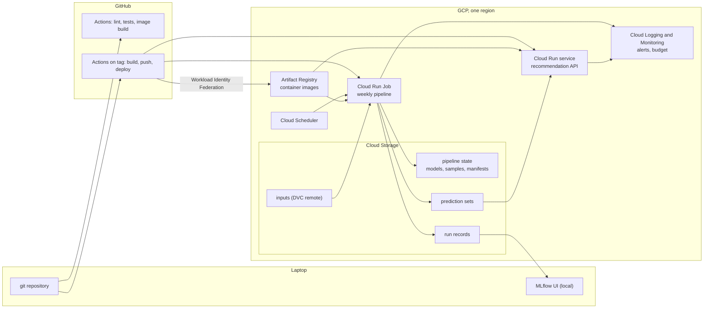

# Stage 3: MLOps on GCP

> **Status.** Approved by the user on 2026-11-21. Stage 3 starts with M10; progress and every later change are recorded in `docs/decisions.md`.
> **M10 (container and CI) was closed on 2026-11-22.** The acceptance of container and cloud results was simplified by the user on that day (§8.3); the calibration it rests on is described there as it was carried out, and the sections that referred to the earlier, tiered tolerance were aligned with it.
> Cloud limits and prices quoted below were read from the Cloud Run quota and pricing pages on 2026-11-21. Everything marked "estimate" has to be measured before it is relied on.

---

## 1. Purpose and scope

Stages 1 and 2 produced a system that runs as a sequence of scripts started by hand on one laptop. Stage 3 turns the same system into something that runs every week without a person: in a container, on a schedule, with versioned inputs, recorded runs, automatic checks, a serving endpoint and alerts.

**Stage 3 changes how the system runs, not what it computes.** The six recall channels, the 71 features, the LambdaMART ranker and every lock file stay exactly as they are at tag `v0.2.1`.

The data end on 2020-09-22, so there is no live traffic. "Every week" is therefore simulated: the pipeline is given a date and behaves as if that date were today (§6.3).

## 2. Goals and acceptance criteria

| # | Goal | Accepted when |
|---|---|---|
| S1 | A reproducible runtime environment | One container image builds from the repository alone; `make lint` and `make test` pass inside it; the calibration week of §8.3 inside the container meets the acceptance of §8.3. **Met on 2026-11-22 for the arm64 container** (§8.3) |
| S2 | Versioned data and recorded runs | On a clean clone, `dvc pull` restores every pipeline input and the sha256 values match the records; every pipeline run is visible in MLflow with the same metrics as the result tables |
| S3 | A weekly pipeline that is one command | `weekly --anchor DATE` runs a whole week, stops at the first failed check with the reason, and can be resumed; each of the eight replayed weeks, and their pooled MAP@12, meets the acceptance of §8.3 (relative difference at most 1.0% on the four quantities; the two structural checks pass) |
| S4 | The pipeline runs on GCP on a schedule | A run triggered by Cloud Scheduler completes on Cloud Run Jobs, reads and writes only Cloud Storage, and meets the acceptance of §8.3; its run time and cost are recorded |
| S5 | A serving endpoint | The endpoint returns the Top-12 of a customer from the latest published prediction set, falls back for unknown customers, and has measured cold-start and p95 latency |
| S6 | Monitoring and alerts | A failed step, a failed data check, a quality flag and a budget threshold each produce an alert; this is shown by provoking each one once |
| S7 | CI and CD | Every push runs lint, tests and an image build; a version tag builds, pushes and deploys without stored keys |
| S8 | It stays cheap and leaves nothing behind | Total spend stays under the budget of §12; at the end no billable resource remains |

## 3. Non-goals

- **No change to models, features or locked configurations**, and no new experiment that selects anything.
- **No hyperparameter search**, neither inside the weekly pipeline nor as a separate job (decision D11). The weekly pipeline refits model parameters with locked hyperparameters (continuous training). When to re-select hyperparameters is a human decision; M15 writes down a proposed rule as a design only.
- **No online A/B test.** There is no traffic. M15 delivers a written design only.
- **No real-time feature computation or online ranking.** §9 explains why the endpoint serves precomputed results.
- **No managed ML platform** (Vertex AI / Agent Platform pipelines or model registry) and **no Kubernetes**. The base stays DVC, MLflow, Docker and GitHub Actions, as decided on 2026-11-20.
- **No high availability**: one region, no always-on resource, scale to zero.
- **DeepFM is not deployed.** It cannot be told apart from LambdaMART and costs more memory (`docs/final_report.md` §10).
- **No Kaggle submission** in stage 3.

## 4. Invariants

These hold for all of stage 3 and are checked in code or in review:

1. Every prediction for an anchor uses only data from before the anchor. The simulated clock makes this the normal case, not a special rule.
2. Lock files, existing result tables and `docs/decisions.md` history are not modified. New records go to new tables.
3. **T1–T4 labels are read only by the replay** (the closing steps C1 and C2, the `eval`-mode query set, and the comparison with the M8 records), **never to select or tune anything.** The user approved this on 2026-11-21 (decision D1). Alert thresholds and flag rules are fixed and recorded before the first replay tick and are not changed after any T result is seen. T numbers produced by the replay are reported as a verification of the pipeline, not as a new evaluation.
4. The stage-1 records made on the laptop remain the reference. Container and cloud runs are accepted against them by §8.3: a relative difference of at most 1.0% on four quantities, and two structural checks. Bit-identity with the laptop is not the goal, and bit-identical repetition on one platform is not required (the environments differ; decision of 2026-11-22).
5. Code does not name a cloud project, bucket or region. They come from configuration.
6. No token, key or credential file is written to the repository, an image, a log or a document.
7. Full-data runs start from committed code; every run records its commit and image digest.
8. A budget alert exists before any billable resource is created (§12).

## 5. Target architecture



| Component | Choice | Why this one |
|---|---|---|
| Batch compute | Cloud Run Jobs | Runs a container to completion and bills per second; nothing to keep running. A job instance can have up to 8 vCPU and 32 GiB and a task can run for days, which covers the measured peak of about 8 GB with room to spare |
| Fallback for batch | Compute Engine Spot VM | Only if a step does not fit Cloud Run Jobs, most likely because of local file space (§8.4) |
| Trigger | Cloud Scheduler | A cron entry that starts the job; also used to drive the replay |
| Storage | Cloud Storage | One place for inputs, state, predictions and run records; DVC and MLflow both work with it |
| Images | Artifact Registry | The registry Cloud Run pulls from |
| Serving | Cloud Run service, minimum instances 0 | Scales to zero, so an idle endpoint costs nothing |
| Observability | Cloud Logging and Cloud Monitoring | Already collects job and service logs; alert policies and budget alerts need no extra service |
| CI/CD | GitHub Actions with Workload Identity Federation | No long-lived key stored in GitHub |
| Run tracking | MLflow, viewed locally | No server to host or pay for (§7.3) |

## 6. The weekly pipeline

### 6.1 One tick

The pipeline is called once per week with an anchor date `a` (the first day of the week to predict). One call is a **tick** and has two halves. Labels of a week exist only after the week has ended, so a week's predictions are scored by the next tick.

**Close the previous week** (its labels are now known):

| Step | What it does | Check that stops the pipeline |
|---|---|---|
| C1 Ingest | Make transactions up to `a − 1` available | Row count and date range of the new week; no row on or after `a` |
| C2 Evaluate | Score last week's published predictions against last week's purchases: per-channel recall, union recall, MAP@12 of the ranker and of the RRF baseline, hit value (§10). Skipped when no earlier prediction set exists (the first tick) | None; quality flags only (§10) |
| C3 Sample | Build the ranker training sample of last week with the locked method | sha256 recorded; row counts plausible |
| C4 Fine-tune R6 | Advance the Two-Tower chain by one week from the previous model | Previous model exists and matches its sha256; loss below the recorded stop limit |

**Open the new week:**

| Step | What it does | Check that stops the pipeline |
|---|---|---|
| O1 Recall | R1–R6 candidates as of `a` | Schema validation; scores equal to dot products of saved vectors |
| O2 Features | The 71 features | Row count equals the deduplicated candidates of this run; no duplicate key; feature lock matches |
| O3 Train ranker | LambdaMART on the last 4 closed weeks, locked configuration | Locked entry point checks (configuration id, lock sha256, library versions) |
| O4 Score | Top-12 per customer | 12 distinct valid article ids per customer; output signals of §10 recorded |
| O5 Publish | Write a new prediction set and switch the `current` pointer | The switch happens only if every earlier step passed |
| O6 Record | Write the run manifest: commit, image digest, inputs, outputs, metrics, timings, peak memory | — |

Every check in the right-hand column already exists in the code as a stop condition. Stage 3 wires them into one driver; it does not invent new ones.

### 6.2 Two modes

| Mode | Customers | Purpose | Cost |
|---|---|---|---|
| `eval` | Only the customers who bought in the predicted week | Compare with the stage-1 records week by week; this is the acceptance test of S3 and S4 | About a normal week of stage 1 |
| `serve` | All 1,371,980 customers | Produce the prediction set the endpoint serves | About 18 times more candidates; the Kaggle run took 56 minutes on the laptop |

`eval` mode knows who will buy, which a real system cannot know; it exists only to make the replay comparable with recorded numbers. This does not distort the metrics: a customer's candidates, features and score depend only on that customer and on data before the anchor, not on which other customers are in the run, so a buyer receives the same Top-12 in both modes. `serve` mode is what production would run. Its sharded code path exists on branch `kaggle-late-submission` and is brought into main in M12, without the Kaggle-specific parts.

### 6.3 Simulated clock and replay

- The anchor date is the only clock. The pipeline never asks for the real date.
- **Bootstrap state** is the state at the end of F4: the R6 chain model after F4, the ranker samples of F1–F4, and the monitoring history. It is stored once (§7.1).
- **Replay: eight ticks in `eval` mode, V1, V2, V3, V4, T1, T2, T3, T4** (decision D1), followed by **one `serve` tick at anchor 2020-09-23**, the week after the data end and the same week as the Kaggle submission. The `serve` tick closes T4 (so T4 is scored too) and produces the prediction set for the endpoint. Its labels do not exist.
- Eight weeks give the monitoring rules of §10 enough history to act on, and the V-to-T shift recorded in `docs/final_report.md` (T about 20% above V, with more concentrated purchases and more new articles) is a real distribution change for the monitoring to see.
- **Replay acceptance** (§8.3): for each week, the recall of every channel, the union recall and MAP@12 of the `eval`-mode run differ from the stage-1 record by at most 1.0% relative; so does the pooled MAP@12 over the replayed weeks, compared with the same pooling of the stage-1 records; and in every tick the feature rows equal the deduplicated candidates of the same run with no duplicate key. The records are `results/m6_candidates.csv` and `results/v_phase_metrics.csv` for V1–V4 and the M8 result tables for T1–T4. Pair overlap of the candidates, the deduplicated candidate count and bit-equality of scores are reported for every week and are not acceptance criteria.
- **`serve` tick diagnostic** (reported, not an acceptance criterion): the Top-12 overlap with the saved Kaggle prediction set, which used the same locked configuration, the same R6 chain and a ranker trained on T1–T4. Nothing is submitted.

### 6.4 State and resuming

- All state lives in Cloud Storage under a prefix per anchor. A step writes its outputs under a temporary name and renames them when its checks pass; an output that exists is never overwritten.
- `state/current.json` points to the latest closed week, the model files with their sha256, and the current prediction set. It is replaced only by step O5.
- Running the same tick again skips finished steps. A tick for week `w + 1` refuses to start if week `w` is not closed, so a week cannot be skipped. This is the same rule the R6 chain already enforces.

## 7. Data, state and run versioning

### 7.1 What is versioned with DVC

| Tracked with DVC (remote: Cloud Storage) | Not tracked |
|---|---|
| `data/raw/`: the three CSV files and the two embedding files | Candidates and features of stage 1 (17.8 GB): they are regenerated by the pipeline |
| `data/processed/` with its metadata | `artifacts/kaggle/` (about 30 GB) |
| The bootstrap state of §6.3 | Models and samples the pipeline creates: they are pipeline state, recorded by manifest and sha256 |
| `artifacts/features/category_codes.json` | |

Git holds the small `.dvc` pointer files; the data stay out of git as today. The bucket is private; the competition data are not redistributed. The one-time upload is estimated at 4–6 GB (about 40–50 minutes at the measured 19 Mbps upload); later pushes send only changed files.

### 7.2 Storage layout

```
gs://<bucket>/
  dvc/                         DVC remote (content-addressed)
  state/current.json           pointer to the latest closed week and prediction set
  weeks/<anchor>/              candidates, features (see §8.4), samples, models, checks
  predictions/<anchor>/        one prediction set: ids, Top-12, manifest
  runs/<run-id>/manifest.json  one record per tick
```

### 7.3 Run tracking

- Every tick writes a manifest and appends to the result tables, exactly as stage 1 does. These files are the source of truth.
- MLflow is the **view**: a local command reads the manifests from Cloud Storage and logs each run (parameters, metrics, tags for commit and image digest, links to artifacts) into a local MLflow store. No tracking server runs in the cloud.
- Reason: a hosted tracking server needs an always-on service and a database, which breaks goal S8. If a team used this system, the server would be the first thing to add.
- The MLflow model registry records each weekly ranker and each R6 chain model by storage path and sha256, with one alias for "the model behind the current prediction set". **The registry is a mirror.** The pipeline and the endpoint never read MLflow; what is deployed is decided by `state/current.json`. Reports and interviews describe it that way.

## 8. Environment and reproducibility

### 8.1 The image

- Base: a slim Python 3.12 image, pinned by digest. Dependencies installed with `uv sync --frozen` from `uv.lock`. The OpenMP runtime LightGBM runs on comes from the image and is pinned there (the Debian package `libgomp1`, by exact version in the `Dockerfile`). This removes the limitation that libomp sits outside `uv.lock` (`docs/final_report.md` §7.2 item 17).
- **torch on Linux comes from the PyTorch CPU-only index.** The default PyPI wheel for Linux x86-64 pulls several GB of CUDA libraries that this project never uses. The index is set in `pyproject.toml` for Linux only and `uv.lock` is regenerated; macOS resolution must stay unchanged, which is checked by comparing the macOS entries of the lock before and after. This is a dependency change (D6).
- **The image carries its commit.** There is no `.git` inside a container, so an image is built only from a clean, committed tree, and the commit hash is stored in the image (label and environment variable). Run records take the commit from there and add the image digest (invariant 7).
- **The image carries the hash of its code tree** (decision of 2026-11-22). It is computed at build time over the files that may enter the image (without `results/`), stored in the image, computed again at the start of a run and compared; a mismatch refuses the run, and run records hold the hash next to the commit. **It guards against accidental mounts and edits, not against deliberate replacement**: the stored hash and the commit are both read from inside the container, so someone who replaces both is not detected.
- **Which OpenMP runtime each process uses** (measured in the arm64 image, recorded in every row of `results/m10_calibration/runs.csv`):

  | Process | OpenMP runtime | Pinned by |
  |---|---|---|
  | LightGBM (Dataset, training, scoring) | the system GNU runtime, `libgomp1 14.2.0-19` | the package version in the `Dockerfile` |
  | Recall, R1–R6 (`implicit` for R5, torch for R6) | the copy of libgomp inside the torch wheel. These processes import torch first, and the loader keeps that copy for the whole process | the torch version in `uv.lock` (`2.15.0+cpu`); the platform record identifies it by that version |
  | Feature build | none (polars and numpy only; numpy uses the OpenBLAS inside its wheel) | `uv.lock` |

- **Two runtime settings apply on Linux only; the laptop runs exactly as in stage 1.**
  - **R6 fine-tuning uses `torch.use_deterministic_algorithms(True)`**, for the duration of the fine-tune only. Without it two fine-tunes of the same week give different weights; with it they are bit-identical (measured on arm64 with real data and on x86-64 with the synthetic reproducer, 2026-11-22). The setting costs no measurable time on a real week (199 s and 200 s with it, 198 s and 200 s without). It stays because it is implemented and free; bit-identical repetition is not an acceptance criterion (§8.3).
  - **During an R5 fit the BLAS of scipy runs on one thread**; `implicit` keeps its 6 OpenMP threads. Only scipy's BLAS is limited: limiting every BLAS also changes torch's thread count on arm64. `implicit` still prints its warning once, because it looks at every BLAS of the process.
- No data, model or credential is copied into the image. Data are mounted (laptop) or read from Cloud Storage (cloud).
- torch and LightGBM stay in separate processes, as today.
- `num_threads` stays 6. A Cloud Run job with 6 vCPU can have 4 to 24 GiB of memory; 6 vCPU and 24 GiB is the starting shape.

### 8.2 Three environments

| Environment | CPU and OS | Role |
|---|---|---|
| Laptop, native | Apple silicon, macOS, libomp | Where the stage-1 records were made; they are the reference of §8.3 |
| Container on the laptop | arm64 Linux | Development and the acceptance of S1 and S3 |
| Cloud Run | x86-64 Linux | The acceptance of S4 |

The cloud image is built for x86-64 by CI, not on the laptop (emulation is too slow to be useful). CI also runs lint and both test suites inside that image, so x86-64 problems show up from M10 on, long before M13.

### 8.3 Acceptance across environments

Different operating systems, CPU architectures, OpenMP runtimes and BLAS libraries change the order of floating-point sums, so a container or cloud result is not bit-identical to the laptop. **The environments differ, so bit-level reproduction is not the goal; a difference within 1% is acceptable** (the user's decision of 2026-11-22, `docs/decisions.md`). This section replaces the tiered, provisional tolerance of the first version of this document.

**Acceptance criteria.** A container or cloud result is accepted against the stage-1 record when the relative difference, |result − record| / record, is at most **1.0%** for each of:

| # | Quantity |
|---|---|
| 1 | Recall of a channel in a week (each of R1–R6) |
| 2 | Union recall of a week |
| 3 | MAP@12 of a single week |
| 4 | Pooled MAP@12 over the replayed weeks |

**Two structural checks stay**, because they detect bugs and not numeric differences:

| # | Check |
|---|---|
| 5 | The feature rows of a run equal the deduplicated candidates of the same run |
| 6 | No (query, article) key repeats in the features |

**Reported, not an acceptance criterion**: the pair overlap of the candidates of every channel with the record, the deduplicated candidate count, and bit-equality of scores. **Bit-identical repetition on the same platform is not required**, and no extra run is made to verify it.

- These are engineering thresholds, not statistical tests. For scale: LambdaMART varies by 0.07% across seeds on V, and one week differs from another by up to 41%.
- **The thresholds are fixed for the arm64 container** (platform record `configs/platforms/linux-arm64.yaml`) **and are not changed after a replay result is seen.**
- A difference above 1.0% on an acceptance quantity, or a failed structural check, stops the milestone and is investigated step by step, starting from the first step that differs; it is not explained away.
- Calibration and replay outputs go to new locations and new tables. They never overwrite a stage-1 artifact or result.

**The calibration these thresholds rest on** (M10, 2026-11-22; week V4; arm64 container on the laptop, `--cpus 6 --memory 12g`, inputs mounted read-only; one item per container; tables in `results/m10_calibration/`, records in `docs/decisions.md`). No label of a T week was read; nothing was tuned or selected.

| Item | What was run | Acceptance quantity | Measured against the stage-1 record |
|---|---|---|---|
| A | R1, R2, R3, R4 candidates of V4 | recall of each channel | 0% (the files have the same sha256 as the stage-1 files) |
| B | One R5 fit as of V4, with its candidates | Recall@100 | −0.0036% |
| C1 | R6 candidates of V4 from the **recorded** model of V3, no training | Recall@100 | 0% |
| C2 | The stage-1 R6 process of V3 replayed (the recorded model of V2 predicts V3 and is fine-tuned on it), then R6 candidates of V4 from the resulting model; run four times | Recall@100 | −0.017% and −0.048% (without the deterministic setting); −0.019% twice (with it) |
| Union | The run's own six channels of V4, fused | union recall | −0.022% |
| D | LightGBM trained on the four recorded sample files, scoring the **frozen** stage-1 features of V4 | MAP@12 | 0% (the model has the same sha256 as the stage-1 model) |
| E | End to end: features built from the container's own candidates, scored with the model of item D | MAP@12 | +0.0054% |
| E | | feature rows = deduplicated candidates of the run; duplicate keys | 22,293,932 = 22,293,932; 0 |

The largest relative difference on any acceptance quantity was 0.048%. The pooled MAP@12 (quantity 4) needs several weeks and is first measured by the replay of M12.

Reported in the same calibration, for information:

| Quantity | Measured |
|---|---|
| Recorded (customer, article) pairs present | R1–R4 100%; R5 99.98%; R6 from the recorded model 99.99997%; R6 after one fine-tune 99.75% |
| Deduplicated candidates of V4 | 22,294,520 and 22,293,932 in two runs against 22,293,247 (+0.0057%, +0.0031%) |
| Bit-equality of scores | R1–R4 yes; R5 and R6 no |
| End to end (item E) | Recall@12 +0.100%, NDCG@12 +0.038%; 72.5% of the queries have an identical Top-12 list, 93.4% the same 12 articles; mean Top-12 overlap 99.45% |
| Two container runs of the same item | R5 and LightGBM bit-identical; the R6 fine-tune only with the deterministic setting of §8.1 |

**Procedure.**

1. M10 measured the items above in the arm64 container; the user fixed the criteria on 2026-11-22 and the platform record was written. Done.
2. M13 starts with a calibration on Cloud Run (x86-64), declared in advance as calibration, and a platform record for that platform. Until then x86-64 is covered only by CI (lint, tests, and the synthetic R6 reproducer).
3. Thresholds are not changed after any replay result is seen.

**What the calibration does not show**: one week and one R6 update, not the eight chained updates of the replay; one platform for the full-data items; and nothing about whether the results are good (§16).

### 8.4 A constraint to design around: local files on Cloud Run use memory

On Cloud Run the writable filesystem is in memory, so every file a step writes locally counts against the instance's memory limit. One week's features are about 1.5 GB (measured in the container for V4: 1.4 GB); a `serve` run produces about 26 GB of features in total.

- `eval` mode: files of one week plus the process peak fit in 24 GiB by estimate. Measured in the arm64 container for V4: the highest true peak of any process was 6.02 GB (the feature build; 5.67 GB when the fused table of the six channels is built in one piece), with files on a mounted disk. With in-memory files on Cloud Run it is to be measured in M13.
- `serve` mode: features are produced and scored shard by shard and each shard's features are deleted after scoring, so local files stay near one shard (about 1.5 GB). This needs a change to the sharded driver, but no change to any computation.
- If this is still not enough: mount the bucket as a volume, or run that step on a Spot VM with a disk. The choice is made on measurements in M13, not now.

## 9. Serving

**Design: the pipeline precomputes the Top-12 of every customer once a week; the endpoint only looks it up.**

Why not rank at request time: the features of one customer–article pair need aggregates over two years of transactions and the outputs of six channels, and the system changes once a week by design. Computing at request time would add an online feature store and model server for no gain in freshness. The trade-off is stated plainly: a customer's new purchase does not change their recommendations until the next weekly run.

| Item | Proposal |
|---|---|
| API | `GET /v1/recommendations/{customer_id}` returns 12 article ids, the prediction-set id (anchor and model version) and `source` (`ranker` or `fallback`); `GET /healthz` |
| Unknown customer | Fallback: the popularity list of R1 for the "age missing" bucket of the current week |
| Data | At start-up the service loads the current prediction set from Cloud Storage: 1.37 million customers × 12 ids, under 100 MB in memory (estimate). The served set is the one from the `serve` tick of §6.3 |
| New prediction set | The service checks the `current` pointer on a timer and loads a new set without redeploying |
| Rollback | Point `current` back to the previous prediction set; one command, tested in M14 |
| Access | Authenticated calls only (an identity token). A public endpoint could run up cost |
| Scaling | Minimum instances 0, a small maximum |
| Measured in M14 | Cold-start time, p50 and p95 latency when warm, memory, using synthetic requests |

## 10. Monitoring and alerting

Monitoring has two layers. Same-week signals need no labels and can alert as soon as a tick runs. Quality signals need the purchases of the predicted week, so they arrive one tick later, as in any system that predicts future purchases.

**Same week (no labels needed)**

| Area | Signal | Action |
|---|---|---|
| Pipeline health | A step fails, a check stops the pipeline, a tick does not finish in the expected time | Alert |
| Input data | Row count or date range of the new week outside the expected band | Alert |
| Features | Missing rate or mean of a feature far from the previous 4 weeks | Flag only (drift is known to exist, `docs/final_report.md` §7.2 item 15) |
| Recommendation output | Candidates per query (about 307 in stage 1); share of customers served by the fallback; share of recommended items among the 100 most popular articles of the week; number of distinct articles recommended | Flag when outside the band of the previous 4 weeks |
| Serving | 5xx rate, p95 latency, failed load of a prediction set | Alert |
| Cost | Budget thresholds of §12 | Alert |

**One week late (labelled)**

| Signal | Action |
|---|---|
| A channel's recall more than 10% below its mean of the previous 4 weeks (the existing rule); union recall below 24%; ranker MAP@12 not above the RRF baseline | Flag in the run record; alert if any flag persists for 3 consecutive weeks |
| **Hit value**: the sum of the prices of recommended articles that the customer bought in the week, in the dataset's normalised price units | Tracked only, no threshold. It is closer to business language than MAP@12 but is **not** GMV caused by the recommendations (§16) |

- All thresholds and bands above are fixed and recorded before the first replay tick (invariant 3).
- Alerts go to one email notification channel.
- **No alert changes a configuration.** Re-selecting hyperparameters stays a human decision. M15 writes down a proposed rule for when to re-select; it is a design, not an implementation.
- S6 is accepted by provoking each kind of alert once: a deliberately failing step, a corrupted input week, a quality flag forced in a replay, and a budget threshold set low.

## 11. CI and CD

| Trigger | What runs |
|---|---|
| Every push and pull request | Build the x86-64 image (not pushed to a registry); run `make lint` and the torch-side and LightGBM-side tests, in two processes, inside it |
| A version tag (from M14) | Build the x86-64 image, push it to Artifact Registry, update the Cloud Run job and service to that digest |

- GitHub authenticates to GCP with Workload Identity Federation, restricted to this repository; no service-account key exists.
- Workflows use the minimum permissions and pin third-party actions by commit hash. The M10 workflow needs no secret at all.
- Rollback: redeploy the previous image digest; for data, point `current` back to the previous prediction set. Both are one command and are written in the runbook.
- Infrastructure is created by scripts of `gcloud` commands kept in `infra/`, with a matching teardown script (decision D7).

## 12. Security and cost

**Guardrails**

1. Before anything else: a billing budget of 50 USD on the project with alerts at 20%, 50%, 80% and 100%. Credits do not stop charges when they run out.
2. No always-on resource: no minimum instance, no VM left running, no managed database.
3. One region. `us-central1`, a Tier 1 price region (decision D4).
4. Separate service accounts for the job, the service and the deployer, each with only the roles it needs. Claude Code operates through a service account by impersonation, without a key file; deleting resources, changing IAM and changing billing require the user's approval.
5. Avoid downloading large objects from Cloud Storage to the laptop; outbound transfer is charged. Uploads are not.
6. M15 runs the teardown script and checks that nothing billable remains.

**Cost estimate** (Tier 1 prices for jobs: 0.000018 USD per vCPU-second and 0.000002 USD per GiB-second; all run times are estimates until M13 measures them)

| Item | Assumption | Estimate |
|---|---|---|
| One `eval` tick | 30 minutes at 6 vCPU and 24 GiB. Measured in the arm64 container on the laptop for V4: about 13 minutes for the steps that were measured (R1–R4 31 s, R5 116 s, R6 prediction 31 s, R6 fine-tune 199 s after a prediction of 29 s, features 126 s, ranker Dataset 11 s, ranker training and scoring 278 s); sampling and the evaluation of the previous week were not measured. Cloud Run is another CPU, so 30 minutes stays the assumption until M13 | about 0.3 USD |
| x86 calibration (§8.3) | about one tick | about 0.3 USD |
| Replay of 8 weeks, run twice | 16 ticks | about 4.6 USD |
| One `serve` tick | 2 hours at 6 vCPU and 24 GiB | about 1.1 USD |
| Storage | 20 GB for two months | under 1 USD |
| Images, scheduler, logs, endpoint tests | small | a few USD at most, to be checked |
| **Total** | | **about 10 USD, under 15 USD**, before the monthly free tier of Cloud Run |

The free tier of Cloud Run (240,000 vCPU-seconds and 450,000 GiB-seconds per month for this billing type) covers roughly 11 hours of CPU but only about 5 hours of memory at 6 vCPU and 24 GiB, so part of the compute above may cost nothing. The estimate is deliberately stated without it.

## 13. Milestones

Local work first; nothing billable before M13 except a few cents of storage in M11.

| Milestone | Deliverables | Accepted when | Needs the user |
|---|---|---|---|
| **M10 Container and CI** | Dockerfile with CPU-only torch on Linux; `make` targets to build and run; GitHub Actions for image build, lint and tests; container measurement of the calibration items of §8.3 | S1; acceptance criteria fixed and recorded. **Closed on 2026-11-22** | Approval of the dependency change (D6); enough memory for the container runtime on the laptop |
| **M11 Versioning** | DVC set-up with a Cloud Storage remote; bootstrap state created and tracked; run manifests; local MLflow sync command | S2 | A GCP project, the budget alert, one bucket |
| **M12 Weekly pipeline, local** | The `weekly` driver with both modes, the simulated clock, resume and checks; the sharded `serve` path brought into main; monitoring signals and thresholds of §10 fixed and recorded; replay of V1–T4 in `eval` mode and the `serve` tick inside the container | S3 | Nothing |
| **M13 Cloud** | Image in Artifact Registry; Cloud Run job; Cloud Scheduler entry; x86 calibration first; then replay of V1–T4 in `eval` mode and the `serve` tick in the cloud; measured run time, memory and cost | S4 | Enabling APIs; approving the spend |
| **M14 Serving, monitoring, deployment** | The API service; rollback command; alert policies; deployment on tag with Workload Identity Federation; the four provoked alerts; latency measured with synthetic requests | S5, S6, S7 | An email address for alerts |
| **M15 Close** | Report section on stage 3 (architecture, runbook, measured cost, limits); the online-experiment design and the re-selection rule (below); teardown; tag `v0.3` | S8 | Confirming the teardown |

**Contents of the M15 designs** (written, not implemented):

- **Online experiment**: randomisation unit (customer), split and duration with a sample-size calculation from the observed variance of the metric, primary metric (revenue per customer from the recommendation slot), guardrail metrics (latency, error rate, return rate), sample-ratio-mismatch check, a long-term holdout group served by the RRF baseline so that a drop in revenue can be attributed to the model or to outside causes, a canary stage before full traffic, and explicit rollback criteria.
- **Online metrics** that a live system would watch hourly or daily instead of waiting a week: click-through, add-to-cart and conversion of the recommendation slot, and revenue from it.
- **Re-selection rule**: when quality flags persist, which evidence triggers a new hyperparameter search, which weeks it may use, and who approves the result.

Stopping after M12 still leaves a complete result: a containerised, versioned, replayable weekly pipeline (MLOps level 1). M13 and M14 add the cloud and CI/CD (level 2); they do not change what the pipeline is.

## 14. Decisions

All approved by the user on 2026-11-21.

| # | Decision | Choice |
|---|---|---|
| D1 | Which weeks the replay uses | V1–V4 and T1–T4 in `eval` mode, then one `serve` tick at 2020-09-23. T labels are read for monitoring and verification only (invariant 3) |
| D2 | Form of the serving endpoint | Precomputed weekly Top-12 with a lookup API (§9) |
| D3 | Acceptance of container and cloud results | **Simplified on 2026-11-22 (§8.3)**: relative difference at most 1.0% on the recall of a channel, the union recall, MAP@12 of a week and the pooled MAP@12; two structural checks; everything else is reported. Fixed for the arm64 container after the M10 calibration and not changed after a replay result is seen. The first version of this decision (2026-11-21) was a tiered tolerance, to be confirmed after the M10 measurement |
| D4 | Region | `us-central1` |
| D5 | How many `serve` runs in the cloud | One, the tick at 2020-09-23. Serving every replay week would multiply cost and time for no new information |
| D6 | New dependencies | `dvc` with its Cloud Storage extra, `mlflow`, `fastapi`, `uvicorn`, the Cloud Storage client library, and the PyTorch CPU-only index for Linux. Each is listed in the M10–M14 prompts for explicit approval under `AGENTS.md` §3.4 |
| D7 | How infrastructure is created | Scripts of `gcloud` commands with a teardown script. Terraform is the better tool for a team but adds a tool and state management for six resources |
| D8 | Run tracking | MLflow as a local view over manifests in Cloud Storage; no hosted server; the registry is a mirror (§7.3) |
| D9 | DeepFM in the pipeline | No |
| D10 | Starting shape of the job | 6 vCPU, 24 GiB; raised to 8 vCPU and 32 GiB only if M13 measurements require it |
| D11 | Hyperparameter search | None in stage 3, including a parallel search on Cloud Run |
| D12 | Business-facing proxy | Hit value tracked in monitoring, labelled as a proxy, no threshold (§10) |

## 15. Risks and open questions

| Risk | What happens then |
|---|---|
| An acceptance quantity of §8.3 differs by more than 1.0% in the container or the cloud, or a structural check fails | The milestone stops. The most likely cause is the Two-Tower fine-tuning chain (eight chained updates in the replay; one update was measured in M10: Recall@100 within 0.05%); the investigation compares step by step, starting from the first step that differs |
| The chained R6 differences grow over eight weeks | Each tick's R6 recall is compared with the record of that week and the pair overlap is reported, so growth is visible week by week; if the recall leaves the 1.0% band the cause is investigated rather than the threshold widened |
| A test or a run-time check assumes macOS (for example the Homebrew libomp) or a bit-exact number | It is made platform-aware explicitly, or reported for a decision. No assertion is loosened silently, and no lock file is changed |
| A step does not fit Cloud Run Jobs because of in-memory files | The measures of §8.4, in that order |
| The container on the laptop is much slower than native | Acceptance runs become longer; they are not skipped. Measured for V4 (arm64 container against the laptop's records): the R6 fine-tune takes 3.5 times as long (199 s against 56 s), the feature build 2.4 times (120 s against 50 s), R6 prediction 1.7 times, R4 1.3 times; LightGBM about the same (278 s against 268 s); R5 is faster (116 s against 179 s, because the Linux build of `implicit` is multi-threaded) |
| The CPU-only torch index changes macOS resolution in `uv.lock` | Detected by the lock comparison of §8.1; the change is reworked before it is committed |
| GitHub Actions runner disk is too small for the image | Cache the dependency layer; if needed, build the image with Cloud Build instead |
| Cost grows unexpectedly | The budget alerts; every cloud milestone ends by listing what is deployed |
| The file-based use of MLflow does not fit the pinned MLflow version | Keep the manifests as the record and adapt the sync command; the acceptance of S2 does not depend on a particular MLflow backend |

Open question that does not block M10: which email address receives alerts.

## 16. What stage 3 will not show

Stated in advance so that the final report does not overclaim:

- **No evidence about live behaviour.** The clock is simulated and there are no users; nothing is learned about load, real latency under traffic, or the effect of recommendations.
- **No evidence about business impact.** The purchases in the data were made on H&M's own site under H&M's own recommendations; ours were never shown to anyone. MAP@12 and hit value measure how well purchases were predicted, not revenue caused by the system. Only an online experiment could measure that.
- **The replay is not an evaluation.** V1–V4 took part in selecting the ranker, and T1–T4 were already used once for the final evaluation. Matching their records shows that the pipeline reproduces the system, not that the system is good.
- **One region, one instance, no failover.**
- **Alerting is demonstrated by provoked failures and eight replayed weeks**, not by months of operation.
- **Cost figures are for eight replayed weeks**, not for a year of weekly runs with growing data.
